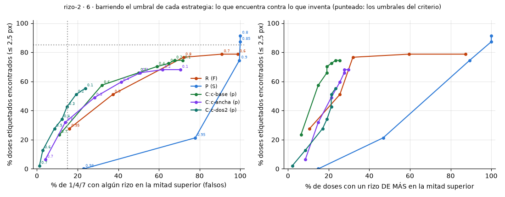
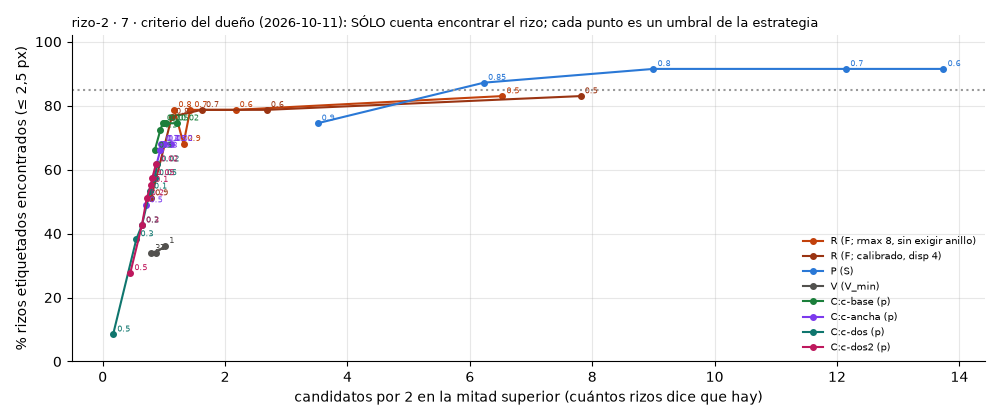
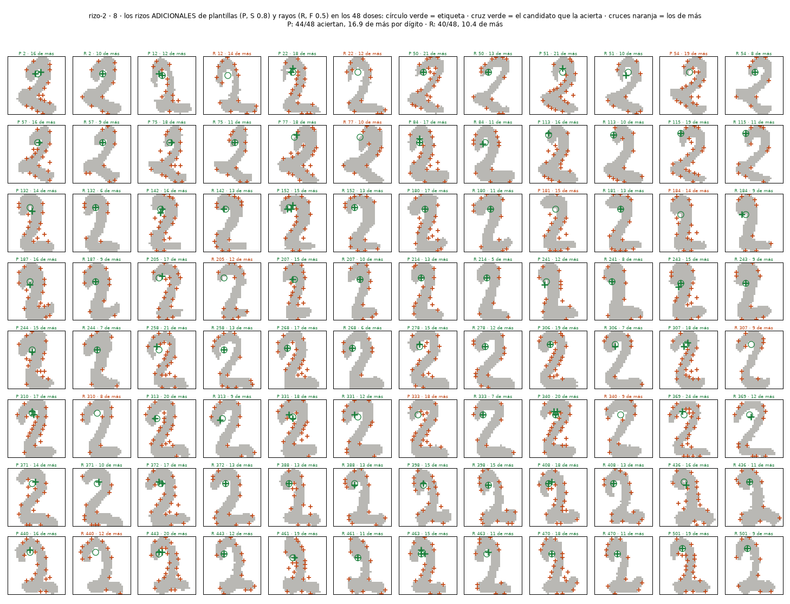
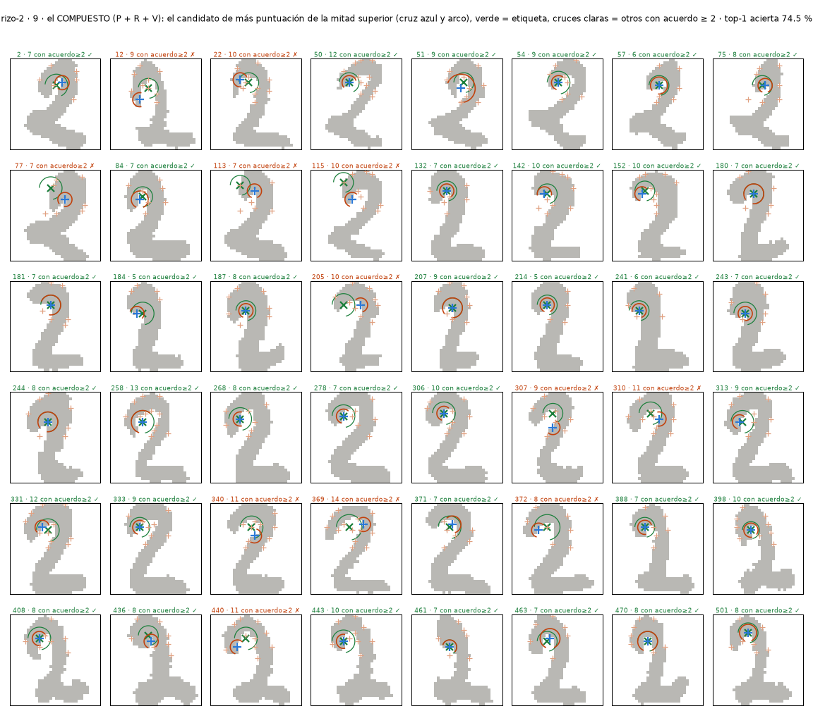
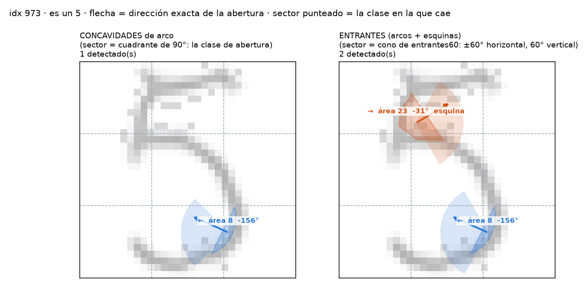
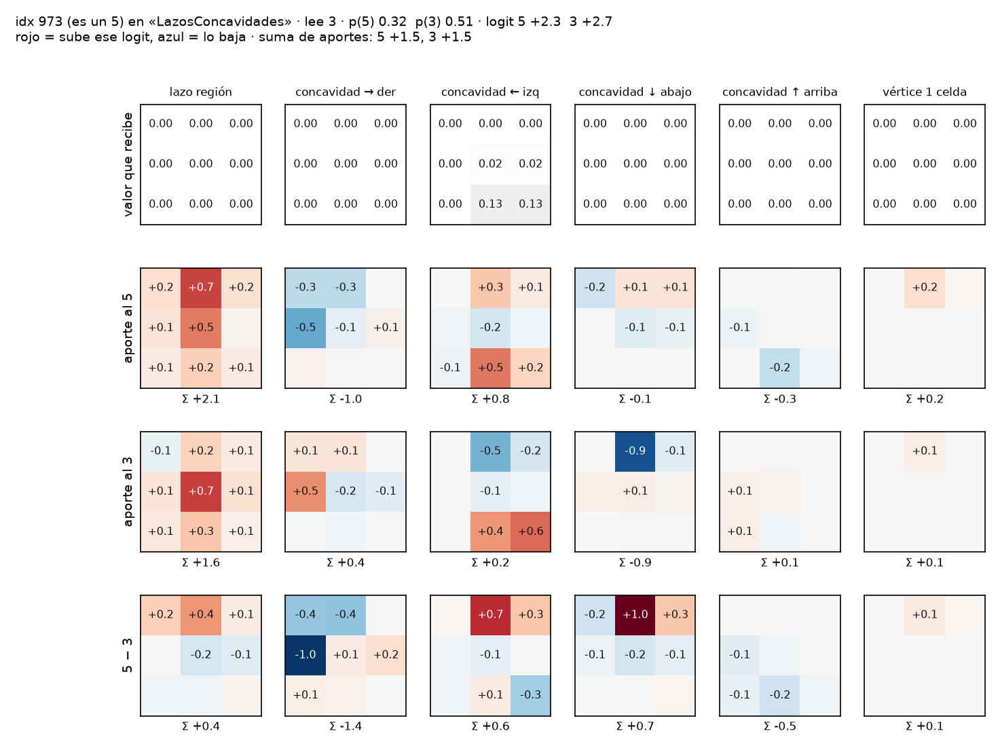
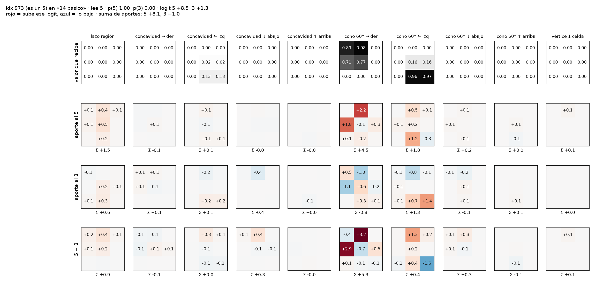
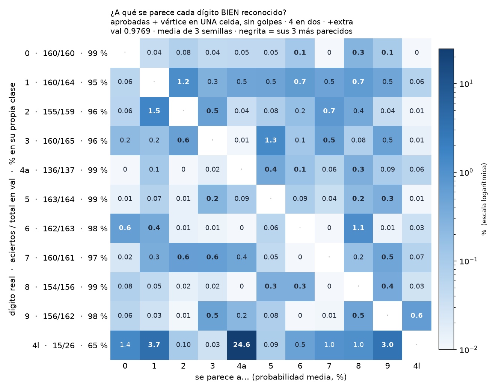

# `rizo-2` — el RIZO SUPERIOR del 2: cuatro estrategias contra 48 doses etiquetados (2026-10-11)

**Pregunta** (`experimento.json`): ¿cuál de cuatro estrategias detecta mejor el rizo superior de los 2 —centro, radio,
cierre y abertura— en los dígitos de UCI de 32 px: **R** rayos, **P** plantillas, **V** votos de curvatura (la referencia
de `lazos`), o **C** una CNN entrenada sólo con sintéticos? Encargo en `instrucciones/01-encargo.md`; criterio, escrito y
commiteado **antes** de medir (`23d72f4`), en `instrucciones/02-criterio.md`. 0 $ gastados (todo local, 2 vCPU; ~2 h de
cómputo en tres vueltas). ⚠ Todas las figuras de abajo son del **estado final** (tercera vuelta).

## Resultado en una frase

**Ninguna estrategia pasa el criterio (≥ 85 % de los doses reales con pocos falsos).** Lo mejor, barriendo el umbral de
cada una (figura 6): la CNN genérica **`c-base` encuentra el 57 % con un 32 % de falsos** en 1/4/7, o el **74 % con un
70 %**; los rayos, el 51 % con un 37 %; las plantillas encuentran el 91 % pero **disparan en el 100 % de los dígitos**
(no sirven solas). En sintéticos la CNN llega al 92–94 %: **lo que falla es el paso de sintético a dígito real**, y
el porqué está medido abajo.



## Lo que se midió, vuelta a vuelta (todo contra la misma verdad)

| vuelta | qué cambió | doses encontrados (47, ≤ 2,5 px): R · P · V · C |
|---|---|---|
| 1 | sintéticos genéricos (rizo + cola corta), etiquetas a ojo | 13 · 45 · 19 · **34** (`c-base`) |
| 2 | + `c-dos`, CNN entrenada con un **compositor de doses** (cabeza + diagonal + base) | 13 · 45 · 19 · 38 (`c-dos`) |
| 3 | **etiquetas afinadas** (el centro a ojo caía 1–2 px sobre la tinta) · huecos de **rendija** (≥ 0,5 px) en sintéticos, plantillas y rayos · `c-dos2` | **51 · 91 · 34 · 57** (`c-base`) |

Los 16 umbrales del criterio, por estrategia, en `resultados/metricas.json` (`criterio`). ⚠ El conteo de «umbrales
pasados» (`c-dos` 12/16) **engaña**: pasa los de falsos (no ve casi nada) y falla el que importa, el 7 (encontrados).
Por eso el eje honesto es la figura 6, y por eso **no se declara ganadora** (el criterio lo exigía: nadie pasa el 7).

### Las tres cosas que se aprendieron, y que valen para cualquier detector de esta feature

1. **El hueco del rizo de un 2 real es una RENDIJA, no un círculo.** Medido en las 47 etiquetas: radio inscrito del
   hueco **mediana 1 px, 90 % ≤ 2,2 px** (`hueco_px` en `etiquetas-2.json`), con trazos de 4–6 px alrededor. Los
   sintéticos de la vuelta 1 exigían hueco ≥ 1,25 px y radio uniforme 2–7: la red aprendió un rizo redondo con aire
   dentro, y no lo encuentra en un 2. Bajar el hueco a 0,5 px (vuelta 3) subió `c-base` del 34 % al 57 % **sin
   reentrenar** sólo por las etiquetas, y los rayos del 13 % al 51 %.
2. **Las etiquetas a ojo sobre una rejilla se van 1–2 px.** El píxel anotado caía **sobre tinta** en la mitad de los
   casos (vuelta 2). Se afinaron al píxel de fondo más **encerrado** a ≤ 3 px del anotado (fracción de 36 rayos que
   chocan antes de 8 px; `centro_manual` conserva lo leído). La primera afinación, por distancia a la tinta, se iba al
   fondo abierto: se vio en la figura 0 y se cambió. ⚠ **Siguen siendo etiquetas de Claude**: la figura 0 está para
   que el dueño las corrija.
3. **El compositor de doses NO cerró el hueco sintético→real** (`c-dos2` 43 % contra `c-base` 57 %): parecerse a un 2
   no basta si la cabeza sintética sigue siendo un arco de círculo limpio. Las figuras 5 y 2 enseñan dónde se va: la
   CNN ve el **codo inferior** del 2 (entre la diagonal y la base) como rizo, y no ve una cabeza cuyo hueco es una
   rendija de 1 px.

## Las figuras

- **0 · las 48 etiquetas** (para corregir): `resultados/0-etiquetas.png`
- **1 · sintéticos de prueba y lo que ve cada estrategia**: `resultados/1-sinteticos.png` · muestras de los dos
  generadores: `1-sinteticos-muestra.png`, `1b-sinteticos-dos-muestra.png`
- **2 · los 48 doses, las siete columnas** (R · P · V · c-ancha · c-base · c-dos · c-dos2; ✓ = encontrado):
  `resultados/2-doses-etiquetados.png`
- **3 · % con rizo en la mitad superior por clase**: `resultados/3-por-clase.png` — P 100 % en todas; V 84–94 % en
  0/5/7/8/9; `c-base` 67 % en el 2, 61 % en el 3, 76 % en el 9, 6 % en el 1
- **4 · desplazamientos**: `resultados/4-desplazamientos.png` — **planas** para todas en horizontal (recorte 0 %), como
  se predijo; en vertical los dígitos tocan arriba y abajo, así que el «recortado» se mide sobre el rizo (tinta
  perdida a ≤ R + 3 px del centro): sin recorte, el % no cambia; con d = −4 queda el 13 % de la muestra
- **5 · los 20 doses que `c-base` no encuentra**: `resultados/5-fallos.png`
- **6 · barrido del umbral de cada estrategia**: `resultados/6-curvas.png` (`6-curvas.json`)

## Predicción contra lo medido

Se predijo que **C ganaría** pasando A y B con ≈ 90 % en los doses y fallando en el 7; que P pasaría por poco; que R y V
fallarían. **Acerté en A** (C 92–94 % en sintéticos, P/R/V por debajo), en que R y V fallan, y en que el 7 se parece al
rizo (47–58 % de los 7 con `c-base`). **Fallé en lo central**: C no pasa de sintéticos a dígitos (57 %), y P no «pasa
por poco», dispara en todo (S 0,8 → 100 % de falsos; S 0,95 → 21 % encontrados).

## Qué probar en la siguiente vuelta (sugerencias, ninguna probada)

1. **Entrenar la CNN con dígitos reales**, que es lo que el hueco sintético→real pide: verdad = el píxel más
   encerrado del rizo (lo que afinó las etiquetas, calculable **para los 159 doses de val y los ~1.200 de extra sin
   etiquetar a mano**) más las 47 etiquetas como control; negativos = las demás clases, con el 3 y el 9 como positivos
   «de arriba». Entra en 32 px en minutos en el dev. ⚠ Cambia la regla de este experimento (*«ninguna se entrena con
   dígitos»*): va como experimento aparte, con su criterio.
2. **Compositor de dos niveles: P propone y la CNN verifica.** P encuentra el 91 % (recall) pero no discrimina; la
   CNN discrimina y no encuentra. Puntuar cada candidato de P con el mapa de calor de C (o con el encierro por rayos).
3. **El encierro por rayos como feature directa**: *«fracción de rayos que chocan antes de 8 px»* es la medida que mejor
   localizó el hueco real (es la que afinó las etiquetas). Como detector dio 51 %/37 % porque exige anillo parejo
   (`disp`); sin esa exigencia y con un **mínimo de rendija** (hueco ≥ 1 px y ≤ 3 px) puede ser el mejor candidato
   barato. Y combinar con V, que es el único que ve la **curvatura** del trazo y no el hueco.
4. **Que el dueño corrija la figura 0**, o etiquete 20 más: con 47 doses, un punto son 2 %.

## Cómo repetirlo

    cd 2026-10-11-rizo-dos
    ../.venv/bin/python nn/rayos.py            # calibra R (~15 min)   → resultados/cal-rayos.json
    ../.venv/bin/python nn/plantillas.py       # calibra P (~10 s)     → resultados/cal-plantillas.json
    ../.venv/bin/python nn/entrenar_local.py c-base --epocas 12                     # ~36 min
    ../.venv/bin/python nn/entrenar_local.py c-dos2 --datos dos --epocas 8 --n 16000  # ~17 min
    ../.venv/bin/python nn/evaluar.py          # ~10 min → metricas.json y figuras 1–5
    ../.venv/bin/python nn/etiquetas.py        # figura 0

Los brazos `c-ancha` (genérico, cortado en la época 5 al ver la vuelta 1) y `c-dos` (compositor, huecos ≥ 1,25) se
conservan con sus pesos. `resultados/vuelta2/` guarda `metricas.json` y las calibraciones de la vuelta 2 (etiquetas
sin afinar, huecos ≥ 1,25); la vuelta 1 está en el commit `2a75a7e`.

## Reevaluación con el criterio del dueño (2026-10-11, tarde): SÓLO cuenta encontrar el rizo

> «No importa, para este experimento, diferenciar los 2 de los otros números. Lo importante es hallar el mayor
> porcentaje posible de esos rizos que hallamos en muchos 2. Pero también se van a hallar en otros números.»

Con eso, los umbrales 2, 11 y 12 del criterio (falsos y rizos de más) dejan de decidir; cada estrategia se lleva al
umbral que **más rizos etiquetados encuentra** (≤ 2,5 px), y se reporta cuántos candidatos pone por 2 para que se vea
el precio. `nn/evaluar.py` no cambia; esto es `resultados/7-solo-encontrar.{png,json}` (barrido hecho a mano, mismos
47 doses, mismas funciones de medida).



| estrategia (umbral) | **encontrados** | centro px | radio px | abertura ° | candidatos arriba por 2 |
|---|---:|---:|---:|---:|---:|
| **P plantillas (S 0,8)** | **91,5 %** | 1,41 | 1,0 | 40 | 9,0 |
| R rayos (F 0,5) | 83,0 % | 0,0 | 0,75 | 30 | 6,5 |
| C:c-base (p 0,2) | 74,5 % | 1,41 | 1,21 | 17 | 1,0 |
| C:c-ancha (p 0,2) | 68,1 % | 1,21 | 1,05 | 16 | 1,0 |
| C:c-dos2 / c-dos (p 0,02) | 61,7 % | 1,0 | 1,0 | 31–33 | 0,9 |
| V votos (V_min 1) | 36,2 % | 1,0 | 2,0 | 22 | 1,0 |

**Con este criterio ganan las plantillas (91,5 %), y los rayos pasan el 85 % por poco no (83 %).** Pero el precio está
en la última columna: P y R lo consiguen diciendo que hay **6–9 rizos por dígito** en la mitad de arriba (uno de ellos
cae donde está el de verdad). La CNN sigue dando **un** candidato por 2 y acierta 3 de cada 4. Son dos cosas distintas:
P/R **localizan** (el de verdad está entre sus candidatos), la CNN **decide**. Por eso la sugerencia 2 de arriba —P o R
proponen, la CNN puntúa— sigue siendo la que junta las dos virtudes, y con este criterio es la primera que probaría.

Dos matices medidos: el **centro** de R es exacto (0 px: el píxel más encerrado por rayos es la misma medida con la que
se afinaron las etiquetas, así que esto es en parte circular y hay que decirlo); y la abertura de P/R (30–40°) es peor
que la de la CNN (16–17°).

## El COMPUESTO de los tres primeros (P + R + V), pedido por el dueño el 2026-10-11

Antes de componer, lo que P y R ponen **de más** (figura 8): cruces a lo largo de **todo el contorno** —son detectores
de concavidad, no de rizo— con 16,9 (P) y 10,4 (R) candidatos sobrantes por dígito.



`nn/compuesto.py`: **candidatos** = unión de los de P (S 0,8), R (F 0,5) y los lazos de V, fundidos a ≤ 2 px; en cada
uno se miden las tres evidencias en su píxel (p = mejor plantilla, r = encierro por rayos a 8 px, v = votos de curvatura
relativos); **puntuación = r**; el rizo es el de más puntuación de la mitad superior.

| compuesto | rizos encontrados | candidatos por 2 |
|---|---:|---:|
| todos los candidatos | 100 % | 10,1 |
| con acuerdo ≥ 2 de los 3 | 97,9 % | 8,6 |
| acuerdo = 3 | 23 % | 1,2 |
| **el mejor (top-1)** | **74,5 %** | 1 |
| los dos mejores (top-2) | 78,7 % | 2 |
| top-1 de P solo · R solo · V solo | 25,5 · 46,8 · 6,4 % | 1 |



**Qué dice.** Componer **sí** sirve, y se ve en la última fila (⚠ esas tres cifras y la de acuerdo ≥ 2 estaban mal
copiadas de la corrida anterior en el commit `d32ef53`; las de aquí son las de `9-compuesto.json`, y lo cazó el
`verificador`): ninguno de los tres solo elige bien (25 / 47 / 6 %), y
juntos eligen el 74,5 % con un candidato por dígito — **igual que la mejor CNN** (`c-base`, p 0,2, 74,5 %) y sin
entrenar nada. Pero el reparto de méritos no es el esperado: P y R **proponen** (el rizo está entre sus candidatos el
100 % de las veces), el **encierro elige**, y P y V **no ayudan a elegir**: la puntuación empezó como p + r + v (40 %)
y, probadas nueve combinaciones sobre los 47 doses, el encierro solo sube al 70–74 % mientras sumarle p o v baja
(p vale 0,90 en el rizo y 0,86 en el resto del contorno; v ≈ 0 en los dos). ⚠ Dos cosas que hay que decir: la regla se
eligió **mirando** los 47 etiquetados, así que está ajustada a ellos; y el encierro es la misma medida con la que se
afinaron las etiquetas, lo que favorece su **centro** (no su elección entre regiones, que es lo que mide el top-1).

**Lo que falla en el 25 % restante** (figura 9, en naranja): el top-1 cae en **otra concavidad de la misma cabeza** (el
hueco entre la cabeza y la diagonal, 1–3 px por debajo del rizo) o en el codo inferior. Para separar esas dos hace falta
algo que P, R y V no miden: que el trazo **rodee** al punto de forma continua (la estrategia 1 de la lista de `CLAUDE.md`,
seguir el trazo), o la CNN como juez de los candidatos del compuesto —que es lo contrario de lo que se probó hoy, y
queda como siguiente vuelta—.

## Plantillas MÁS RODEADAS (pedido por el dueño, 2026-10-11)

El banco actual, dibujado (`nn/plantillas_rodeadas.py` → figura `11-banco-actual.png`): 851 plantillas = radio
{2,5…7} × grosor {3,4,5} × cobertura {0,55 · 0,7 · 0,85 · 1} × abertura cada 30°; trazo +1, hueco −1, vano −½. La
figura 10 enseñó que las de **media vuelta** (0,55) casan con cualquier curva. Se probaron bancos que exigen más
vuelta y/o más hueco, con los mismos 47 doses (`11-bancos.json`, figura `11-bancos-rodeados.png`):

| banco (plantillas) | S | encontrados | candidatos por dígito | **top-1 arriba acierta** |
|---|---:|---:|---:|---:|
| actual, cob ≥ 0,55 (851) | 0,8 | 91,5 % | 18,2 | 29,8 % |
| cob ≥ 0,7 (575) | 0,8 | 85,1 % | 4,7 | 61,7 % |
| cob ≥ 0,7 (575) | 0,7 | 89,4 % | 10,1 | 61,7 % |
| **cob ≥ 0,85 (299)** | 0,8 | 76,6 % | **2,5** | **72,3 %** |
| cob ≥ 0,85 (299) | 0,6 | 87,2 % | 8,4 | 72,3 % |
| cob 0,6–0,8, «como los 2» (828) | 0,8 | 91,5 % | 12,5 | 36,2 % |

**Sí: quitar las de media vuelta arregla la mayor parte.** Con cob ≥ 0,85 el top-1 pasa del 30 % al **72 %** —a dos
puntos del compuesto (74,5 %) y de la CNN— con 2,5 candidatos por dígito en vez de 18. Exigir hueco ≥ 1 px no cambia
nada (las plantillas con hueco de medio píxel apenas pesan). Y la sorpresa: el banco «como los 2» (cob 0,6–0,8, que es
la cobertura que **tienen** los rizos etiquetados) es casi tan malo como el actual (36 %), porque una C de 0,6–0,7
sigue casando con cualquier curva desde su lado cóncavo. **Lo que discrimina no es que la plantilla se parezca al
rizo; es que la plantilla exija ser rodeada** —que es lo mismo que mide el encierro por rayos—. Un rizo real de
cobertura 0,65 casa con una plantilla de 0,85 porque la diagonal del 2 cierra el resto de la vuelta.

## El compuesto con las plantillas RODEADAS como proponente (`nn/compuesto2.py`, 2026-10-11)

Candidatos = plantillas rodeadas (cob ≥ 0,85, S 0,6) ∪ rayos (F 0,5); se elige por encierro, por la plantilla, o por
la suma (`12-compuesto2.json`):

| elige por | top-1 acierta | top-2 |
|---|---:|---:|
| **encierro r** | **78,7 %** | 89,4 % |
| plantilla rodeada p' | 70,2 % | 80,9 % |
| r + p' | 70,2 % | 83,0 % |
| (sólo candidatos de P', por p') | 59,6 % | 74,5 % |

**78,7 % con un candidato por dígito**: cuatro puntos más que el compuesto anterior (74,5 %) y que la CNN, y el top-2
llega al 89 %. Los candidatos son 8,2 por dígito (97,9 % de recall) y sigue eligiendo mejor el encierro que la propia
plantilla rodeada. Los 10 fallos, de cerca, en `12-compuesto2-fallos.png`; los 48, en `12-compuesto2.png`.

## TODOS los dígitos: el compuesto como detector de curvas cerradas + los otros detectores (`nn/digitos_cerradas.py`, 2026-10-11)

Cadena del boceto curvas-gabor (detector DELGADO: recto · vector de curvatura · golpe, 384 características en celdas
8×8 → compositor lineal, 180 train / 1617 val / 3823 a ciegas, 3 semillas) **más** dos mapas de curvas cerradas del
compuesto (campana de altura = encierro en cada candidato, y otra sólo con el mejor; 128 características). Dos corridas:

| características | val (1617) | a ciegas (3823) | fallos val s0 | arregla / rompe |
|---|---:|---:|---:|---:|
| otros (delgado), la referencia | **0,929** | **0,921** | 114 | — |
| cerradas solas (encierro ≥ 0,5, rayos 8 px) | 0,733 | 0,723 | | |
| otros + cerradas (≥ 0,5, 8 px) | 0,925 | 0,913 | 119 | 41 / 46 |
| cerradas solas (encierro ≥ 0,85, rayos 12 px) | 0,502 | 0,495 | | |
| otros + cerradas (≥ 0,85, 12 px) | 0,914 | 0,899 | 140 | 34 / 60 |

**No ayuda: añadir las curvas cerradas deja el compositor igual o peor.** Arregla tantos como rompe (41/46) y con los
candidatos más estrictos rompe más (34/60). Las cerradas solas clasifican el 73 % (y el 50 % si sólo se dejan las muy
encerradas). Figuras: `13-digitos-fallos.png` (los 119 fallos de la primera corrida, con la cruz azul del mejor
candidato), `13-digitos-cerradas.png` y `13b-*` (lo que el detector ve en tres dígitos de cada clase).

**Por qué, mirando las figuras:**
1. **El compositor lineal ya tiene esa información.** Sus vectores de curvatura → ← ↓ ↑ por celda dicen desde qué
   lado gira cada trozo; un lazo es «curvatura hacia dentro por los cuatro lados», y el compositor lo aprende sin
   necesitar que nadie le marque el centro. La feature nueva es redundante con las que había, y 128 números más sobre
   180 ejemplos de entrenamiento meten ruido (de ahí que rompa).
2. **El encierro premia estar PEGADO a la tinta, no estar en el centro del hueco** —lo que el dueño vio como «un punto
   arriba y afuera de lo que un humano consideraría una curva cerrada»—: en un 0 el mejor candidato cae en el borde del
   óvalo (donde todos los rayos chocan cerca), no en su centro (figura 13b, fila del 0). Con rayos a 12 px pasa igual.
   Para una feature de dígito haría falta el centro del hueco (distancia a la tinta) además del encierro.
3. **Los fallos del compositor no son de lazos** (figura 13): 8→9 (14), 1→3 (7), 8→3 (6), 9→3 (6), 2→1 (5)… son
   dígitos gruesos, unos sin hueco y treses con panza cerrada — justo donde un detector de cerradas tampoco distingue.

Lo que sí queda: el detector de curvas cerradas sirve como **feature para localizar** (el 78,7 % de los rizos del 2, y
los lazos del 6, 8, 9 y 0 en la figura 13b), no para **clasificar** dígitos por encima de lo que ya hacen las curvas.

## Más FONDO en el centro (`nn/cerradas_hueco.py`, pedido por el dueño el 2026-10-11)

Al candidato del compuesto se le añade **h = el radio inscrito del hueco** (la mayor distancia a la tinta a ≤ 2 px del
candidato; el candidato se MUEVE a ese píxel, el centro del hueco) y se exige h ≥ H. El encierro se mide ahí, con
rayos de 8 px (como hasta ahora) o de **14 px**. Medido en los 47 doses (top-1) y dibujado sobre los 119 dígitos que
falla el compositor (`14-hueco-*.png`, `14-hueco.json`):

| h ≥ | rayos | doses: top-1 | doses: encontrados | candidatos por dígito (en los 119) |
|---:|---:|---:|---:|---:|
| 0 (actual) | 8 | **80,9 %** | 89,4 % | 2,5 |
| 1,5 | 8 | 55,3 % | 59,6 % | 1,5 |
| 2,5 | 8 | 21,3 % | 21,3 % | 0,5 — y pierde los 0 |
| 0 | 14 | 78,7 % | 85,1 % | 3,1 |
| 1,5 | 14 | 53,2 % | 55,3 % | 2,2 |
| **2,5** | **14** | 21,3 % | 21,3 % | **0,7 — y sólo en lazos de verdad** |

⚠ Primera versión fallida, que hay que contar: h medido **en el píxel propuesto** (que casi siempre está pegado a la
tinta: h = 1) tiraba el 75 % de los rizos con h ≥ 1,5. El hueco se mide en su centro.

**Tres cosas que salen:**
1. **Mover el candidato al centro del hueco ya sube el top-1 de los doses de 76,6 a 80,9 %** sin exigir nada (fila 1).
2. **Pedir fondo en el centro es un dial entre «rizo» y «lazo».** Con h ≥ 2,5 y rayos de 14 px el detector marca **sólo
   lo que un humano llamaría curva cerrada**: los dos huecos del 8, el lazo del 6, 9 y 0, la panza cerrada de algunos 3 y
   5; y **nada** en 1, 4, 7 ni en la mayoría de los 2 (figura `14-hueco-h2.5-a0-r14.png`). Pero los rizos del 2 son
   rendijas (radio inscrito mediana 1 px) y se pierden casi todos (21 %). Con h ≥ 1,5 se queda a medio camino (55 %).
3. **Los rayos largos hacen falta para los lazos grandes**: con 8 px, los 0 (centro a más de 8 px de la tinta) tienen
   encierro bajo y con h ≥ 2,5 **desaparecen**; con 14 px vuelven (figura `14-hueco-h2.5-a0-r14.png`, fila de los 0).

Qué se propone: **dos salidas del mismo detector**, no un umbral: «lazo» (h ≥ 2,5, rayos 14) y «rizo» (h ≥ 0, rayos 8,
candidato en el centro del hueco), que es lo que el 2 tiene y el 8 no.

## Cada salida como feature APARTE del compositor (`nn/digitos_variantes.py`, 2026-10-11)

Cinco variantes del detector sobre los mismos candidatos (hueco medido en su centro; encierro ahí con rayos de 8, 14 o
18 px): **rizo** (h ≥ 0, 8 px), **medio** (h ≥ 1,5, 14 px), **lazo** (h ≥ 2,5, 14 px), **amplia** (h ≥ 3,5, 18 px,
para los 0) y **amplia floja** (encierro ≥ 0,7). Lo que cada una ve, en un dígito de cada clase: `15-variantes-mapas.png`.
% de dígitos de val con algún candidato: la amplia marca el 97 % de los 0 y ≤ 34 % de todo lo demás; el lazo, el 99 %
de los 0, 70–75 % de 6/8/9 y 0 % de los 1; el rizo, 100 % de los 8, 99 % de 6/9, 70 % de los 2 y 13 % de los 1.

**Con la codificación de antes (dos mapas en celdas 8×8 = 128 características por variante): todas empeoran**, y
cuantas más, peor (`15-variantes.json`): otros 0,929 → + rizo 0,912 · + medio 0,923 · + lazo 0,889 · + amplia 0,904 ·
+ rizo + lazo + amplia 0,876 · + las cinco **0,868**. Con 180 dígitos de entrenamiento, 128 números más por variante son
ruido que el compositor lineal ajusta.

**Con una codificación COMPACTA** (sólo el mapa del mejor candidato en celdas 2×2 o 4×4, más el número de candidatos:
5 o 17 características por variante; `15b-compactas.json`, con los candidatos ya calculados):

| compositor | val (1617) | a ciegas (3823) |
|---|---:|---:|
| otros (delgado), referencia | 0,9287 | 0,9209 |
| otros + rizo (2×2) | **0,9349** | **0,9246** |
| otros + medio (4×4) | **0,9355** | 0,9227 |
| otros + las cinco (2×2) | 0,9347 | 0,9227 |
| otros + rizo + lazo + amplia (2×2) | 0,9322 | 0,9239 |
| otros + lazo (2×2) | 0,9293 | 0,9181 |
| otros + amplia (2×2) | 0,9287 | 0,9188 |

**Lo que sale:** codificadas de forma compacta, las curvas cerradas **sí suman, poco**: +0,6 puntos en val y +0,4 a
ciegas con el rizo solo (0,9349 / 0,9246), y el medio igual; las que más ayudan son las que ven **más** dígitos (rizo,
medio), no las más selectivas (lazo, amplia), que apenas mueven nada y a ciegas restan. Juntar las cinco no supera a la
mejor sola. ⚠ El margen entre semillas es ≈ 0,002, así que +0,006 es una señal pequeña, no una declaración. **El cuello
de botella es el compositor** (lineal, 180 ejemplos): una feature de 128 números lo rompe y una de 5 apenas le cabe; con
más entrenamiento o un compositor que no sea lineal, las mismas salidas podrían valer más. Los fallos de la mejor
combinación de 8×8: `15-variantes-fallos.png`.

## Compositores NO lineales (`nn/compositores.py`, pedido por el dueño el 2026-10-11)

Mismo protocolo (180 train / 1617 val / 3823 a ciegas, 3 semillas) y mismas características; cambia el compositor
(`16-compositores.json`, figura `16-compositores.png`). Val / a ciegas:

| compositor | otros (384) | + rizo compacto (5) | + las cinco (25) | + rizo 8×8 (128) |
|---|---:|---:|---:|---:|
| lineal (referencia) | 0,929 / 0,921 | 0,935 / 0,925 | 0,935 / 0,923 | 0,912 / 0,908 |
| MLP 64 | 0,937 / 0,924 | 0,941 / 0,930 | 0,940 / 0,927 | 0,913 / 0,908 |
| **MLP 256** | 0,943 / 0,932 | **0,947 / 0,935** | 0,942 / 0,934 | 0,917 / 0,919 |
| SVM RBF | 0,927 / 0,919 | 0,933 / 0,924 | 0,930 / 0,924 | 0,882 / 0,875 |
| **bosque aleatorio (500)** | 0,946 / 0,930 | **0,956 / 0,933** | 0,942 / 0,919 | 0,919 / 0,888 |
| gradient boosting | 0,885 / 0,864 | 0,890 / 0,874 | 0,890 / 0,871 | 0,902 / 0,886 |
| k vecinos (5) | 0,856 / 0,837 | 0,860 / 0,841 | 0,856 / 0,832 | 0,824 / 0,793 |

**Lo que sale:**
1. **Un compositor no lineal sube ~1,5 puntos sobre el lineal con las mismas características**: bosque 0,946 y MLP 256
   0,943 contra 0,929 (a ciegas 0,930 / 0,932 contra 0,921). Boosting y k vecinos, peor que el lineal con 180 ejemplos.
2. **El rizo compacto suma en TODOS los compositores que funcionan**: +1,0 punto con el bosque (0,946 → **0,956**, el
   mejor val de todo el experimento), +0,45 con el MLP 256 (→ **0,947**, y el mejor a ciegas, **0,935**), +0,6 con el
   lineal y el SVM. Cinco características bastan; las cinco variantes juntas (25) y el mapa 8×8 (128) siguen restando,
   también con los no lineales: el cuello de botella no era sólo la linealidad, sino los 180 ejemplos.
3. **La ganancia a ciegas es menor que en val** (bosque: +1,0 en val, +0,3 a ciegas), así que parte es ajuste a val.
   ⚠ Rangos entre semillas ≈ 0,005 en el bosque y el MLP: el +1,0 del bosque está fuera del rango; el +0,3 a ciegas no.

Lo que se lleva: **MLP 256 + otros + rizo (0,947 / 0,935)** es la combinación más honesta (mejor a ciegas, poca
varianza), y el bosque la que más sube en val. En ambos casos la salida «rizo» del detector de curvas cerradas, codificada
como mejor candidato en 2×2 más la cuenta, es una feature que vale: la primera de este experimento que mejora el
reconocimiento de dígitos.

## Los detectores YA PROBADOS, solos y combinados (`nn/detectores.py`, pedido por el dueño el 2026-10-11)

Cuatro familias, cada una el detector tal como quedó publicado en el boceto curvas-gabor, sin tocar su calibración:
**rectas** (4 Gabor par integrados, 512), **delgado** (curvas sobre el dígito tal cual, 384), **gris** (curvas sobre el
borde Gabor gris λ_b 10 · K 9, 384) y **rizo** (la salida compacta de este experimento, 5). Con tres compositores
(`17-detectores.json`, figura `17-detectores.png`). Val / a ciegas:

| características | lineal | MLP 256 | bosque 500 |
|---|---:|---:|---:|
| rectas | 0,955 / 0,947 | 0,961 / 0,958 | 0,956 / 0,943 |
| delgado | 0,929 / 0,921 | 0,943 / 0,932 | 0,946 / 0,930 |
| **gris** | 0,960 / 0,957 | 0,967 / 0,960 | 0,967 / 0,955 |
| rizo solo | 0,374 / 0,361 | 0,424 / 0,391 | 0,471 / 0,428 |
| rectas + rizo | 0,958 / 0,950 | 0,964 / 0,959 | 0,958 / 0,944 |
| delgado + rizo | 0,935 / 0,925 | 0,947 / 0,935 | 0,956 / 0,933 |
| **gris + rizo** | 0,965 / 0,958 | **0,971** / 0,963 | **0,970** / 0,960 |
| rectas + gris | 0,963 / 0,960 | 0,971 / 0,968 | 0,962 / 0,949 |
| gris + delgado | 0,967 / 0,961 | 0,970 / 0,965 | **0,975** / 0,962 |
| **rectas + gris + rizo** | 0,965 / 0,962 | **0,972 / 0,969** | 0,965 / 0,951 |
| rectas + gris + delgado | 0,964 / 0,958 | 0,971 / 0,970 | 0,964 / 0,951 |
| todo | 0,965 / 0,957 | 0,970 / **0,970** | 0,968 / 0,952 |

**Lo que sale:**
1. **El gris es el mejor detector solo** (0,960 lineal, 0,967 no lineal), como ya decía el boceto; el delgado, que es el
   que se usó en las secciones anteriores como «otros», es el **peor** de los tres viejos. Lo que allí parecía poco
   margen era en parte eso.
2. **El rizo contribuye en todas las combinaciones y con los tres compositores**: +0,3 a +1,0 en val al añadirlo a
   cualquier familia (gris: 0,960 → 0,965 lineal, 0,967 → 0,971 MLP, 0,967 → 0,970 bosque). Con 5 números. A ciegas
   suma menos (+0,1 a +0,5) pero no resta en ningún caso.
3. **Rectas y gris se complementan** (0,963 lineal, 0,971 MLP, por encima de cada una), y el delgado aporta sobre el
   gris con el bosque (0,975 val, el máximo de la tabla) pero poco a ciegas (0,962).
4. **Lo mejor a ciegas**: MLP 256 con **rectas + gris + rizo (0,969)** o con todo (0,970) —a ciegas, que es lo que no se
   ha mirado al elegir—. El bosque gana en val y pierde a ciegas en todas las filas: ajusta más a val.

Resumen: de los detectores previos contribuyen **gris** (el que más), **rectas** (complementa al gris) y, poco pero
siempre, el **rizo**; el **delgado** sólo aporta con el bosque y no a ciegas. La mejor combinación honesta hoy:
**MLP 256 · rectas + gris + rizo: 0,972 val / 0,969 a ciegas** (la referencia del boceto era 0,960 / 0,957).

## Resistencia a los DESPLAZAMIENTOS, y cómo dársela (`nn/resistencia.py`, pedido por el dueño el 2026-10-12)

Compositor MLP 256 · rectas + gris + rizo. Val movida d = −4…+4 px (sin recortados; en vertical los dígitos tocan
arriba y abajo, así que sólo d = ±1 es medible), 3 semillas (`18-resistencia.json`, figura `18-resistencia.png`):

| método | d = 0 | x ±1 | x ±2 | x ±3 | x ±4 | y ±1 | cambian a x ±4 |
|---|---:|---:|---:|---:|---:|---:|---:|
| A base (180 tal cual, celdas 8×8) | 0,972 | 0,963 / 0,962 | 0,894 / 0,918 | 0,618 / 0,804 | **0,301 / 0,561** | 0,951 / 0,921 | 70 % / 44 % |
| **B aumento** (copias movidas ±1–3 px, 180 × 13) | **0,985** | 0,985 / 0,985 | 0,982 / 0,977 | 0,977 / 0,968 | **0,957 / 0,939** | 0,979 / 0,952 | 4 % / 6 % |
| C celdas 4×4 + aumento | 0,984 | 0,985 / 0,984 | 0,984 / 0,980 | 0,975 / 0,973 | 0,953 / 0,956 | 0,958 / 0,968 | 4 % / 4 % |
| D conjunto en prueba (±1) + aumento | **0,986** | 0,985 / 0,985 | 0,983 / 0,981 | 0,975 / 0,969 | 0,959 / 0,941 | 0,979 / 0,976 | 4 % / 5 % |

**Lo que sale:**
1. **El compositor base NO resiste**: a 3 px pierde 15–35 puntos y a 4 px lee mal 1 de cada 2 dígitos (70 % cambian de
   lectura a −4). Los detectores son convolucionales y se mueven con el dígito; lo que no se mueve son las **celdas fijas**
   en las que se leen (el mismo fallo que el boceto encontró en los gemelos del 5).
2. **El aumento lo arregla casi entero y, de paso, sube el acierto sin mover: 0,972 → 0,985.** Con 13 copias movidas de
   cada uno de los 180 dígitos, a ±4 px queda en 0,94–0,96 y sólo cambian de lectura el 4–6 %. Es la mejora más grande
   de todo el experimento, y es gratis: mismo detector, mismas features, más ejemplos de los que ya había.
3. Celdas 4×4 y el conjunto en prueba **añaden poco sobre el aumento** (±0,3 puntos; D da el mejor d = 0, 0,986, y la
   mejor y ±1). Lo que da la resistencia es ver los dígitos movidos al entrenar, no leerlos más grueso.
4. ⚠ Sólo val: el aumento no se ha medido a ciegas (3823), y el +1,3 en d = 0 hay que confirmarlo ahí.

### Y pasándole lo CERRADO de la curva (métodos E/F, 2026-10-12)

Al rizo compacto se le añaden 4 números del mejor candidato: el **cierre** de la plantilla que casa (0 = media vuelta …
1 = vuelta entera), cos y sin de su **abertura**, y la media del cierre de todos los candidatos (`compositores.cerrado`).
Misma medida (`18-resistencia.json`):

| método | d = 0 | x ±2 | x ±4 | y ±1 | cambian a x ±4 |
|---|---:|---:|---:|---:|---:|
| A base | 0,972 | 0,894 / 0,918 | 0,301 / 0,561 | 0,951 / 0,921 | 70 % / 44 % |
| E base + cerrado | 0,972 | 0,899 / 0,919 | 0,298 / 0,564 | 0,944 / 0,929 | 70 % / 44 % |
| B aumento | **0,985** | 0,982 / 0,977 | 0,957 / 0,939 | 0,979 / 0,952 | 4 % / 6 % |
| F aumento + cerrado | 0,984 | 0,983 / 0,978 | 0,954 / 0,938 | 0,972 / 0,952 | 5 % / 6 % |

**No cambia nada**: ni el acierto sin mover (0,972 → 0,972; 0,985 → 0,984) ni la resistencia (diferencias de ±0,3
puntos, dentro del margen entre semillas). Dos lecturas posibles, y no se distinguen con esto: (a) lo cerrado ya está
implícito en el encierro (altura del rizo) y en los vectores de curvatura del gris; (b) el cierre que da la plantilla
es grueso (cuatro valores: 0,1 · 0,4 · 0,7 · 1) y mal medido en rendijas, así que no aporta señal nueva. Para saber
cuál, haría falta un cierre medido sobre el trazo (cuánto arco rodea de verdad al hueco), que ninguno de los detectores
de hoy calcula.

## RASTREO de un fallo: el idx 784, un 8 leído como 6 (`nn/rastrear.py`, pedido por el dueño el 2026-10-12)

`python nn/rastrear.py --idx 784` entrena el mejor compositor (MLP 256 · rectas + gris + rizo, con aumento; semilla 0)
y para ese dígito pinta: candidatos del rizo y logits; **ablación** por grupo (sustituir rectas / gris / rizo por la media
de train, de los 8 o de los 6); **atribución** gradiente × entrada del margen logit 6 − logit 8, celda a celda sobre el
dígito; la feature del rizo frente a las medias de clase; y los 6 vecinos más cercanos en train
(`20-rastrear-784.json`, figura `20-rastrear-784.png`). Lo medido:

| | |
|---|---|
| logits | 6: **4,01** · 8: 3,12 (margen +0,89; p(6) 0,69, p(8) 0,28). El resto por debajo de 0 |
| rizo | encuentra **los dos huecos** (arriba en (12,9), abajo en (16,25), encierro 1,0 en los dos) · 5 rizos frente a 4,2 de media en los 8 y 2,7 en los 6 |
| atribución por grupo | **rectas +3,95** (hacia el 6) · gris −2,44 (hacia el 8) · rizo −0,51 (hacia el 8) |
| ablación | rectas ← media train: lee **8** (margen −2,7) · gris ← media train: lee 6 con más margen (+3,0) · rizo ← cualquier media: sigue 6 |
| sólo un grupo (los otros dos a la media) | sólo rectas → **6** · sólo gris → **8** · sólo rizo → 9 |
| vecinos en train | 1.º un **6** (idx 66), luego 8, 8, 6, 8, 6 · la clase más cercana en media es el 6 (33,1) y después el 8 (35,6) |

**Por qué 6:** los dos detectores que miran la curva —el gris (vectores de curvatura) y el rizo— leen un 8, pero el grupo de
**rectas** (Gabor en 4 orientaciones × 2 escalas, leído en celdas 8×8) lo lee como 6 con más fuerza, y gana por 0,89. Lo
que más empuja son las rectas a **135° a escala ×2** (+1,52) y a 0° (+0,79), en las celdas del lado derecho del lazo
inferior y del remate superior: el lazo de arriba es un bloque casi macizo (13 px de ancho con un hueco de 4×4) y a escala
gruesa su contorno se lee como el trazo diagonal grueso con que un 6 arranca. Es un fallo de **composición**, no de
detección: las features que distinguen (hueco arriba, curvatura) están, y el compositor las pesa menos que la textura de
rectas. Falla en las 3 semillas, y su vecino más cercano en feature es un 6.

⚠ Rastreo de **un** dígito y una semilla; la atribución grad × entrada es local (el margen es de 0,89 y la suma de las
atribuciones, +1,0, no coincide exactamente con él porque la red no es lineal). Para generalizarlo habría que correrlo en
los 23 fallos de la figura 19 (los 8→9 sobre todo).

### ¿Tiene sentido que sea la recta 135°? (2026-10-12, figura `20b-gabor135-784.png`)

Sí, y es una ambigüedad real a esa escala, no un artefacto. Medido con el kernel: en este proyecto «135°» es la cresta
que sube hacia la derecha (`/`). El 784 es un 8 **inclinado** (lazo de arriba a la izquierda, lazo de abajo a la derecha),
así que su silueta exterior tiene dos tramos `/` largos: el flanco superior-izquierdo del lazo de arriba y el inferior-
derecho del de abajo. En las celdas 8×8 a escala ×2 esos dos tramos caen **exactamente donde la media de los 6 de train
tiene su 135°** (el gancho con que arranca el 6 arriba a la izquierda, 1,1–1,2, y el cierre abajo a la derecha), y el 784
da 1,0 ahí. Lo que la media de los 8 tiene y el 784 no es el 135° **en el centro** (el cruce de la cintura, 0,9–1,0 en los
8; 0,1–0,3 en el 784, cuya cintura es casi horizontal). A escala ×2 además el hueco de arriba (4×4 px) se difumina y el
lazo se ve como una barra `/` gruesa, como el trazo del 6. O sea que la feature hace lo que es: energía de orientación por
posición; lo que distingue un 8 inclinado y macizo de un 6 es el hueco, que las rectas no ven y el gris y el rizo sí.

## Por qué el compositor pesa MÁS las rectas que el gris y el rizo (`nn/peso_grupos.py`, pedido por el dueño el 2026-10-12)

Cinco medidas sobre el compositor MLP 256 · rectas + gris + rizo con aumento, 3 semillas (`21-peso-grupos.json`, figura
`21-peso-grupos.png`; la comparación con/sin aumento en `21b-con-sin-aumento.json`):

| medida | rectas (512) | gris (384) | rizo (5) |
|---|---:|---:|---:|
| ‖W‖² de la 1.ª capa, total | **7,39** | 5,51 | 0,35 |
| ‖W‖² **por feature** | 0,0144 | 0,0144 | **0,071** |
| sensibilidad media en val, Σ\|grad × entrada\| | **12,9** | 9,2 | 0,39 |
| acierto en val SIN ese grupo (a la media) | **0,952** (−3,3) | 0,969 (−1,6) | 0,984 (−0,1) |
| acierto en val SÓLO con ese grupo | 0,961 | 0,952 | 0,290 |
| 8 contra 6, logística con ese grupo solo | 0,988 | **0,991** | 0,881 |
| ruido/señal del aumento (var. entre copias / entre dígitos) | 0,71 | **1,34** | 0,16 |
| ceros en train | 13,6 % | **73,5 %** | 29,4 % |
| F de Fisher por feature (mediana) | **13,2** | 4,2 | 9,1 |
| F de Fisher, suma del grupo | **7.717** | 2.158 | 54 |

**Lo que sale, en orden de importancia:**
1. **Rectas y gris pesan IGUAL por feature (0,0144 las dos).** La red no prefiere una recta a una curva: lo que hay es que
   las rectas son 512 números y el gris 384, y con el mismo peso por número el grupo grande suma más (1,34× en ‖W‖² y en
   sensibilidad, que es casi exactamente 512/384 = 1,33). **La ventaja de las rectas es de cuenta, no de preferencia.**
2. **El gris es RALO: el 73,5 % de sus features son cero** (sólo hay curvatura donde hay un borde curvo medible; la media
   de un 8 ocupa pocas celdas), y por feature separa las clases **3 veces peor** que una recta (F 4,2 frente a 13,2). Su
   información está concentrada en pocas celdas decisivas; la de las rectas, repartida en muchas celdas que informan
   un poco cada una. Con `weight_decay` y 400 pasos, el MLP reparte el peso por utilidad por feature, así que un grupo
   de muchos votos débiles acumula más peso que uno de pocos votos fuertes **aunque el segundo sea mejor detector solo**
   (gris 0,960 contra rectas 0,955 con el lineal, tabla de `detectores.py`). En 8 contra 6 los dos separan igual de bien
   (0,991 / 0,988): el 784 no se pierde por falta de información en el gris, sino porque su voto tiene menos masa.
3. **El rizo pesa 5 veces más por feature (0,071) y es el más estable al mover (ruido/señal 0,16)**: la red se fía de
   cada uno de sus números más que de ninguna recta. Pero son **5 números** que resumen sólo el mejor candidato (2×2) y
   la cuenta, así que su voto total es el 3 % de la sensibilidad y no puede dar la vuelta a un margen de 0,89. Solo
   separa 8 de 6 al 0,881: la cuenta de rizos (5 en el 784, 4,2 de media en los 8, 2,7 en los 6) solapa.
4. ⚠ **El aumento NO es lo que inclina hacia las rectas, al contrario** (`21b`): sin aumento el peso por feature era
   0,0119 rectas / 0,0094 gris / 0,025 rizo, y la sensibilidad 11,6 / 6,6 / 0,19. El aumento **igualó** rectas y gris
   por feature y multiplicó por 2,8 el peso del rizo. La hipótesis «el gris se mueve más al desplazar (1,34) y por eso
   se le desconfía» se midió y es **falsa**: el desequilibrio ya está en los 180 sin mover, y viene de la cuenta y de la
   ralez.

**Qué se sigue de aquí** (sin probar): si se quiere que el compositor escuche más al gris y al rizo, lo barato no es
cambiar el compositor sino el **tamaño relativo** de los grupos: o reducir las rectas (una escala, o celdas 4×4: 128–256
números), o dar al rizo más números (un mapa 8×8 por candidato, como la variante de 128 de `digitos_variantes.py`, que
en la tabla 15 no mejoró al compositor **lineal**; con el MLP y con aumento no está medido). Lo otro es no
estandarizar por feature sino por grupo, para que cada grupo entre con la misma norma total.

### Las rectas del 784 dibujadas como rectas (`nn/rectas_dibujo.py`, pedido por el dueño el 2026-10-12)

`python nn/rectas_dibujo.py --idx 784` → `22-rectas-784.png`: cada celda 8×8 de la feature «rectas» se pinta como un
segmento en la posición del máximo dentro de la celda, con la orientación de su Gabor (la dirección de la cresta se lee
del kernel: 0° horizontal, 45° `\`, 90° vertical, 135° `/`), y con longitud y tono proporcionales al valor (el máximo del
dígito, 2,13, se pinta de 15 px, que es la longitud del integrador). Suma de celdas por orientación, escala ×1 / ×2: 0°
29,4 / 22,2 · 45° 31,5 / 23,7 · 90° 33,5 / 25,3 · 135° 29,8 / 19,7. Lo que se ve: a 135° ×2 una sola recta larga y
oscura cruza el lazo de arriba por su flanco superior-izquierdo (la que la media de los 6 tiene ahí) y otra el cierre
inferior-derecho; a 45° las rectas fuertes van por el cuerpo inclinado del dígito; a 0° las más largas están en el remate
inferior y el superior, y a 90° en los dos flancos exteriores.

## Que las rectas cuenten MENOS: tres opciones a probar (orden del dueño, 2026-10-12)

De `peso_grupos.py`: rectas y gris pesan igual por feature, pero son 512 contra 384, y una recta larga enciende de 4 a 8
celdas seguidas, así que **una recta se cuenta varias veces**. Las rectas que ve son válidas; lo que sobra es la cuenta.
El dueño decidió probar, en este orden:

3. **Celdas 4×4 en vez de 8×8 sólo para las rectas** (512 → 128). `nn/menos_rectas.py`. ✅ empezado el 2026-10-12.
4. **Un solo voto por recta**: supresión del no máximo a lo largo de la recta (en la perpendicular, picos; a lo largo,
   un máximo por segmento conexo), para que una recta larga valga una celda y no cuatro. Mismo tamaño, mucho más ralo.
   ⏳ pendiente.
5. **Rectas como OBJETOS, como los rizos**: extraer segmentos (posición, orientación, longitud, grosor) y resumirlos por
   orientación y escala (cuántos, longitud total, 2×2 del más largo). ⏳ pendiente; con más números que el rizo, que a
   5 apenas vota (3 %).

Criterio para las tres, escrito antes de mirar: que **val y ciega no bajen** respecto de la referencia (0,985 val con
aumento; ciega con aumento no medida aún: la mide la primera corrida) **y** que se arreglen fallos de la figura 19 sin
abrir otros tantos. Que el 784 pase a 8 no es el criterio: es un dígito.

### Opción 3, medida (`nn/menos_rectas.py`, 2026-10-12): el 784 pasa a 8, pero val BAJA y se abren más fallos de los que cierra

`23-menos-rectas.json`, figura `23-menos-rectas.png`. MLP 256 con aumento, 3 semillas, gris 8×8 y rizo iguales:

| rectas | n | val | a ciegas | cuota de peso rectas / gris / rizo | fallos fig. 19 arreglados | fallos nuevos | 784 |
|---|---:|---:|---:|---|---:|---:|---|
| 8×8 (referencia) | 512 | **0,9852** | 0,9785 | 0,56 / 0,42 / 0,03 | 0–2 | 0–4 | 6, 6, 6 |
| **4×4** | 128 | 0,9825 | **0,9789** | 0,41 / 0,56 / 0,03 | 4–6 | **10–11** | **8, 8, 8** |
| 4×4, una escala | 64 | 0,9810 | 0,9772 | 0,28 / 0,68 / 0,04 | 4–5 | 12–13 | 8, 8, 8 |

1. **Reequilibra como se predijo**: con 128 rectas la cuota de peso pasa de 0,56 a 0,41 y el gris de 0,42 a 0,56. Y el
   784 se lee como 8 en las 3 semillas.
2. **Pero no mejora**: val baja 2,7 milésimas (0,9852 → 0,9825, fuera del rango entre semillas de la referencia,
   0,9845–0,9858) y a ciegas queda igual (0,9785 → 0,9789, +0,4 milésimas, dentro del ruido). De los 23 fallos arregla 4–6
   y **abre 10–11 nuevos**: las rectas a 8×8 resolvían más dígitos de los que confundían.
3. Con una sola escala (64) es peor aún: val 0,9810, 12–13 fallos nuevos. La escala ×2 aporta.

**Lectura**: el criterio escrito antes (val y ciega no bajen, y arreglar sin abrir otros tantos) **no se cumple**. Lo
que el 784 necesitaba —que las rectas pesen menos— se lo quita a otros dígitos que las necesitaban finas. Reducir celdas
quita posición, no repeticiones: la opción 4 (un voto por recta) es la que ataca lo segundo sin tocar lo primero, y es
la siguiente. ⚠ Primera medida a ciegas del compositor con aumento: 0,9785 (en val 0,985; la tabla de `detectores.py`
daba 0,969 a ciegas sin aumento, así que el aumento también sube a ciegas, +1,0).

**Quiénes son** (`nn/menos_rectas_fallos.py`, figura `23b-menos-rectas-fallos.png`, semilla 0; `n` en la tabla es el
número de features de rectas que entran al compositor): la 4×4 **arregla 5** —idx 27 (7, leído 9), 420 (6, leído 5),
**784 (8, leído 6)**, 1662 (9, leído 5) y 1765 (3, leído 5)— y **estropea 11**, que son casi todos trazos finos e
inclinados donde lo que distingue es la posición fina de las rectas: cinco 9 (683 y 738 → 1; 1562 y 1572 → 7; 1658 → 8),
dos 2 → 1 (75, 461), 4 → 1 (247), dos 5 → 7 (633, 1575) y 1 → 8 (1723). En dos de los 9 (1562, 683) el rizo no ve el
lazo o lo ve flojo, así que lo único que separaba 9 de 7 o de 1 era la recta fina del lazo, que a 4×4 se funde con el
palo. Siguen mal en las dos variantes 18 de los 23.

La misma figura con la opción 3 (`--celdas 4`): `22-rectas-784-4x4.png`. A 4×4 cada orientación y escala queda en 16
segmentos (uno por celda) en vez de 64; la suma de celdas baja de 124 a 50 (×1) y de 91 a 36 (×2). La recta `/` larga del
135° ×2 sobre el flanco superior-izquierdo sigue ahí, pero ahora es **una** celda, no cuatro: el mismo voto que en la media
de los 6, sin la repetición que lo multiplicaba.

### Opción 4, medida (`nn/menos_rectas.py --opcion 4`, 2026-10-12): UN VOTO por recta reequilibra más, arregla más y estropea más

Supresión del no máximo con ventana alargada sobre el mapa integrado de cada orientación (3 px de ancho, L px de largo
en la dirección de la recta; a ×2 la ventana se escala con la imagen): una recta larga deja un pico cada L px. Celdas 8×8,
512 números, pero ralos: en el 784 quedan 14 celdas no nulas de 256 a ×1 (la referencia tiene 226), y dibujadas
(`22-rectas-784-voto15.png`) son un trazado de 16 segmentos que se lee como el dígito. `24-un-voto.json`, figuras
`24-un-voto.png` y `24b-un-voto-fallos.png`; MLP 256 con aumento, 3 semillas:

| rectas | val | a ciegas | cuota de peso rectas / gris / rizo | fallos fig. 19 arreglados | fallos nuevos | 784 |
|---|---:|---:|---|---:|---:|---|
| 8×8 (referencia) | **0,9852** | **0,9785** | 0,56 / 0,42 / 0,03 | 0–2 | 0–4 | 6, 6, 6 |
| un voto, L = 15 | 0,9831 | 0,9740 | 0,25 / 0,71 / 0,04 | **7–9** | 12–13 | 8, 8, 8 |
| un voto, L = 31 | 0,9821 | 0,9735 | 0,25 / 0,71 / 0,04 | 7–9 | 14–15 | 8, 8, 8 |

1. **Reequilibra de verdad**: la cuota de peso de las rectas cae de 0,56 a 0,25, y el gris pasa a mandar (0,71). Es el
   efecto buscado, mayor que con 4×4 (0,41).
2. **Arregla más que la 4×4** (7–9 de 23, frente a 4–6; semilla 0: 27, 449, 784, 1100, 1152, 1662, 1765: cuatro 9, un 8, un
   7 y dos 3), **pero estropea más** (12–13 nuevos; semilla 0: dos 8 → 9 y 8 → 1, tres 5 → 7/4, dos 9, dos 3, un 1).
   Val baja 2 milésimas y **a ciegas baja 4,5** (0,9785 → 0,9740): es la peor a ciegas de las tres variantes.
3. L = 31 (un voto por recta entera) es igual o peor que L = 15 en todo: el voto único no aporta sobre el voto cada 15 px.

**Por qué estropea, leído de los nuevos fallos**: un mapa ralo leído en **celdas fijas** es frágil por construcción. Un
pico cae en una celda o en la vecina según 1 px, y con 14 celdas no nulas cada una de ellas pesa mucho; el aumento lo
compensa en parte en val (los 12 nuevos) y menos a ciegas. Es el mismo fallo que la figura 18 midió en el compositor base
sin aumento, concentrado en las pocas celdas que sobreviven. Las rectas densas de la referencia son redundantes, y esa
redundancia es lo que las hace estables a 1 px: contar menos quita la repetición **y** la estabilidad a la vez.

**Lectura para la opción 5**: convertir los picos en OBJETOS (posición continua, orientación, longitud) y resumirlos sin
rejilla fija (cuántos por orientación, longitud total, posición del más largo) es justo lo que evita que un pico cambie
de celda; por eso el rizo compacto, con 5 números, es el grupo más estable al mover (ruido/señal 0,16 en `peso_grupos`).
El criterio sigue siendo el mismo: val y ciega no bajen.

### Cómo se obtiene la feature del rizo, etapa a etapa (`nn/rizo_dibujo.py`, pedido por el dueño el 2026-10-12)

`python nn/rizo_dibujo.py --idx 784` → `25-rizo-784.png`, ocho paneles: 1 dígito · 2 plantillas rodeadas (299 anillos con
cob ≥ 0,85, mejor correlación por píxel y sus picos, P') · 3 rayos (36 rayos de 8 px desde cada píxel de fondo, fracción que
choca; regiones ≥ 0,5, R) · 4 unión P' ∪ R ordenada por encierro y sin duplicados a 2 px (24 candidatos crudos) · 5 el
hueco: cada candidato salta al máximo de la distancia al trazo a ≤ 2 px y toma su altura h · 6 encierro en ese centro con
rayos de 8 px, filtro h ≥ 0 y encierro ≥ 0,85, sin duplicados (5 rizos) · 7 mapa de campanas σ 1,5 con altura = encierro
(todos, y sólo el mejor) · 8 lo que entra al compositor: máximo 2×2 del mapa del mejor + la cuenta = 5 números, aquí
`[1,0 · 0,03 · 0 · 0 · 5]`. ⚠ Lo que enseña el último panel: de los dos huecos del 8, al compositor sólo le llega la
**posición del mejor** (arriba a la izquierda); el de abajo sólo cuenta en el `5`, mezclado con los duplicados del mismo
hueco. Es lo que limita al rizo a 0,881 en 8 contra 6.

## Pasarle TODOS los agujeros al compositor, en 3×3 (`nn/rizo_huecos.py`, pedido por el dueño el 2026-10-12)

Al ver la figura 25 (*«logra identificar los agujeros del 8, pero sólo pasa 1»*): los rizos filtrados se **agrupan por
agujero** —dos candidatos cuyo centro cae en la misma componente conexa del fondo son el mismo agujero, se queda el de
mayor encierro; los del fondo exterior (concavidades abiertas) se agrupan por distancia ≤ 6 px—, un agujero → una campana
σ 1,5 de altura = encierro, el mapa de **todos** se lee en **3×3** y se añade la **cuenta de agujeros**: 10 números. Sin
agujeros, nueve ceros y un 0. Figura `26-huecos.png` (784: 5 rizos → 2 agujeros, cuenta 2 en vez de 5, y los dos huecos en
el 3×3; el 6: 1; el 3 y el 9 idx 1562: 0). ⚠ Ese 9 tiene lazo cerrado y el detector **no lo ve** (0 candidatos pasan):
eso es aguas arriba de esta feature y no lo arregla.

Medido con el compositor (`26-huecos.json`, `26-huecos-medida.png`; MLP 256, rectas + gris + …, con aumento, 3 semillas):

| grupo del rizo | n | val | a ciegas | cuota de peso del rizo | fallos fig. 19 arreglados | nuevos | 784 |
|---|---:|---:|---:|---:|---:|---:|---|
| actual: 2×2 del mejor + cuenta | 5 | 0,9852 | 0,9785 | 0,027 | 0–2 | 0–4 | 6 |
| huecos 3×3 + cuenta de agujeros | 10 | 0,9847 | 0,9787 | 0,030 | 1–2 | 3 | 6 |
| actual + huecos 3×3 | 15 | **0,9854** | **0,9792** | 0,048 | 2 | 2–3 | 6 |

**No cambia nada medible**: ±0,5 milésimas en val y +0,7 a ciegas con los dos juntos, dentro del margen entre semillas
(0,9845–0,9858). El compositor sí le da más peso (0,027 → 0,048) pero el 784 sigue en 6: con 10–15 números frente a 896
de rectas y gris, el grupo sigue siendo el 3–5 % del voto. La feature es más fiel —cuenta agujeros de verdad, y los dos
del 8 llegan— y eso vale por sí mismo; lo que no hace es cambiar el equilibrio del compositor, que es el problema de
`peso_grupos.py`. Mismo criterio: se queda si no baja, y no baja.

### Opción 5, medida (`nn/rectas_objetos.py`, 2026-10-12): las rectas como OBJETOS, con la receta de los agujeros

Los picos de «un voto» (L = 15) de la misma orientación, colineales (≤ 2 px en la perpendicular) y a ≤ 15 px a lo largo
se agrupan: una recta. Cada recta es un objeto (centro, orientación, longitud = extensión de sus picos + 15, fuerza = el
pico mayor), y por orientación se lee el mapa de todas (campana σ 1,5, altura = fuerza/2,5) en 3×3 + cuenta + longitud
total: 44 números por escala. Figura `27-objetos-784.png`: el 784 queda en **14 rectas** a ×1 (2 · 5 · 3 · 4 por
orientación) y 4 a ×2, dibujadas con su longitud y su fuerza, frente a las 226 celdas de la referencia. Medida con gris
8×8 y rizo = actual + huecos 3×3 (15), MLP 256 con aumento, 3 semillas (`27-objetos.json`, `27-objetos-medida.png`):

| rectas | n | val | a ciegas | cuota rectas / gris / rizo | fallos fig. 19 arreglados | nuevos | 784 |
|---|---:|---:|---:|---|---:|---:|---|
| 8×8 (referencia) | 512 | 0,9854 | **0,9792** | 0,55 / 0,41 / 0,05 | 2 | 2–3 | 6 |
| objetos ×1 | 44 | 0,9829 | 0,9689 | 0,17 / 0,77 / 0,06 | 6–7 | 10–12 | 8 |
| objetos ×1 y ×2 | 88 | 0,9843 | 0,9710 | 0,25 / 0,70 / 0,06 | **9** | 10–13 | 8 |
| **8×8 + objetos ×1 y ×2** | 600 | **0,9878** [0,9876–0,9882] | 0,9787 | 0,60 / 0,36 / 0,04 | 5–6 | **2** | 6 |

1. **Solas, las rectas-objeto cumplen lo que se buscaba y no el criterio**: con 88 números el grupo baja a 0,25 de la
   masa, el 784 se lee como 8 en las 3 semillas y arregla 9 de los 23; pero abre 10–13 nuevos y **a ciegas cae 8
   milésimas** (0,9792 → 0,9710), la peor caída de las tres opciones. Son 14 objetos por dígito: cada uno pesa mucho y
   uno que se parta o se funda cambia la lectura.
2. **Añadidas a las rectas 8×8 dan el mejor val hasta hoy: 0,9878**, 2,4 milésimas sobre la referencia y fuera de su
   rango entre semillas; arregla 5–6 y abre sólo 2. A ciegas, igual (0,9787). O sea que las rectas-objeto **aportan
   información que las celdas no tienen** (cuánto mide una recta y cuántas hay), pero no sustituyen a las celdas, y el
   784 sigue en 6 porque la cuota de rectas incluso sube (0,60).
3. **Las tres opciones dicen lo mismo**: todo lo que hace que las rectas cuenten menos arregla el 784 y baja a ciegas.
   La redundancia de las 512 celdas no es sólo cuenta: es estabilidad, y a ciegas se paga quitarla.

⚠ La longitud de un objeto de un solo pico es 15 px por construcción (L); es un suelo, no una medida. Y `NORMA` = 2,5
se fijó a mano (el 784 da 2,13): si alguna vez un pico pasa de ahí, satura.

### ✅ Decisión del dueño (2026-10-12): para las rectas, **objetos ×1** (44), porque baja el peso de las rectas

Con eso el **gris** pasa a dominar el compositor (cuota 0,77). Queda pendiente medir esa configuración a ciegas con
intención (hoy sale 0,9689; ver tabla de la opción 5) y qué hacer con la caída.

### Cómo funciona el detector GRIS, etapa a etapa (`nn/gris_dibujo.py`, pedido por el dueño el 2026-10-12)

`python nn/gris_dibujo.py --idx 784` → `28-gris-784.png`. Es la cadena del boceto curvas-gabor con la calibración «gris
re-calibrado» (τ 0,1 · σ_E 0,5 · coh 0,25 · λ 3):
1. el dígito; 2. **borde**: banco de Gabor **impar** (seno, λ_b 10, 9×9, 8 orientaciones), |respuesta| máxima normalizada
por un escalón ideal → borde **gris** en la frontera del trazo (2–3 px, no binario); 3. **campo**: Gabor **par** (coseno,
12 orientaciones, λ 3) sobre ese borde → energía E_max (dónde hay borde: umbral τ), orientación θ (media en ángulo doble)
y coherencia (cuánto se cree θ); 4. **giro**: en cada píxel del borde se lee θ a ±4 px a lo largo de la tangente, κ = Δθ/8
en °/px, medible sólo si los dos extremos siguen en el borde y son coherentes (en el 784, 222 de 493 px); 5. el **vector
de curvatura** k = κ·(−sin θ, cos θ), que apunta al centro de la curva; 6. **seis mapas**: recto (|κ| < 2 °/px) · k→ ·
k← · k↓ · k↑ (cada sentido, max(0, ·)) · golpe (coherencia < 0,25: esquina o cruce); 7. máximo en celdas 8×8 → 384.
Lo que se ve en el 784: el lazo de abajo es casi todo «k←» y «k↑» (el centro queda a la izquierda y arriba de su borde
derecho e inferior), el de arriba «k→» y «k↓»; «recto» sólo tiene 13 celdas (los dos flancos del cuello), y «golpe»
marca el cruce de la cintura y las esquinas de los huecos.

### Sólo el gris (2026-10-12, `29-gris-solo.json`)

MLP 256 con aumento, 3 semillas, sin rectas ni rizo: **val 0,9779** (0,9765–0,9790) · **a ciegas 0,9690**. Arregla 7–8
de los 23 fallos (el 784 entre ellos: 8 en las 3 semillas) y abre 19–22 nuevos. Sin aumento (`detectores.py`) era
0,967 / 0,960, así que el aumento le da +1,1 / +0,9. Contra la configuración elegida (objetos ×1 + gris + rizo, 0,9829 /
0,9689): a ciegas son **iguales**, o sea que en esa configuración las rectas-objeto y el rizo sólo aportan en val.
Contra la referencia (0,9852 / 0,9792): −0,7 / −1,0 puntos.

### ¿Quitar el canal «recto» del gris, ya que las rectas están en otro grupo? (2026-10-12, `30-gris-sin-recto.json`)

El «recto» del gris son 64 de sus 384 (|κ| < 2 °/px y medible). Medido quitándolo, MLP 256 con aumento, 3 semillas:

| configuración | n | val | a ciegas | fallos fig. 19 arreglados | nuevos | 784 |
|---|---:|---:|---:|---:|---:|---|
| gris solo | 384 | 0,9779 | 0,9690 | 7–8 | 19–22 | 8 |
| gris SIN recto, solo | 320 | 0,9722 | 0,9640 | 6 | 27–30 | 8 |
| objetos ×1 + gris + rizo (elegida) | 443 | 0,9829 | 0,9689 | 6–7 | 10–12 | 8 |
| objetos ×1 + gris SIN recto + rizo | 379 | 0,9823 | **0,9629** | 6–8 | 12–13 | 8 |
| rectas 8×8 + gris + rizo (referencia) | 911 | 0,9854 | 0,9792 | 2 | 2–3 | 6 |
| rectas 8×8 + gris SIN recto + rizo | 847 | 0,9856 | 0,9776 | 3 | 2–4 | 6 |

**No conviene quitarlo.** Solo, el gris pierde 0,6 / 0,5 puntos sin él. En la configuración elegida, val queda igual pero
**a ciegas baja 0,6** (0,9689 → 0,9629): las rectas-objeto no sustituyen al «recto» del gris. Y hasta con las 512 rectas
densas baja a ciegas (0,9792 → 0,9776). El motivo es que no son la misma cosa: las rectas Gabor miden **dónde hay un trazo
recto** (energía de orientación en el trazo); el «recto» del gris dice **dónde el borde no gira**, medido en la misma
cadena y con la misma máscara que las curvas, así que es el complemento de «k→ k← k↓ k↑»: para una celda, «hay borde y
no es curvo» es información que los otros cuatro canales no llevan (su cero puede ser «recto» o «no medible»).

### El gris (sin «recto») como OBJETOS, con la receta de los agujeros (`nn/gris_objetos.py`, 2026-10-12)

Cada píxel curvo del borde se asigna al **sentido dominante** de su vector k (→ ← ↓ ↑); las componentes conexas dentro de
cada sentido son **una curva** (objeto: centro, longitud en px, fuerza = |κ| máx / 6); por sentido, 3×3 de todas + cuenta +
longitud; el golpe igual, 3×3 + cuenta: **54 números** (contra 320 del gris sin recto en 8×8). Figura `31-gris-objetos-784.png`:
el 784 queda en 14 curvas (6 → · 3 ← · 3 ↓ · 2 ↑) y 7 golpes. Medida (`31-gris-objetos.json`, `31-gris-objetos-medida.png`;
MLP 256 con aumento, 3 semillas; rizo = actual + huecos):

| configuración | n | val | a ciegas | fallos fig. 19 arreglados | nuevos | 784 |
|---|---:|---:|---:|---:|---:|---|
| objetos ×1 + gris + rizo (elegida) | 443 | 0,9829 | 0,9689 | 6–7 | 10–12 | 8 |
| objetos ×1 + gris sin recto + rizo | 379 | 0,9823 | 0,9629 | 6–8 | 12–13 | 8 |
| objetos ×1 + **gris-objetos** + rizo (sustituye) | 113 | 0,9678 | 0,9529 | 10–11 | 39–40 | 8, 8, 6 |
| objetos ×1 + gris sin recto + gris-objetos + rizo (añade) | 433 | 0,9800 | **0,9711** | 8 | 16–18 | 8 |
| rectas 8×8 + gris-objetos + rizo | 581 | 0,9870 | 0,9774 | 7 | 4–6 | 6 |
| rectas 8×8 + gris + gris-objetos + rizo | 965 | 0,9862 | **0,9801** | 3–4 | 2–3 | 6 |
| gris-objetos solo | 54 | 0,9419 | 0,9326 | 7–8 | 78–79 | 6 |

1. **Como sustituto, no**: 54 números en vez de 320 pierden 1,5 / 1,6 puntos (0,9678 / 0,9529) y abren 39 fallos. Es el
   mismo patrón que con las rectas: los objetos resumen demasiado y cada uno pesa demasiado.
2. **Como añadido, sí, y a ciegas**: sobre el gris sin recto en la configuración elegida sube a ciegas 0,8 puntos
   (0,9629 → 0,9711, por encima incluso de la elegida con recto, 0,9689) aunque baje 0,2 en val; y sobre la referencia
   completa da **0,9801 a ciegas, lo mejor medido hasta hoy** (0,9792 antes), con val 0,9862. Cuántas curvas hay de cada
   sentido y cuánto miden es información que las celdas no llevan y que generaliza a otros escritores.
3. El 784 sigue en 8 en toda configuración sin rectas densas, y en 6 con ellas: no es cosa del gris.

### Cómo queda repartido el peso (2026-10-12, `32-reparto-peso.json`)

Cuota de ‖W‖² de la 1.ª capa y de sensibilidad (Σ|grad × entrada| en val) por grupo, 3 semillas:

| configuración | rectas | gris celdas | gris-objetos | rizo |
|---|---|---|---|---|
| elegida: objetos ×1 (44) + gris (384) + rizo (15) | 0,17 / 0,15 | **0,77 / 0,80** | — | 0,06 / 0,06 |
| objetos ×1 + gris sin recto (320) + gris-objetos (54) + rizo | 0,17 / 0,15 | 0,56 / 0,61 | **0,21 / 0,20** | 0,06 / 0,05 |
| referencia: rectas 8×8 (512) + gris + rizo | **0,55 / 0,57** | 0,41 / 0,40 | — | 0,05 / 0,03 |
| rectas 8×8 + gris + gris-objetos + rizo | 0,50 / 0,52 | 0,35 / 0,36 | 0,11 / 0,09 | 0,04 / 0,03 |

(peso / sensibilidad). Y el peso **por feature**: en la elegida, rectas-objeto 0,070 · gris celdas 0,038 · rizo 0,079; con
gris-objetos, éstos 0,072 (igual que las rectas-objeto y el rizo), y el gris en celdas 0,032.

Lo que dice: **los tres grupos de objetos pesan lo mismo por número (≈0,07) y el doble que una celda del gris (≈0,035)**;
la red se fía más de cada número-objeto que de cada celda. Lo que decide la cuota es la cuenta: el gris en celdas sigue
siendo el 56 % con 320 números, y los 54 del gris-objetos valen el 21 %, más que los 44 de las rectas-objeto (17 %). El rizo
se queda en el 6 % con 15. Si el objetivo es que el reparto sea más parejo sin quitar información, el mando es el número
de celdas del gris, no el peso.

## ✅ Decisión del dueño (2026-10-12): TODO OBJETOS — «responsables» identificables (`nn/todo_objetos.py`)

*«La idea es tener una especie de responsables claramente identificables. Cuando un dígito no sea correctamente
identificado, vamos a los objetos y hallamos cuáles son los responsables de la falla. Por supuesto, un porcentaje no va a
ser identificado, porque depende de los detalles que estamos dejando de lado en esta etapa.»*

Compositor sólo con objetos: **rectas-objeto ×1 (44) + gris-objetos (54) + agujeros 3×3 + cuenta (10) = 108 números**
(sin celdas de ninguna clase; el rizo «actual» 2×2 también queda fuera). MLP 256 con aumento, 3 semillas
(`33-todo-objetos.json`):

| | val | a ciegas | cuota de peso rectas / gris-obj / agujeros | fallos val (s0) | en las 3 semillas |
|---|---:|---:|---|---:|---:|
| todo objetos (108) | **0,9637** (0,9629–0,9647) | **0,9527** | 0,38 / 0,54 / 0,08 | 59 | 53 |
| referencia celdas (911) | 0,9852 | 0,9792 | | 23 | 21 |

Es decir, **2,2 puntos menos en val y 2,7 a ciegas**: el precio de dejar los detalles, que el dueño da por asumido en esta
etapa. Confusiones más frecuentes: **8→9 ×9, 9→7 ×8**, 2→1 ×4, 3→9 ×4, 5→7 ×4, 2→9 ×3. Los 59 fallos, cada uno con sus
objetos encima (segmentos = rectas, círculos = curvas por sentido, × = golpe, + = agujero), en `33-todo-objetos-fallos.png`;
la lista con «real → predicho» y en cuántas semillas falla, en el JSON. De los 23 de la referencia arregla 8–10 (el 784
entre ellos, en las 3 semillas) y abre 44–45.

### Los 9 ochos que «todo objetos» lee como 9 (`33b-ochos-como-nueve.png`, 2026-10-12)

Arriba todos los objetos, abajo sólo el detector de agujeros. ⚠ **Corrige lo que se dijo al presentar la figura 33**
(«en varios el agujero de abajo no aparece»): **en 7 de los 9 el detector encuentra los DOS agujeros** (816, 1423, 1468,
1491, 1511, 1529, 1542). Sólo en 890 (lazo de abajo macizo, sin hueco) y 898 (hueco de abajo de 1–2 px) hay uno. O sea
que el responsable **no es el detector de agujeros**: la cuenta dice 2 y el compositor lee 9 igual. Lo que tienen en
común los nueve es la forma: lazo de arriba grande y redondo (círculos → y ← grandes arriba), lazo de abajo pequeño y
pegado a la derecha, con el trazo izquierdo descendiendo en diagonal — la silueta de un 9 con cola. Con la cuota de peso
de esta configuración (gris-objetos 0,54 · rectas 0,38 · agujeros 0,08), dos agujeros no bastan contra esa silueta.
El responsable es el **reparto**, y la salida barata es subirle el peso al grupo de agujeros (o darle más números), no
tocar el detector.

### Los mismos 9 ochos SIN rectas (`33c-ochos-sin-rectas.{png,json}`, 2026-10-12)

Compositor «todo objetos» con rectas (108), sin rectas (gris-objetos + agujeros, 64) y sólo agujeros (10); media de 3
semillas del margen logit 8 − logit 9:

| idx | con rectas | sin rectas | sólo agujeros |
|---:|---|---|---|
| 816 | 9 (−3,7) | 9 (−5,5) | **8** (+2,4) |
| 890 | 9 (−7,4) | 9 (−6,7) | 9 (−3,2) · un agujero |
| 898 | 9 (−5,4) | 9 (−5,9) | 9 (−2,7) · un agujero |
| 1423 | **8** (+0,4) | **8** (+2,0) | **8** (+3,0) |
| 1468 | 9 (−0,7) | 2 (−1,7) | 3 (+3,0) |
| 1491 | 9 (−2,4) | 9 (−3,2) | **8** (+5,1) |
| 1511 | 9 (−2,7) | **8** (+0,9) | **8** (+2,8) |
| 1529 | 9 (−3,9) | 9 (−4,0) | **8** (+3,1) |
| 1542 | 9 (−1,2) | **8** (+1,6) | **8** (+2,0) |
| val / ciega | 0,9637 / 0,9527 | 0,9441 / 0,9394 | 0,4945 / 0,4817 |

**Las rectas no son el responsable principal**: sin ellas sólo cambian 2 de los 9 (1511 y 1542 pasan a 8; 1468 se va a
2), y 5 siguen en 9 con márgenes iguales o peores. Quien dice 9 es el **gris-objetos** (la silueta: lazo grande arriba,
lazo chico abajo a la derecha, diagonal a la izquierda). Y **sólo los agujeros** leen 8 en 7 de los 9 —los dos que no,
890 y 898, son los que de verdad tienen un agujero—, aunque solos clasifiquen al 0,49. O sea que el grupo pequeño tiene
la respuesta correcta para estos y el grande lo tapa: el responsable es el reparto, como decía la figura 33b.

### Con MÁS dígitos de entrenamiento (`nn/mas_digitos.py`, 2026-10-13, unidad `rizo2-mas-digitos2`, 37 min)

«Todo objetos» (108) entrenado con los 180 de train y con 180 + los 3823 extra (otros escritores; 4003 dígitos, 52.039
filas con aumento), evaluado en val; 3 semillas (`34-mas-digitos.json`, figura `34-mas-digitos.png`). ⚠ Sin conjunto a
ciegas en la segunda fila: extra está en train.

| train | val | fallos val | de los 59 arreglados | nuevos | cuota agujeros | ochos bien (de 9) |
|---|---:|---:|---:|---:|---:|---:|
| 180 | 0,9637 | 57–60 | — | — | 0,079 | 1 |
| **4003** | **0,9833** (0,9827–0,9845) | **25–28** | 41–42 | 8–10 | 0,072 | **4** |

1. **Con 22× más dígitos, todo objetos sube 2 puntos** (0,9637 → 0,9833) y queda a 2 milésimas de la referencia en
   celdas entrenada con 180 (0,9852): los objetos no son peores features, son features que **necesitan más ejemplos**
   para que el compositor aprenda a combinarlas. Arregla 41–42 de los 59 fallos.
2. **Los ochos: de 1 a 4 bien** (1423, 1491, 1511, 1542), y en 890 y 898 —los de un solo agujero— el margen pasa de
   −7,4 / −5,4 a casi 0. Pero **la cuota de peso de los agujeros NO sube** (0,079 → 0,072): no aprende «los agujeros
   importan más» como regla general, aprende con más ejemplos **cuándo** dos agujeros con silueta de 9 son un 8. 816 y
   1529 siguen en 9 con los dos agujeros vistos, y 1468 se va a 3.
3. Lo que queda por decidir: para esta línea, el conjunto de entrenamiento de 180 era una **regla del boceto** (el
   compositor se entrena con pocos para que las features hagan el trabajo). Con objetos, 180 no bastan; con 4003 se
   pierde la medida a ciegas. Una partición nueva (p. ej. 2000 train / 1617 val / ~2000 ciegas) daría las dos cosas.

### Modo normal (180 de train) SIN agujeros: sólo rectas-objeto + gris-objetos (`35-sin-agujeros.{json,png}`, 2026-10-13)

| | n | val | a ciegas | cuota rectas / gris-obj / agujeros | fallos val | de los 59 arreglados | nuevos | ochos bien (de 9) |
|---|---:|---:|---:|---|---:|---:|---:|---:|
| todo objetos | 108 | 0,9637 | 0,9527 | 0,38 / 0,54 / 0,08 | 57–60 | — | — | 1 |
| **sin agujeros** | 98 | 0,9612 | **0,9430** | 0,41 / 0,59 / — | 60–65 | 8–9 | 10–14 | **0** |

Los 10 números de agujeros valen **0,25 puntos en val y 1,0 a ciegas**, más que su 8 % de peso sugiere: de todo el
compositor es el grupo que más rinde por número. Sin ellos los 9 ochos se leen 9 **todos**, y el margen empeora en 8 de
los 9 (816: −3,7 → −6,2; 1423, el único que acertaba: +0,4 → −0,35). Las confusiones de la semilla 0 sin agujeros: 8→9
×10, 2→1 ×7, 9→7 ×5, 3→9 ×4, 5→7 ×4, 1→8 ×4. O sea que los agujeros sí están haciendo su parte en los ochos; lo que no
pueden es ganar solos contra la silueta.

### Por qué los agujeros no se hacían más representativos — y una causa medida (2026-10-13, `36-agujeros-separados.json`)

**La cuenta estaba sucia.** `agujeros()` suma los huecos CERRADOS y las CONCAVIDADES exteriores (el gancho de un 7, la
boca de un 3 o un 5) en la misma cuenta. Medido en val: de los 349 dígitos con cuenta 2, sólo 125 son 8 (**36 %**); 45 son
3, 46 son 9, 32 son 7. Con sólo huecos cerrados, de 153 con cuenta 2, 121 son 8 (**79 %**). En train, 9 de 34 (26 %)
frente a 9 de 12 (75 %). Un compositor no puede fiarse de una regla que acierta 1 de 3 veces, y más muestras no la
limpian.

`rizo_huecos.huecos_separados`: cerrados y concavidades **aparte**, cada uno 3×3 + cuenta (20 números). Todo objetos,
180 de train, aumento, 3 semillas:

| agujeros | n | val | a ciegas | cuota agujeros | fallos val | de los 59 arreglados | nuevos | ochos bien |
|---|---:|---:|---:|---:|---:|---:|---:|---:|
| mezclados (10) | 108 | 0,9637 | 0,9527 | 0,079 | 57–60 | — | — | 1 |
| **cerrados y concavidades aparte (20)** | 118 | **0,9728** | **0,9582** | **0,170** | 42–46 | 25–27 | 10–12 | 1 |

**La cuota de peso del grupo se dobla (0,08 → 0,17) y el compositor sube 0,9 en val y 0,6 a ciegas** sin tocar nada más.
Es la primera vez que el grupo de agujeros «pesa» en este compositor, y lo hizo limpiando la feature, no añadiendo datos.

**Y aun así los 9 ochos siguen en 9** (1 bien, ahora el 1468). Lo que queda es de otra clase, y son dos cosas:
1. **La firma del 8 en train no es estable**: de los 18 ochos, 9 tienen 2 huecos cerrados, 5 tienen 1 (lazo macizo) y
   4 tienen 3 o más (huecos partidos o diminutos). Con la mitad de los 8 sin la firma, «2 huecos ⇒ 8» no es una regla
   que train obligue a aprender. Lo primero a mirar son esos 4 con 3+: si son huecos de 1–2 px, un tamaño mínimo los
   quita.
2. **El compositor es aditivo**: el logit es una suma, y 98 números de silueta que apuntan a 9 de forma consistente
   pesan más que un número de agujeros, por limpio que sea, mientras en train la silueta baste. Para que un agujero
   **mande** sobre la silueta hace falta o bien que train tenga ochos con silueta de 9 (hay pocos, y más muestras no
   los crea), o bien un compositor que no sea una suma: una primera decisión por cuenta de huecos (0 / 1 / 2) que
   restrinja las clases, y el MLP dentro de cada rama. Es lo que un «responsable» identificable permite escribir.

### Las dos ideas que faltaban, medidas (2026-10-13, `37-dos-etapas.json`)

Todo objetos (rectas-objeto ×1 + gris-objetos + huecos cerrados y concavidades aparte), 180 de train, aumento, 3 semillas:

| variante | val | a ciegas | cuota agujeros | fallos val | ochos bien (de 9) |
|---|---:|---:|---:|---:|---:|
| separados, sin área mínima | 0,9728 | 0,9582 | 0,170 | 42–46 | 1 |
| **+ área mínima 3 px** (una mota de 1–2 px no es un hueco) | **0,9775** | **0,9592** | 0,161 | **36–37** | 2 |
| + prior log P(clase \| huecos cerrados) de train, λ = 1 | 0,9765 | 0,9574 | | 37–39 | **6** |
| + prior, λ = 2 | 0,9709 | 0,9522 | | 46–48 | 6 |
| + máscara dura (clases vistas en train con esa cuenta) | 0,9728 | 0,9553 | | 44 | 2 |

1. **El área mínima se queda** (`AREA_MIN = 3` en `rizo_huecos.huecos_separados`): +0,5 en val, 36 fallos en vez de 44,
   y en train la tabla cuenta × clase queda limpia — con 2+ huecos cerrados, 13 de 14 son 8 (el otro es un 0); con 0,
   ningún 8. Medido en los 18 ochos de train: los «3+» eran motas de 1–2 px (idx 1443: áreas 49, 40, 1, 1).
2. **El compositor en dos etapas (prior por cuenta de huecos) arregla los ochos y cuesta en el resto**: 6 de los 9 pasan
   a 8 (816, 1423, 1468, 1491, 1511, 1529; 890 y 898 tienen un solo hueco de verdad, 1542 sigue), pero val baja 0,1 y
   ciega 0,2, y con λ = 2 baja más. El prior de «0 huecos» castiga al 8 (ningún 8 de train tiene 0), y eso pierde los
   ochos de lazo macizo y algún otro. La máscara dura no aporta. Es un **trade-off**, no una mejora neta: con 180
   ejemplos el prior es grueso (Laplace sobre 18 por clase).
3. Lo que queda de esos ochos ya no es de los huecos: 890 y 898 son ochos con un hueco, indistinguibles de un 9 por
   esa vía; para ellos el responsable es la silueta, que es el «porcentaje que depende de los detalles».

⚠ `todo_objetos.py` sigue usando `huecos` (mezclados, 10); la configuración vigente es con `huecos_separados` (20, área
≥ 3): val 0,9775 / ciega 0,9592.

### ✅ Decisión del dueño (2026-10-13): huecos SEPARADOS de las concavidades, con área mínima 3 px

Configuración vigente de «todo objetos»: rectas-objeto ×1 (44) + gris-objetos (54) + `huecos_separados` (20) = 118:
**0,9775 val / 0,9592 a ciegas**. Anotado también en el CLAUDE.md del repo.

## 40–41 · TODO OBJETOS sobre el dígito ADELGAZADO por `delg-cnn` (2026-10-13)

El experimento `delg-cnn` entrena una red de sólo kernels (6 conv 3×3 × 8, 2.489 parámetros, sólo trazos sintéticos de
3–6 px) que devuelve un **mapa continuo de línea media** M ∈ [0,1] por dígito. Aquí se mide qué hacen los detectores de
«todo objetos» con ese mapa como entrada (`nn/todo_objetos_entrada.py`; el `.npz` lo produce `exportar_delgados.py` de
aquel experimento y se pasa por ruta, como dato). Mismo protocolo que el vigente (180 de train con aumento, MLP 256, 3
semillas). Los JSON y las figuras de fallos, en `resultados/40-entrada-<nombre>*`.

| entrada | huecos | n | val | a ciegas | fallos val |
|---|---|---|---|---|---|
| tinta (referencia, mismo script) | binarios (`rizo_huecos`) | 118 | 0,9775 | 0,9592 | 36 |
| M > 0,5 (binarizado) tal cual | binarios | 118 | 0,9749 | 0,9589 | 42 |
| M > 0,5 + engrosar 2 px | binarios | 118 | 0,9602 | 0,9586 | 64 |
| M > 0,5, huecos con rayos de 14 px | binarios | 118 | 0,9744 | 0,9576 | 40 |
| tinta | sin huecos | 98 | 0,9612 | 0,9430 | 65 |
| **M continuo** (rectas y gris sin binarizar) | sin huecos | 98 | 0,9664 | 0,9519 | 55 |
| tinta | **suaves** (`huecos_suaves`) | 118 | 0,9707 | 0,9583 | 48 |
| **M continuo** | **suaves** | 118 | **0,9781** | **0,9715** | **35** |

**Lo que sale:** binarizar el mapa no aporta (los escalones de 1 px meten curvas y golpes espurios); el mapa **continuo**
gana ya sin huecos (+0,5 val, +0,9 ciega sobre la tinta sin huecos), y con el detector de **huecos suaves** —pedido por
el dueño ese día: «no uses el de huecos, y usa suavizados» → «genera un detector de huecos que funcione con dígitos
suavizados»— da **0,9781 / 0,9715**: el mejor a ciegas de toda la línea «todo objetos» (**+1,2 puntos** sobre el
vigente 0,9592) con el mismo val. La cuota de peso del grupo de huecos sube de 0,16 a 0,26. ⚠ Sobre la **tinta**, los
huecos suaves son peores que los binarios (0,9707): el detector está pensado para el mapa continuo, no para tinta gruesa.

`nn/huecos_suaves.py` — sin binarizar en ningún paso: desde cada píxel, 36 rayos de hasta 14 px devuelven su *pared* (el
máximo de M por el camino, bilineal); **cerrado** = (1−M)·percentil 10 de las paredes; **concavidad** =
(1−M)·percentil 35·(1−percentil 10); objetos = máximos locales (supresión 3 px) con su altura como fuerza; 3×3 + cuenta
suave por mapa (20 números, la forma de `huecos_separados`). Dos calibraciones medidas: alcance 14 y no 8 (el 0 del
idx 0 no se cerraba) y la concavidad con percentil 35 y no `media − p10` (marcaba el exterior de toda pared). Figura:
`resultados/41-huecos-suaves.png`. Los fallos que quedan (35): `8→9` ×8 (los de siempre: lazo inferior pequeño),
`4→1/9`, `9→3`; ver `40-entrada-suave-k3x3-hs-fallos.png`.

### ⏳ PENDIENTES del detector de huecos suaves (el dueño, 2026-10-13, tras ver `43-huecos-falsos.png`)

1. **Eliminar los huecos de los 1 gruesos**: el adelgazado deja dos crestas paralelas con una rendija entre ellas, y
   esa rendija cuenta como hueco (349 «huecos» en los 1 de val). Es un fallo de la ENTRADA (`delg-cnn`), no del
   detector; mientras tanto, el detector puede descartar regiones cuyo radio inscrito sea < 1 px (`SIN_RENDIJAS`).
2. **Centrar el centro del hueco**: el objeto se ponía en el máximo local, que en un hueco alargado cae en un extremo y
   lo visualiza deformado. Pasar al centroide de la región (`CENTRAR`).
3. **Un hueco por celda 3×3** (propuesta 3): quita los duplicados (408 en val) y acota la cuenta a 9 (`UNO_POR_CELDA`).
4. **Pared ponderada por distancia** (propuesta 4): una pared a 13 px cierra menos que una a 2 px (`PONDERAR`).

Orden: los más rápidos primero, medidos con `nn/huecos_suaves_falsos.py --variante …` y luego con el compositor.

### 44–45 · curvas sobre la CRESTA en vez del borde (2026-10-13, «procede» del dueño)

`nn/cresta_curvas.py`: esqueleto de M > 0,4, grafo de racimos, curvatura con signo por tramo → arcos (uno por panza, con
su sentido), rectas, golpes y **lazos** (ciclos del grafo = huecos sin rayos). Es la representación **intuitiva**
(`resultados/45-cresta-*.png`): una panza, un arco; los 3 y 4 que engañaban al detector de rayos no tienen lazo.
**Pero como números para el compositor es PEOR que el gris** (mismo protocolo, mapa suave continuo):

| grupos | n | val | a ciegas | fallos |
|---|---|---|---|---|
| rectas + gris + huecos suaves v4 (el mejor) | 118 | **0,9804** | **0,9711** | 32 |
| rectas + **cresta** + huecos suaves v4 | 118 | 0,9650 | 0,9501 | 56 |
| rectas + cresta + **lazos** (sin rayos) | 108 | 0,9466 | 0,9332 | 89 |
| rectas + gris + cresta + lazos + huecos suaves v4 | 182 | 0,9730 | 0,9666 | 44 |

Por qué, medido: (1) la cresta da **pocos objetos** (2–4 arcos por dígito contra 8–15 del gris) y el 3×3 con el máximo
por celda pierde casi toda la posición; (2) los lazos salen en **0,48 por dígito** cuando debería haber ~0,55: un lazo
con una rotura de 1–2 px en el mapa (9 de idx 119, 8 de idx 1763) no cierra, y los rayos sí lo cerraban; (3) sumar
cresta al gris **baja** (0,9730): 64 números más con 180 ejemplos de train es ruido. Lo intuitivo y lo discriminativo
no coinciden aquí: la redundancia del gris (dos bordes por trazo) es lo que lo hace estable, como ya pasó con las 512
rectas densas (§ «Que las rectas cuenten MENOS»). Se queda como **visualización** y como detector de lazos para mirar,
no como entrada del compositor.

**46 · ¿Detecta bien los LAZOS la cresta?** (regla del dueño: un detector se juzga por su feature, no por el
compositor). Verdad = huecos cerrados de la **tinta original** (792 en val, área ≥ 3 px). `nn/lazos_comparar.py`:

| detector | detecciones | cobertura | precisión (en tinta) | precisión (tinta o mapa) | falsos | duplicados |
|---|---|---|---|---|---|---|
| **cresta** (ciclos del grafo) | 779 | 0,949 | **0,972** | **0,995** | **4** | 5 |
| huecos suaves v4 (rayos, continuo) | 1.425 | **0,987** | 0,552 | 0,651 | 498 | 5 |
| `compuesto2` «lazo» (rayos 14 px, M > 0,5) | 961 | 0,847 | 0,698 | 0,698 | 290 | 0 |

La cresta es el detector de lazos **bien definido**: en 1, 2, 3, 5 y 7 (sin huecos en la tinta) emite **0–2** lazos
en total, donde los rayos emiten 67–121 por clase. Lo que le falta (54 dígitos, figura `46-lazos-comparar.png`): 8
cuyo hueco de tinta está partido por un puente (la cresta da un lazo donde la tinta tiene dos: es la verdad la que
engaña), 4 con el triángulo de arriba cerrado en tinta que el adelgazado abre, y 0/9 con una rotura de 1–2 px en el
mapa. Los «de más» (4 de 779) son 4 y 6 que el mapa cierra. → **Se queda como detector de lazos**; su uso en el
compositor es otra pregunta (§ 44–45).

**47 · El compositor con los LAZOS de la cresta en lugar de los huecos de rayos** (el dueño, 2026-10-13: «que use los
lazos de la cresta»). Mapa suave continuo; rectas + gris + lazos (10 números: 3×3 + cuenta), y además las concavidades
de los rayos suaves v4 (10), porque el grupo sustituido traía huecos Y concavidades:

| grupos | n | val | a ciegas | fallos |
|---|---|---|---|---|
| rectas + gris + huecos suaves v4 (huecos + concavidades por rayos) | 118 | 0,9804 | **0,9711** | 32 |
| rectas + gris + **lazos de la cresta** | 108 | 0,9707 | 0,9588 | 45 |
| rectas + gris + lazos de la cresta + concavidades suaves v4 | 118 | 0,9784 | 0,9670 | 35 |

Los lazos solos pierden 1,2 puntos a ciegas; con las concavidades recuperan casi todo (−0,4). Es decir, la mitad del
valor del grupo de rayos estaba en las **concavidades** (la panza del 3 y del 5, el entrante del 7), que los lazos no
representan. El detector de lazos es más limpio (§ 46) pero su resumen para el compositor —3×3 con fuerza fija 1 y la
cuenta— lleva menos información que el de rayos, que gradúa cada hueco por su encierro. Lo que probar si se quiere
cerrar la brecha: fuerza = área del lazo o su encierro, y los lazos que el mapa deja abiertos por 1–2 px (§ 46).

### 48 · Las CURVAS de la cresta contra la verdad, y el compositor SIN gris (2026-10-13)

Regla del dueño: un detector se juzga por su feature. `nn/curvas_comparar.py` sobre 600 trazos sintéticos con línea media
conocida (607 arcos reales ≥ 20°): **cresta cobertura 0,815 · precisión 0,812** (0,8 objetos por trazo) contra **gris
0,740 · 0,340** (3,5 por trazo). Por barrido: 45–180° la cresta da 0,94–1,00 en las dos; falla en < 45° (frontera con
la recta, 0,52) y en > 180° (ahí falla la medida del sentido, no el detector). → **La cresta sustituye al gris** como
detector de curvas. El compositor sin gris (rectas + curvas de la cresta + lazos + concavidades suaves v4, 118):

| corrida | n | val | a ciegas | fallos |
|---|---|---|---|---|
| suave-k3x3-hs-v4 | 118 | 0.9804 | 0.9711 | 32 |
| suave-gris-lazos-conc | 118 | 0.9784 | 0.967 | 35 |
| suave-cresta-lazos-conc | 118 | 0.9604 | 0.9448 | 63 |

Es el precio de la regla: menos acierto hoy, y **responsables identificables** (cada arco es una panza real). Lo que
queda por hacer es la REPRESENTACIÓN del arco para el compositor (barrido, radio, extremos; 4×4), no el detector.

### 49–50 · Las RECTAS, medidas y mejoradas; y el compositor SÓLO con objetos de la cresta (2026-10-13)

`nn/rectas_comparar.py` (verdad: tramos rectos ≥ 6 px de la línea media sintética): **rectas-objeto** (Gabor par)
cobertura 0,964 · precisión **0,026** (17,9 por trazo: casi ninguna es una recta); **cresta** 0,937 · 0,708 antes y
**0,909 · 0,798** después de: arcos de < 20° fundidos en rectas (`segmentar`, la misma regla para la verdad), recta =
ajuste de línea ≥ 5 px con orientación (la verdad exige 6: el esqueleto pierde 1,04 px por extremo, mediana medida).
Figura `50-rectas-comparar-despues.png`, y `49-rectas-*.png` sobre los fallos. `cresta_curvas.caract` da ahora 108
números (rectas 44 + arcos 44 + golpes 10 + lazos 10).

El compositor SÓLO con objetos de la cresta (`--cresta todo`):

| grupos | n | val | a ciegas | fallos |
|---|---|---|---|---|
| rectas-objeto + gris + huecos de rayos v4 (el mejor) | 118 | 0,9804 | 0,9711 | 32 |
| cresta: rectas + arcos + golpes + lazos | 108 | 0,8705 | 0,8638 | 210 |
| cresta: ídem + concavidades suaves v4 | 118 | 0,9188 | 0,9068 | 134 |

Los tres detectores de la cresta son los mejor definidos de los que hay (rectas 0,91/0,80 · curvas 0,80/0,83 · lazos
0,95/0,97 contra la verdad) y el compositor que los consume es el peor: **el cuello de botella es la REPRESENTACIÓN**
(3×3 con el máximo por celda y una cuenta, pensada para detectores que emiten 10–20 objetos; la cresta emite 2–5). Las
confusiones lo dicen: 1→7 ×29 (el 1 grueso sale con dos crestas paralelas → «dos rectas»), 5→4/5→3. Siguiente paso:
representar cada objeto con lo que lo define (extremos, orientación, barrido, radio, longitud) en una rejilla más fina
o como lista ordenada, y arreglar la doble cresta de los 1 en la entrada (`delg-cnn`).

### 53–54 · CONCAVIDADES de la cresta (2026-10-14, «me gusta tu definición de concavidad»)

Concavidad = la región que encierra un arco de la cresta de ≥ 60° (polígono arco + cuerda), fuera de todo lazo; objeto
con centro, área, abertura y su dirección (`cresta_curvas.concavidades`). Contra la verdad sintética (281 reales):
**cresta 0,815 / 0,912**; rayos v4 **0,491 / 0,476** (y en reales los rayos llenan el interior de los huecos cerrados
de 0/6/8/9, `53-concavidades.png`). Las cuatro features de la cresta quedan así contra la verdad: rectas 0,91/0,80 ·
curvas 0,80/0,83 · lazos 0,95/0,97 · concavidades 0,82/0,91. `caract` → 152 números. Compositor sólo-cresta con ellas
(`--cresta todo --conc-cresta`), que ya no decide nada por la regla del dueño pero se anota:

| corrida | n | val | a ciegas | fallos |
|---|---|---|---|---|
| suave-k3x3-hs-v4 | 118 | 0.9804 | 0.9711 | 32 |
| suave-cresta-todo-conc | 118 | 0.9188 | 0.9068 | 134 |
| suave-cresta-todo-cc | 152 | 0.8697 | 0.8612 | 207 |

### 55 · REJILLA 4×4 contra 3×3 con las cuatro features de la cresta (2026-10-15, punto 1 del plan del dueño)

Mismas features, mismo protocolo (`todo_objetos_entrada.py --continuo --cresta todo --conc-cresta`), sólo cambia
`--celdas` (`cresta_curvas.caract(M, celdas)`; los cortes los da `bloques(celdas)`). Lanzador `nn/correr-rejilla.sh`
(unidad `rizo2-rejilla`, `Result=success`, `NRestarts=0`; 119 s + 115 s). El control 3×3 se volvió a correr sobre el
`delgados-k3x3.npz` regenerado hoy y dio **exactamente** lo del § 54: mismo dato, mismo protocolo.

| corrida | celdas | n | val | a ciegas | fallos (3 sem.) | cuota rectas · curvas · golpes · lazos · conc |
|---|---|---|---|---|---|---|
| cresta-cc-3x3 (= suave-cresta-todo-cc) | 3×3 | 152 | 0,8697 [0,867–0,872] | 0,8612 | 207 (198) | 0,31 · 0,36 · 0,03 · 0,15 · 0,17 |
| cresta-cc-4x4 | 4×4 | 250 | 0,8631 [0,862–0,866] | 0,8545 | 217 (205) | 0,29 · 0,36 · 0,03 · 0,15 · 0,17 |

**La rejilla NO es el cuello.** 4×4 pierde 0,7 puntos en val y en ciega (fuera del rango de las 3 semillas: 0,862–0,866
contra 0,867–0,872), con 10 fallos más y la misma cuota por grupo. Más celdas = la misma información (un máximo por
celda) repartida en más números y más sensible a 1–2 px de desplazamiento; no añade lo que falta, que es **qué** arco es
(barrido, radio, extremos) y no **dónde** cae. Cambian las confusiones, no su cantidad: con 4×4 el 1→7 baja de 25 a 18
pero aparecen 5→1 ×18 y 6→1 ×17 (con 3×3, 5 y 2). Figuras: `40-entrada-cresta-cc-4x4-muestra.png` y `-fallos.png`.

→ Por el plan, lo siguiente es la **lista ordenada de objetos** (extremos, orientación, barrido, radio, área, abertura),
que es un cambio de representación y no de parámetro: no se ha empezado.

### 56–57 · Qué pasan las concavidades al compositor, y por qué el 5 NO tiene concavidad arriba (2026-10-15)

`56-concavidades-al-compositor.png`: un 3 y un 5 de val con sus concavidades (polígono arco + cuerda, color = dirección
de la abertura) y los 44 números que recibe el compositor (4 direcciones × 3×3 máx. de área/60 + cuenta + abertura/32).
Las dos panzas del 3 (141° y 126°) entran como 0,23 y 0,36 en la columna central del bloque «←»; el barrido y la forma
no viajan.

`57-cinco-sin-concavidad-arriba.png`: el entrante bajo la barra del 5 (idx 5) no sale, por dos motivos que se suman:

1. **Por definición no puede salir.** Una concavidad es la región que encierra un **arco** de ≥ 60°, y el entrante del
   5 es una **esquina**: la barra y el palo se cortan en un nodo del grafo de la cresta (racimo 2), y los tramos se
   trocean en los nodos. Dos rectas que se juntan a 90° nunca forman un arco, así que una esquina nunca es concavidad
   —ni golpe, porque el golpe es un pico de |κ| *dentro* de un tramo y aquí el quiebro es un nodo—. Es el agujero que
   el punto 3 del plan ya nombra (los sintéticos no tienen esquinas).
2. **Y en este 5 la entrada la borra.** La barra mide 6–7 filas de alto y se funde con un palo de 6 px en un bloque de
   16×7; `M` es una meseta (0,6–1,0 en 4 filas) y su esqueleto es una cruz de brazos de 6–7 px: la barra queda en dos
   arcos de 2–3 px (20° y 29°) y una recta de 5,8 px a 61°. Es la misma clase de fallo que la doble cresta de los 1
   gruesos (punto 2 del plan): `delg-cnn` no adelgaza un trazo de 6–7 px a una línea.

### 58 · ENTRANTES: la concavidad sin importar si la cierran rectas o curvas (pedido por el dueño el 2026-10-15)

«Otro feature que sea como una concavidad, pero ignorando si está rodeada por rectas o curvas.» Un **entrante** es la
unión de las concavidades de arco (§ 53) y las **esquinas** (`cresta_curvas.esquinas`): en cada racimo del grafo de la
cresta, cada par de tramos que se juntan con un giro de ≥ 60° (ángulo interior ≤ 120°) encierra una región: polígono =
brazo de uno (≤ 10 px desde el nodo, nunca más que el brazo corto) + brazo del otro + cuerda. Mismo objeto que la
concavidad (centro, área, abertura, dirección de la abertura; `barrido` = el giro, `s = -1`), misma representación para
el compositor (4 direcciones × 3×3 máx. de área/60 + cuenta + abertura/32 = 44). `entrantes()` no cuenta dos veces: si el
centro de uno cae dentro del polígono del otro, se queda el de más área. `caract` → 196 (los 152 primeros, idénticos a
los de antes: comprobado sobre 20 dígitos). ⚠ Las esquinas se buscan sobre los tramos **sin empalmar**: el empalmado
pasa por dentro del nodo y la barra se quedaba sin pareja (0 esquinas en una T sintética; test). Figura
`58-entrantes.png`: el 5 (idx 5) gana su entrante bajo la barra (108°, 35 px², abre →), el 4 y el 7 sacan las esquinas
de sus cruces, y el 1 grueso (idx 21) suelta 4 esquinas falsas por la doble cresta (punto 2 del plan).
`nn/probar_entrantes.py` (5 tests: T → 2 esquinas y 0 arcos; L suelta → 1 arco y 0 esquinas; recta → nada; arco → 1 y
no 2; 196 con los 152 primeros intactos). Lanzador `nn/correr-entrantes.sh` (unidad `rizo2-entrantes`, `Result=success`,
`NRestarts=0`, 110 s por corrida).

| corrida | grupos | n | val | a ciegas | fallos (3 sem.) | cuota rectas · curvas · golpes · lazos · conc · entr |
|---|---|---|---|---|---|---|
| cresta-cc-3x3 (§ 55) | rectas + arcos + golpes + lazos + concavidades | 152 | 0,8697 [0,867–0,872] | 0,8612 | 207 (198) | 0,30 · 0,36 · 0,03 · 0,15 · 0,17 · — |
| cresta-entrantes | ídem, **entrantes en vez de concavidades** | 152 | **0,9140** [0,912–0,917] | **0,8993** | 135 (132) | 0,21 · 0,36 · 0,02 · 0,15 · — · 0,26 |
| cresta-cc-entrantes | concavidades **y** entrantes | 196 | **0,9208** [0,920–0,922] | **0,9010** | 128 (120) | 0,20 · 0,29 · 0,02 · 0,15 · 0,14 · 0,20 |

**Es el mayor salto de toda la línea sólo-cresta**: +4,4 puntos en val y +3,8 a ciegas con el **mismo** número de
entradas (152), y 72 fallos menos. El 1→7 (×25, el primero en el § 54) **desaparece de las seis confusiones más
frecuentes** (ahora 8→9 ×9 y 5→3 ×8), y la cuota de las rectas baja de 0,30 a 0,21: el compositor deja de leer el
dígito por dónde hay rectas y lo lee por qué encierran. Con los dos bloques, +0,7 más en val y casi nada a ciegas
(0,9010): la información de la concavidad de arco ya está casi entera dentro del entrante. Sigue a 6 puntos del mejor
compositor (0,9804 / 0,9711, 118 números con rectas-objeto + gris + rayos), y los fallos que quedan son los de siempre
(8→9, 5→3, 6→8) más las esquinas falsas de los trazos gruesos.

### 59 · Los entrantes reducidos a 4 posibilidades: arriba, abajo, derecha e izquierda (pedido por el dueño el 2026-10-15)

En vez de los 44 números del § 58, **uno por dirección de abertura** (→ ← ↓ ↑): la fuerza máxima (área/60) del entrante
que abre hacia ahí, o la cuenta de los que abren hacia ahí, o los dos (`caract` → 204: `entrantes4` en 196–199,
`entrantes4n` en 200–203; `--entrantes4 fuerza|cuenta|ambos`). Lanzador `nn/correr-entrantes4.sh` (unidad
`rizo2-entrantes4`, `Result=success`, `NRestarts=0`). Mismo protocolo, misma entrada:

| corrida | entrantes como | n | val | a ciegas | fallos (3 sem.) | cuota del bloque |
|---|---|---|---|---|---|---|
| cresta todo sin concavidades (§ 49–50) | — | 108 | 0,8705 | 0,8638 | 210 | — |
| cresta-cc-3x3 (§ 55) | concavidades de arco, 44 | 152 | 0,8697 | 0,8612 | 207 | 0,17 |
| cresta-entrantes4-fuerza | **4**: fuerza máx. por dirección | 112 | 0,8827 [0,881–0,884] | 0,8748 | 192 (182) | 0,10 |
| cresta-entrantes4-cuenta | **4**: cuenta por dirección | 112 | 0,8885 [0,887–0,890] | 0,8708 | 183 (168) | 0,13 |
| cresta-entrantes4-ambos | 8: los dos | 116 | 0,8866 [0,885–0,887] | 0,8796 | 182 (166) | 0,07 + 0,10 |
| cresta-entrantes (§ 58) | 44: 4 dir. × (3×3 + cuenta + abertura) | 152 | **0,9140** | **0,8993** | 135 | 0,26 |

**Cuatro números ya valen más que las 44 concavidades de arco** (+1,2 a +1,8 en val sobre el § 55, y 15–25 fallos
menos), lo que confirma que lo que importa es *qué encierra* y no *si lo cierra un arco*. **Pero sin la posición se
pierden 2,5–3 puntos** respecto de los 44 del § 58 (0,9140 → 0,8827–0,8885; 135 → 182–192 fallos): un entrante que
abre a la derecha arriba (la barra del 5) y uno que abre a la derecha abajo (la panza del 3) son el mismo número. Las
confusiones lo dicen: vuelve el **2→7** (×18–22, en el § 58 no estaba entre las seis primeras) y el 4→1 (×13–15),
que son justo pares con el mismo juego de aberturas en distinto sitio. La cuenta lee mejor en val y la fuerza mejor a
ciegas; los dos juntos no suman (0,8866 / 0,8796). Lo que la cuota también dice: con 4 números el compositor vuelve a
cargar sobre las curvas (0,36 → 0,42–0,47).

### 60 · Los fallos de 3 y 5 con sus entrantes, y qué los distingue (2026-10-15)

`60-fallos-3-5-entrantes.png`: los 30 fallos de val con real 3 o 5 de la corrida `cresta-entrantes` (13 treses, 17
cincos; 5→3 ×8, 3→9 ×6, 3→7 ×3, 5→7 ×3), tinta y cresta con sus entrantes. Y la firma de **todos** los 3 y 5 de val,
aciertos contra fallos (entrantes por dígito, y qué direcciones de abertura aparecen arriba y abajo del dígito):

| | n | entr./dígito | cuenta media → ← ↓ ↑ | fuerza máx. media → ← ↓ ↑ | arriba (cy < 16), lo más frecuente | abajo |
|---|---:|---:|---|---|---|---|
| 3 aciertan | 152 | 2,63 | 0,52 · 1,20 · 0,65 · 0,26 | 0,17 · 0,45 · 0,29 · 0,13 | ↓ 50 · →↓ 33 · ← 30 · ←→ 27 | ← 97 · ↑ 32 |
| 3 fallan | 13 | 2,08 | 0,23 · 1,08 · 0,62 · 0,15 | **0,05 · 0,31 · 0,10 · 0,10** | ↓ 8 · ← 2 · ∅ 2 | ← 7 · ←→ 3 |
| 5 aciertan | 147 | 2,42 | **0,99** · 0,69 · 0,37 · 0,37 | **0,43** · 0,37 · 0,07 · 0,07 | **→ 81 · →↓ 36** · ∅ 5 | ← 85 · ↑ 36 · ∅ 13 |
| 5 fallan | 17 | 2,82 | **0,41** · 0,71 · 0,88 · 0,82 | **0,16** · 0,33 · 0,21 · 0,27 | **↑↓ 6** · →↓ 2 · ←↑↓ 2 · ↓ 2 | ← 7 · ∅ 5 · ↑ 4 |

Lo que sale:
1. **El 5 se reconoce por UN entrante que abre a la derecha arriba** (la región bajo la barra): lo tiene el 99 % de los
   que aciertan (cuenta 0,99, fuerza 0,43) y sólo el 41 % de los que fallan (fuerza 0,16). Los 5 que fallan tienen en
   su lugar un par **↑↓ arriba** (6 de 17): la barra se junta al palo en una T y las dos esquinas de la barra salen
   abriendo arriba y abajo, no a la derecha — o el palo sobresale por encima de la barra (como el idx 5 del § 57) y el
   entrante bueno se parte en dos. Con eso el 5 lleva la firma de un 3 (← abajo, nada → arriba) y se lee 5→3.
2. **Los 3 que fallan son 3 «planos»**: menos entrantes (2,08 contra 2,63) y **tres veces más débiles** (fuerza → 0,05,
   ↓ 0,10 contra 0,17 y 0,29): panzas de 4–11 px² que apenas se distinguen de una recta con quiebro, y de ahí el 3→7
   y el 3→9 (el 9 también es «arco arriba + ← abajo» cuando el lazo no cierra).
3. ⚠ **El empate diagonal reparte la señal del 5 en dos cajones.** El entrante bajo la barra abre hacia abajo-derecha,
   y la regla de cuadrantes (`|vx| ≥ |vy|` → horizontal) lo manda a **→ en 90 cincos y a ↓ en 14, y a los dos en 40**
   (dos entrantes). Lo mismo le pasa al 3 arriba (↓ 50 · →↓ 33 · ← 30): una misma panza cae en tres firmas distintas
   según 1–2 px. Cuatro direcciones duras son pocas para una abertura que es un ángulo continuo: **8 direcciones, o
   repartir el peso entre las dos vecinas (cos del ángulo)**, es el siguiente cambio barato de la representación.

### 61 · Los mismos 30 fallos con el feature «entrantes a 4 direcciones» calculado por dígito (2026-10-15)

`61-fallos-3-5-feature-4dir.png`: sólo el dígito delgado con sus entrantes (color = cuadrante; etiqueta = cuadrante y
ángulo real de la abertura) y, debajo, los 4 números que recibiría el compositor (fuerza máxima por abertura → ← ↓ ↑ y
la cuenta). Leído dígito a dígito, los fallos caen en cuatro grupos:
1. **El 5 pierde su → y lo gana ↑** (idx 418, 421, 521, 633, 636): el palo sobresale por encima de la barra, y la esquina
   barra–muñón de arriba abre hacia arriba-derecha (−50°) con brazos de 10 px, así que sale **grande** (↑ 0,9) mientras
   el entrante bueno, bajo la barra, sale pequeño o no sale. Geométricamente es una esquina; como feature del 5 es ruido.
2. **El → cae en ↓ por el empate diagonal** (1129, 1322, 1699, 1776): el entrante bajo la barra abre a +45…+55° y la
   regla de cuadrantes lo manda a ↓ (↓ 0,90 y → 0,00 en el 1322). § 60 punto 3.
3. **Los 3 planos** (83, 91, 143, 189, 190, 192, 217): todo entre 0,10 y 0,25; ninguna abertura domina. Y los 3 grandes
   con ↑ fuerte (389: ↑ 1,00 · ← 0,84) se van a 9.
4. **El 5 sin panza** (1738 → 0,97 y ← 0,00; 506 con la panza cerrada en lazo): sin el ← de abajo, es un 7 o un 8.

### 62–66 · Los entrantes en 4 CONOS de ±60°, con posición y SIN magnitud: el mejor sólo-cresta (el dueño, 2026-10-15)

Camino del día, por orden: `62-aciertos-3-feature-4dir.png` (24 treses acertados con el feature a 4 direcciones: firma
«← fuerte + esquina → en el medio»); `63-entrantes-3x3-al-compositor.png` (el bloque de 44 del § 58 tal como lo recibe el
compositor: una mancha cae en dos celdas, el 60 % son ceros); `64-entrantes-H-V.png` (dos clases, horizontal ±60° sin
lado y vertical: **el 3 y el 5 quedan con la misma firma**, porque la panza ← del 3 y el entrante → del 5 caen en la
misma celda); y de ahí la forma final, pedida por el dueño: **cuatro CONOS con lado** —derecha e izquierda = abertura a
±60° de la horizontal; abajo y arriba = el resto— y, como observó que ni el ángulo fino ni la magnitud aportan, **sólo
PRESENCIA** en 3×3 por cono (gaussiana de altura 1, σ = 2 px, máximo por celda): 36 números (`cresta_curvas.cono`,
`--entrantes60 presencia|fuerza`; `65-entrantes-conos60.png`; lanzador `nn/correr-entrantes60.sh`, unidad
`rizo2-entrantes60`, `Result=success`, `NRestarts=0`; 7 tests en `probar_entrantes.py`).

| corrida | entrantes como | n | val | a ciegas | fallos (3 sem.) | cuota |
|---|---|---:|---|---:|---|---:|
| cresta-cc-3x3 (§ 55) | concavidades de arco, 4 dir. × 3×3 × fuerza | 152 | 0,8697 | 0,8612 | 207 | 0,17 |
| cresta-entrantes4-cuenta (§ 59) | 4 números, sin posición | 112 | 0,8885 | 0,8708 | 183 | 0,13 |
| cresta-entrantes (§ 58) | 4 dir. a 45° × (3×3 fuerza + cuenta + abertura) | 152 | 0,9140 | 0,8993 | 135 | 0,26 |
| cresta-entrantes60-fuerza | 4 conos ±60° × 3×3 **fuerza** | 144 | 0,9114 [0,911–0,912] | 0,8953 | 143 (134) | 0,19 |
| **cresta-entrantes60-presencia** | 4 conos ±60° × 3×3 **presencia** | 144 | **0,9227** [0,922–0,923] | **0,9001** | **124** (115) | 0,26 |

Lo que sale:
1. **Es el mejor sólo-cresta hasta hoy**: +0,9 en val y +0,1 a ciegas sobre el § 58 con 8 números menos, y 11 fallos
   menos. El rango entre semillas es el más estrecho de toda la línea (0,0012).
2. **La magnitud NO aporta, como dijo el dueño — medido**: la misma rejilla con fuerza en vez de presencia pierde 1,1 en
   val y 0,5 a ciegas (0,9114 / 0,8953) y 19 fallos. Un entrante pequeño de un 3 plano vale tanto como uno grande.
3. **El cono de ±60° arregla el empate diagonal**: 5→3 pasa de 8 (§ 58) a 2; la confusión dominante es ahora **4→1**
   (×10), que es de la entrada (el 1 grueso con doble cresta, punto 2 del plan), no de esta feature.
4. **Lo que sigue sin verse** es la panza de un 3 plano (3→9 ×6) y el 8→9 (×7): un lazo que no cierra.

### 67 · Dónde estamos (2026-10-15): el sólo-cresta por clase, contra el mejor compositor y contra las líneas previas

Acierto por clase en val (semilla 0; n ≈ 160 por clase), de los `40-entrada-*.json`:

| clase | mejor: rectas-obj + gris + rayos v4 (118) | sólo-cresta + conc. arco (§ 55, 152) | + entrantes 45° (§ 58, 152) | **+ conos 60° presencia (§ 66, 144)** |
|---|---|---|---|---|
| 0 | 1,000 (0) | 0,938 (10) | 0,931 (11) | 0,925 (12) |
| 1 | 0,994 (1) | 0,805 (32) | 0,951 (8) | 0,909 (15) |
| 2 | 0,981 (3) | 0,843 (25) | 0,925 (12) | **0,950** (8) |
| 3 | 0,970 (5) | 0,885 (19) | 0,921 (13) | **0,939** (10) |
| 4 | 0,969 (5) | 0,785 (35) | 0,890 (18) | 0,859 (23) |
| 5 | 0,982 (3) | 0,805 (32) | 0,896 (17) | **0,933** (11) |
| 6 | 0,988 (2) | 0,926 (12) | 0,939 (10) | 0,933 (11) |
| 7 | 0,994 (1) | 0,932 (11) | 0,876 (20) | **0,950** (8) |
| 8 | 0,955 (7) | 0,904 (15) | 0,917 (13) | 0,923 (12) |
| 9 | 0,969 (5) | 0,901 (16) | 0,920 (13) | 0,914 (14) |
| **val / ciega / fallos** | **0,9804 / 0,9711 / 32** | 0,8697 / 0,8612 / 207 | 0,9140 / 0,8993 / 135 | **0,9227 / 0,9001 / 124** |

Lo que dice la tabla:
1. **Lo que ganaron los entrantes son el 2, 3, 5 y 7**: entre +6 y +13 puntos por clase respecto del § 55, y en el
   5 y el 7 el cono de 60° añade otros +4 y +7 sobre el § 58. Son las clases cuya forma es «qué encierra el trazo».
2. **Lo que NO mejora es de la ENTRADA, no del compositor**: el **4** (0,859, 23 fallos, 4→1 ×10 y 4→5 ×4) y el
   **1** (0,909; 1→7 ×6) son los dígitos gruesos con doble cresta o con el palo partido —punto 2 del plan—, y el
   **0/6/8/9** (0,91–0,93, 8→9 ×7, 0→6 ×6, 6→8 ×6, 9→3 ×5) son lazos que la cresta no cierra o cierra de más. El
   mejor compositor tampoco los resuelve del todo (8→9 ×7 es también su primera confusión).
3. **La distancia al mejor compositor es de 5,8 puntos en val y 7,1 a ciegas, y está casi toda en 0/1/4/6/8/9.** En
   2/3/5/7 ya está a 2–5 puntos. El mejor lleva 118 números de detectores de **borde** (Gabor, 15–18 objetos por
   dígito) que ven lo que la cresta borra; el sólo-cresta lleva 144 de objetos nombrables (2–5 por dígito).

Y contra las otras líneas del repo, con el mismo protocolo 180/1617 (val):

| línea | entrada | compositor | val | a ciegas |
|---|---|---|---|---|
| píxeles crudos (`por-que-fallan`) | 32×32 tinta | lineal | 0,908 | — |
| `feat-ind` fino + grueso (26 detectores CNN) | mapas 8×8 | lineal | 0,972 | — (0,990 con 900 de train) |
| `rect-bor` Gabor fijos | mapas | lineal | 0,955 | — |
| rizo-2 rectas-obj + gris + rayos v4 | 118 objetos/celdas | MLP 256 + aumento | **0,980** | **0,971** |
| **rizo-2 sólo-cresta + conos 60°** | 144 objetos nombrables | MLP 256 + aumento | 0,923 | 0,900 |

El sólo-cresta ya **supera a los píxeles crudos** (+1,5) con 144 números en vez de 1024, y queda 3–5 puntos por debajo
de los bancos de detectores convolucionales. La diferencia de principio es la que fijó el dueño: aquí cada número es un
objeto con nombre y posición (rectas, arcos, lazos, entrantes), y un fallo se puede atribuir a uno (§ 60–61).

⚠ **Desplazamientos: NO medidos para este compositor.** El protocolo entrena con 13 copias movidas (±1–3 px), que en
`resistencia.py` dio 0,94–0,96 a ±4 px para el compositor de 118; la curva del sólo-cresta no se ha corrido (regla del
dueño del 2026-10-09: va antes de darlo por cerrado). Los objetos de la cresta se mueven con el dígito, pero la rejilla
3×3 y el cono no: un entrante a 2 px de una raya cambia de celda.

### 68 · La CURVA de desplazamientos del sólo-cresta (regla del dueño del 2026-10-09; corrida el 2026-10-15)

`nn/curva_entrantes.py` (unidad `rizo2-curva`, `Result=success`, `NRestarts=0`, 242 s): el mapa delgado `M` movido
d = −4…+4 px con relleno de fondo (`EV.mover`, nunca `np.roll`), sólo los dígitos que no pierden tinta, acierto en val y
% que cambia de lectura respecto de d = 0; tres compositores de la misma pasada de `caract`. Figura
`68-curva-entrantes.png`, datos `68-curva-entrantes.json`.

| compositor | d = 0 | x ±1 | x ±2 | x ±3 | x ±4 | cambian a x ±4 |
|---|---:|---:|---:|---:|---:|---:|
| conc. de arco 45° (§ 55, 152) | 0,8697 | 0,863 / 0,872 | 0,852 / 0,872 | 0,836 / 0,865 | 0,799 / 0,850 | 13,5 % / 12,3 % |
| entrantes 45° (§ 58, 152) | 0,9140 | 0,911 / 0,912 | 0,906 / 0,910 | 0,893 / 0,900 | 0,867 / 0,887 | 11,3 % / 8,8 % |
| **conos 60° presencia (§ 66, 144)** | **0,9227** | 0,922 / 0,924 | 0,914 / 0,920 | 0,902 / 0,910 | **0,879 / 0,894** | **9,8 % / 9,4 %** |
| *(referencia, § resistencia: rectas + gris + rizo, 118, con aumento)* | *0,985* | *0,985 / 0,985* | *0,982 / 0,977* | *0,977 / 0,968* | *0,957 / 0,939* | *4 % / 6 %* |

(primer número = d negativo, segundo = d positivo; «cambian» = % de dígitos cuya lectura difiere de la de d = 0)

Lo que sale:
1. **La curva es casi plana hasta ±2 px** (−0,9 puntos como mucho) y a ±4 px pierde **2,9–4,4 puntos** y cambia de
   lectura el 9–10 %. El compositor de referencia de 118 números, con el mismo aumento, pierde 2,8–4,6 a ±4 px: la
   resistencia **relativa** es la misma; lo que difiere es el nivel. Los objetos de la cresta se mueven con el dígito y
   el aumento con 13 copias absorbe el salto de celda, como ya se había medido para el otro compositor.
2. **Cada mejora de la representación mejoró también la resistencia**: a ±4 px el % que cambia baja de 13,5 (conc. de
   arco) a 11,3 (entrantes 45°) a 9,8 (conos 60°). El cono ancho era, de hecho, una ganancia de estabilidad: un
   entrante que oscila entre 40° y 50° al moverse ya no cambia de cajón.
3. ⚠ **En vertical no se puede medir**: el 97–100 % de los dígitos de val pierde tinta con 1 px de desplazamiento
   vertical (el dataset ocupa las 32 filas; en horizontal sólo el 0–12 %). A y ±1 quedan ~50 dígitos, y el conos 60°
   **no cambia ninguna lectura** (0,0 %) en ellos; nada más se puede decir, y es la misma limitación de § resistencia.
4. **Asimetría**: mover a la izquierda cuesta más que a la derecha en los tres (0,879 contra 0,894 a ±4): a la
   derecha se recorta el 11,8 % de los dígitos (los más anchos, que son los difíciles) y salen de la media.

### 69–70 · CRUCES: el detector, y el barrido de sus parámetros — NO aportan sobre el sólo-cresta (el dueño, 2026-10-15)

**El detector** (`cresta_curvas.cruces`, figura `69-cruces.png`): dos rectas que se cortan por el INTERIOR = un nodo de la
cresta (tramos sin empalmar) con dos pares de brazos casi colineales (≤ `ang_max`° de la colinealidad), o dos nodos de 3
brazos unidos por un tramo ≤ `puente` px (así parte el esqueleto una X de trazo grueso); cada brazo ≥ `brazo_min` px, que
es el «cerca de los extremos» del dueño. Sale con centro, ángulo entre las rectas y los cuatro largos. En sintéticos: X y
+ sí; T, L y recta no. En val (brazo 2, puente 3, 40°): 4 → 46/163, 7 → 42/161, 8 → 8/156, 1 → 1/164, 0/2/3/5/6/9 → 0.
Lo que se le escapa: el 7 idx 7 (un brazo de 1,9 px), el 7 idx 44 (puente de 3,3 px), los 4 que son una T de verdad
(correcto) y los 8 cuyos lazos se tocan en un punto sin brazos (no son dos rectas: sería otra feature).

**El barrido** (`nn/cruces_barrido.py`, unidad `rizo2-cruces`, `Result=success`, `NRestarts=0`, 33 min): bloque de
cruces = 3×3 de presencia + cuenta (10) sobre el sólo-cresta de 144 (§ 66); brazo {1,2,3,4,6} × puente {0,2,3,4,6} ×
colinealidad {30,40,50}° = 75 combinaciones + la base, mismo protocolo (180 × 13, MLP 256, 3 semillas). **Criterio escrito
antes**: gana el mejor val medio y se confirma a ciegas; si ninguna supera la base por más que el rango entre semillas
(~0,002), las cruces no aportan. Figura `70-cruces-barrido.png`, datos `70-cruces-barrido.json`.

| | n | val | a ciegas | % de val con cruz |
|---|---:|---|---:|---:|
| **base: sólo-cresta § 66, sin cruces** | 144 | **0,9227** [0,922–0,923] | 0,9001 | — |
| parámetros de la figura 69 (brazo 2 · puente 3 · 40°) | 154 | 0,9208 [0,920–0,922] | 0,8993 | 6,1 |
| toda la rejilla (75) | 154 | 0,9196 – 0,9221 (media 0,9207) | 0,8962 – 0,9056 (media 0,9000) | 0,1 – 8,1 |
| «mejor» por val (brazo 6 · puente 6 · 30°) | 154 | 0,9221 | 0,9049 | **0,5** |

**Veredicto, por el criterio: las cruces NO aportan.** Ninguna de las 75 combinaciones llega al val de la base; el
«mejor» es el que casi no detecta nada (0,5 % de los dígitos: es la base con 10 columnas de ceros) y su +0,5 a ciegas
está dentro del rango de la rejilla (0,896–0,906, que se mueve con 10 columnas casi vacías: es ruido del MLP). Las
combinaciones que SÍ detectan (brazo 1–3, 4–8 % de los dígitos) quedan 0,2 puntos **por debajo** de la base en val y
a ciegas. La marginal por parámetro es plana: brazo 0,9201–0,9217, puente 0,9205–0,9211, ángulo 0,9206–0,9208.

**Por qué, medido**: la cruz ya está dentro de los entrantes. En los 99 dígitos de val con cruz hay **3,54 esquinas por
dígito** contra 0,66 en los que no la tienen, y a < 3 px de cada cruz hay 1,06 esquinas de media (el resto las absorbe
`entrantes()` por solapar con arcos). Un nodo donde se cruzan dos rectas produce cuatro giros de ~90°, o sea cuatro
entrantes en cuatro conos distintos: el compositor ya lee «aquí se cruzan dos cosas» como «→ ← ↓ ↑ en la misma celda».
Añadir el bloque de cruces es contar lo mismo dos veces con 10 columnas más, y con 180 dígitos eso resta.

⚠ Lo que esto NO dice: que la cruz no sirva **como objeto** (para explicar un fallo, «sobró un cruce», como propone
`trazos`), ni que no sirviera sobre otro compositor sin esquinas. Dice que sobre éste, con esta codificación, no suma.
El bloque queda en `caract` (posiciones 276–285) por si se quiere probar otra codificación; `--cresta todo` no lo usa.

### 71–73 · Los fallos sobre el dígito DELGADO; los 23 del 4; y sólo las cruces (2026-10-15)

`71-fallos-delgados.png` (4 fallos por clase del § 66), `72-fallos-4.png` (los 23 del 4: 4→1 ×10, 4→5 ×4, 4→8 ×3, 4→7 ×3)
y `73-fallos-4-cruces.png` (los mismos 23 con SÓLO los tramos de la cresta y el detector de cruces).

Lo que la 73 corrige de la lectura de la 72: en los 4→1 (idx 228, 580, 790, 966, 1043, 1244) **el brazo izquierdo SÍ está
en la cresta** —se ve como tramo gris— pero **no sale como ningún objeto**: ni recta (≥ 5 px con |κ| < 0,07) ni arco
(≥ 20°), porque es un tramo corto y ondulado. Un tramo que no produce objeto es invisible para el compositor, y el 4
queda como «palo + entrante»: un 1. Medido sobre val, el % de puntos de la cresta a ≤ 1 px de algún objeto (recta, arco o
lazo): **83 %** en general (el cuarto peor cubierto, < 77 %); en el 4, 78 % tanto en aciertos como en fallos; en el 2,
86 % aciertan / 68 % fallan; en el 1, 77 / 70. O sea: **un quinto de la cresta no llega al compositor**, y no es
específico de los fallos — es la holgura de las reglas de recta/arco, que se diseñaron contra la verdad sintética.

Las cruces: **6 de los 23 fallos del 4 tienen cruz** (el palo atraviesa la barra: 74–90°, brazo mínimo 2–5 px) y aun así
se leen 7 o 8 — un 7 europeo también tiene esa cruz, y lo que distingue al 4 es el brazo diagonal izquierdo, que es
precisamente el tramo sin objeto. Los otros 17 no tienen cruz porque son T (la barra termina en el palo o en la diagonal)
o lazos triangulares: correcto por definición. Confirma el § 70 por el otro lado: la cruz no es lo que le falta al 4.

### 74 · TODO tramo produce objeto: los RESTOS — el mejor sólo-cresta hasta hoy (el dueño, 2026-10-15: «corrige para que funcione con todo tramo»)

Dos puertas, las dos en `cresta_curvas.objetos`: (1) lo que `segmentar` descartaba —runs de < 4 puntos y rectas de < 5 px—
pasa a ser un **resto** (centro, largo, orientación en 4 clases, `fuerza` = largo/32, como una recta); (2) **por
construcción**, cualquier trozo de tramo que quede a > 1 px de todo objeto (medido: tramos de 5 px que no dejaban ni
recta ni resto, idx 191/198/225) se convierte en resto. Las rectas y los arcos medidos contra la verdad **no cambian**.
Cobertura de la cresta en val (300 dígitos): **82 % → 92 %**, peor cuarto 75 → 89 %; lo que queda fuera son **883 puntos
sueltos, todos de 1 punto**, a 1,0–1,9 px de un objeto (el suavizado σ = 1,5 recorta las esquinas y los extremos):
ningún tramo queda sin objeto. 1,5 restos por dígito, 2,5 px de media. Test en `probar_entrantes.py` (9).

Dos formas de dárselo al compositor (`--restos fundido|aparte`; lanzador `nn/correr-restos.sh`, unidad `rizo2-restos`,
`Result=success`, `NRestarts=0`):

| corrida | restos | n | val | a ciegas | fallos (3 sem.) | cuota rectas · curvas · lazos · entrantes · restos |
|---|---|---:|---|---:|---|---|
| cresta-entrantes60-presencia (§ 66) | ninguno | 144 | 0,9227 [0,922–0,923] | 0,9001 | 124 (115) | 0,21 · 0,35 · 0,16 · 0,26 · — |
| **cresta-restos-fundido** | **rectas ∪ restos**, mismos números | 144 | **0,9340** [0,933–0,934] | **0,9158** | **108** (95) | **0,33** · 0,29 · 0,14 · 0,23 · — |
| cresta-restos-aparte | bloque propio de 44 | 188 | 0,9297 [0,927–0,932] | 0,9034 | 110 (105) | 0,20 · 0,26 · 0,13 · 0,20 · 0,18 |

Por clase (val, semilla 0; fallos entre paréntesis):

| clase | § 66 | **fundido** | aparte |
|---|---|---|---|
| 0 | 0.925 (12) | **0.963** (6) | 0.925 (12) |
| 1 | 0.909 (15) | **0.927** (12) | 0.939 (10) |
| 2 | 0.950 (8) | **0.956** (7) | 0.969 (5) |
| 3 | 0.939 (10) | **0.945** (9) | 0.939 (10) |
| 4 | 0.859 (23) | **0.871** (21) | 0.871 (21) |
| 5 | 0.933 (11) | **0.921** (13) | 0.933 (11) |
| 6 | 0.933 (11) | **0.939** (10) | 0.939 (10) |
| 7 | 0.950 (8) | **0.950** (8) | 0.957 (7) |
| 8 | 0.923 (12) | **0.929** (11) | 0.917 (13) |
| 9 | 0.914 (14) | **0.932** (11) | 0.932 (11) |

Lo que sale:
1. **+1,1 en val y +1,6 a ciegas con los MISMOS 144 números**, y 16 fallos menos: es la mayor ganancia a ciegas de
   toda la línea sólo-cresta, y la primera que no viene de una feature nueva sino de **no tirar lo que ya se veía**.
   La cuota de las rectas sube de 0,21 a 0,33: el compositor ahora lee los trozos cortos como rectas de poca longitud.
2. **Fundido > aparte**: 44 columnas nuevas con 180 dígitos cuestan más de lo que aportan (0,9297 / 0,9034); la misma
   información dentro del bloque de rectas la aprovecha entera. Misma lección que las cruces (§ 70): con 180 ejemplos,
   columnas nuevas restan; información nueva en columnas que ya existen, suma.
3. **El 4 NO mejora** (23 → 21 fallos, 4→1 ×15): el brazo izquierdo del 4 ahora llega como resto (un trozo corto en la
   celda izquierda-centro del bloque de rectas), pero el 1 con remate deja el mismo trozo en el mismo sitio. Lo que los
   separa es que en el 4 ese trozo **se junta** con el palo en un nodo, y el bloque de rectas no sabe de nodos.

## 📖 GLOSARIO (el dueño lo pide siempre; se actualiza con cada término nuevo, 2026-10-15)

**La cadena, de la tinta al veredicto**
- **tinta**: el dígito original de UCI, 32×32 binario, trazos de 3–6 px.
- **dígito delgado / mapa M / `delgados-k3x3.npz`**: la tinta pasada por la red `delg-cnn` (sólo kernels 3×3): un mapa
  continuo donde el trazo queda reducido a una línea media de ~1 px. Es la ENTRADA de todo lo de aquí (el preproceso
  siempre se aplica).
- **cresta**: el esqueleto de ese mapa (`M > 0,4`, `skeletonize`), afinado a sub-píxel. Sobre ella se buscan los objetos.
- **tramo**: un trozo de cresta entre dos **nodos** (puntos donde se juntan ≥ 3 ramas, o extremos). El grafo de la
  cresta = nodos + tramos.
- **empalme**: en un nodo, dos tramos que llegan casi colineales (≤ 30°) se unen en uno antes de buscar rectas y arcos
  («donde empieza un cruce termina una recta»).
- **objeto**: lo que un detector emite con nombre y posición: recta, arco, golpe, lazo, concavidad, esquina, entrante,
  cruz, resto. «Todo objetos» = la línea de trabajo donde el compositor sólo ve objetos nombrables.
- **feature**: un grupo de números que resume un tipo de objeto para el compositor (p. ej. «rectas» = 44 números).
- **bloque**: las columnas de `caract` que ocupa una feature (`cresta_curvas.bloques()` da los cortes).
- **compositor**: el clasificador que recibe el vector de features y dice el dígito. Hoy: MLP de una capa oculta (256,
  ReLU, dropout 0,3), entrenado con **180 dígitos de train × 13 copias movidas** (±1–3 px), 3 semillas.
- **val / a ciegas**: val = 1617 dígitos con los que se compara y se eligen cosas; a ciegas = 3823 que nunca se miran
  al decidir. Un resultado que sube en val y no a ciegas es ajuste a val.
- **fallos (3 sem.)**: dígitos de val mal leídos por la semilla 0 (y entre paréntesis, los que fallan en las 3).
- **cuota**: qué fracción del peso de la primera capa del MLP se lleva cada bloque: de qué se fía el compositor.
- **confusiones** `a→b`: dígitos de clase a leídos como b.

**Los objetos de la cresta** (`nn/cresta_curvas.py`)
- **recta**: tramo (o run de tramo) con |κ| < 0,07 y ≥ 5 px; se representa por su ajuste (segmento, orientación en 4
  clases: 0/45/90/135°). Contra la verdad sintética: cobertura 0,91 · precisión 0,80.
- **arco / curva**: run de curvatura del mismo signo que barre ≥ 20°; sentido = hacia dónde está su centro. 0,80 / 0,83.
- **golpe**: pico de |κ| ≥ 0,45 dentro de un tramo (un quiebro brusco). Sin medir contra la verdad.
- **lazo**: ciclo del grafo de la cresta = un hueco cerrado (el 0, el 8, la cabeza del 9). 0,95 / 0,97.
- **concavidad (de arco)**: región que encierra un arco de ≥ 60° + su cuerda, fuera de lazos; con centro, área,
  abertura (la cuerda) y DIRECCIÓN de abertura (hacia dónde está abierta). 0,82 / 0,91.
- **esquina**: lo mismo pero cerrado por dos tramos que se juntan en un nodo con un giro ≥ 60° (brazos ≤ 10 px).
- **entrante**: concavidad de arco ∪ esquina, sin contar dos veces: «una concavidad, ignorando si la rodean rectas o
  curvas» (el dueño). Es la feature que más subió el sólo-cresta (§ 58).
- **cono (de 60°)**: cómo se clasifica la abertura de un entrante: derecha e izquierda si está a ±60° de la horizontal;
  abajo y arriba el resto. Sustituye a los 4 cuadrantes de 45°, que partían la señal del 5 en dos cajones (§ 60–66).
- **presencia**: codificar un objeto en la rejilla con altura 1 (está / no está) en vez de con su fuerza. Para los
  entrantes, presencia > fuerza (§ 66).
- **cruz**: dos rectas que se cortan por el interior: nodo con dos pares de brazos colineales (≤ 40°), brazos ≥ 2 px.
  Medido: no aporta sobre este compositor porque ya está en los entrantes (§ 69–70).
- **resto**: trozo de cresta que no llega a recta ni a arco (runs de < 4 puntos, rectas de < 5 px, y por construcción
  todo lo que quede a > 1 px de cualquier objeto). Con centro, largo y orientación, como una recta (§ 74).

**La representación (cómo un objeto se vuelve números)**
- **región (del lazo)**: en vez de una gaussiana en el centro, la fracción de cada celda que cubre el polígono del lazo: tamaño y forma en los mismos 9 números (§ 79, adoptada).
- **rejilla 3×3**: el 32×32 partido en 9 celdas de ~10,7 px. Cada objeto se pinta como una gaussiana (σ 1,5 px; 2 px
  en concavidades y entrantes) centrada en su centro, y la celda guarda el MÁXIMO. Es la única noción de posición que
  recibe el compositor. 4×4 no mejora (§ 55).
- **cuenta**: cuántos objetos de ese tipo hay en el dígito. **largo/32, abertura/32**: suma de largos o aberturas,
  normalizada.
- **4 direcciones × (3×3 + cuenta + largo)** = 44 números: la forma estándar de rectas, arcos, concavidades, entrantes.
- **sin posición**: sólo cuenta o fuerza por dirección (4 números). Excepción de prueba, nunca la forma normal (regla
  del dueño).
- **fundido / aparte** (§ 74): dos formas de meter los restos. *Fundido*: los restos se suman a la lista de rectas antes
  de calcular el bloque de rectas → el vector sigue teniendo 144 números. *Aparte*: los restos tienen su propio bloque de
  44 → 188 números. Ganó fundido: con 180 dígitos de train, columnas nuevas cuestan más de lo que aportan.
- **sólo-cresta**: el compositor que sólo recibe objetos de la cresta (hoy: rectas + arcos + golpes + lazos + entrantes
  en conos 60° con presencia = 144). Se compara contra «el mejor compositor» (rectas-objeto + gris + rayos, 118
  números de detectores de borde, 0,980 / 0,971), que no tiene objetos nombrables.

**Las corridas** (`resultados/40-entrada-<nombre>.json`)
- cada nombre es una combinación de bloques; `n` = cuántos números recibe el compositor. Las de hoy, en orden:
  `cresta-cc-3x3` (§ 55, concavidades de arco) → `cresta-entrantes` (§ 58, entrantes a 45°) → `cresta-entrantes4-*`
  (§ 59, sin posición) → `cresta-entrantes60-{presencia,fuerza}` (§ 66, conos) → `cresta-restos-{fundido,aparte}` (§ 74).
- **desplazamientos**: la curva de acierto contra el dígito movido d px (regla del dueño); § 68.

### 78–79 · El LAZO con tamaño: región y área (el dueño, 2026-10-15)

`78-lazo-tamano.png`: el área del lazo separa el 0 del resto (mediana 296 px² contra 113 el 6, 98 el 9, 87 el 8, 75 el 4,
cuartiles sin solape) y la rejilla de hoy —gaussiana de altura 1 en el centro— la tira: un lazo de 312 px² y uno de 55
dejan la misma marca. Dos codificaciones nuevas del bloque de lazos (10 números, igual que hoy; `--lazos region|area`;
`bloque_lazos_region` y `bloque_lazos_area`; test con dos círculos de radio 12 y 5): **región** = fracción de cada celda
cubierta por el polígono del lazo; **área** = la gaussiana con altura área/300. Lanzador `nn/correr-lazos.sh` (unidad
`rizo2-lazos`, `Result=success`, `NRestarts=0`). Figura `79-lazo-tamano-resultado.png`.

| lazo como | n | val | a ciegas | fallos (3 sem.) | 0 | 8 | 9 |
|---|---:|---|---:|---|---|---|---|
| presencia (hoy, § 74) | 144 | 0,9340 [0,933–0,934] | 0,9158 | 108 (95) | 6 | 11 | 11 |
| **región** | 144 | **0,9365** [0,935–0,939] | **0,9161** | **105** (92) | 6 | 13 | 9 |
| área | 144 | 0,9338 [0,931–0,936] | 0,9129 | 111 (97) | 5 | 16 | 9 |

Lo que sale:
1. **Región gana por poco**: +0,25 en val (el rango de sus 3 semillas queda entero por encima del de la base) y +0,03 a
   ciegas, 3 fallos menos. Es una mejora real pero pequeña: la forma del lazo sí se lee, el tamaño no decide tanto.
2. **Área no ayuda** (−0,3 a ciegas, 8→9 sube de 11 a 16): escalar la altura por el área hace que un 8 con un lazo grande y
   otro pequeño se parezca a un 9, y el compositor pierde más de lo que gana.
3. **El 0 no se mueve** (6 → 6 → 5): sus fallos son los ceros **abiertos** en el mapa delgado (§ 76: sin lazo), y a un
   lazo que no existe no se le puede dar tamaño. El tamaño sólo ayudaría al 0 con lazo, que ya acierta.

Se adopta **región** como forma del bloque de lazos (misma cuenta de números). Receta aprobada desde aquí: rectas∪restos
+ arcos + golpes + lazos-región + entrantes conos 60° presencia = 144.

## ⏳ PARA SEGUIR (el dueño, 2026-10-14): las cuatro features de la cresta SE QUEDAN; mañana, rejilla 4×4 contra 3×3

**Decisión del dueño:** «me gustan las features». Los cuatro detectores sobre la CRESTA del mapa suave de `delg-cnn`
(`nn/cresta_curvas.py`) quedan como los detectores de la línea «todo objetos», medidos contra la verdad sintética
(`48-curvas`, `50-rectas`, `46-lazos` [val, verdad = tinta], `54-concavidades`):

| feature | qué es | cobertura | precisión | números hoy |
|---|---|---|---|---|
| rectas | tramo de la cresta con \|κ\| < 0,07 y ≥ 5 px, empalmado a través de los cruces; ajuste de línea con orientación | 0,91 | 0,80 | 4 orient. × (3×3 + cuenta + largo) = 44 |
| curvas (arcos) | run de curvatura del mismo signo que barre ≥ 20°; sentido = hacia dónde está el centro | 0,80 | 0,83 | 4 sentidos × (3×3 + cuenta + largo) = 44 |
| lazos | ciclo del grafo de racimos de la cresta (= hueco, sin rayos) | 0,95 | 0,97 | 3×3 + cuenta = 10 |
| concavidades | región arco ≥ 60° + cuerda, fuera de lazos; centro, área, abertura y su dirección | 0,82 | 0,91 | 4 direcciones de abertura × (3×3 + cuenta + abertura) = 44 |
| golpes | pico de \|κ\| ≥ 0,45 | — (sin medir) | — | 3×3 + cuenta = 10 |

**Lo que está claro tras cuatro corridas (§ 44–54):** el compositor sólo-cresta da 0,87–0,92 contra 0,98 del viejo,
y NO es por los detectores: es la REPRESENTACIÓN (rejilla 3×3 con el máximo por celda + cuenta, hecha para detectores
que sueltan 10–20 objetos; la cresta suelta 2–5 y en 9 celdas un arco de 180° y uno de 60° son iguales).

**Mañana (2026-10-15), en este orden:**
1. ✅ HECHO (§ 55: no mueve, 0,8631 contra 0,8697). **Rejilla 4×4 contra 3×3**, mismas features, mismo protocolo (`todo_objetos_entrada.py --cresta todo --conc-cresta`,
   `CELDAS` en `cresta_curvas.py` → parametrizar por argumento; ojo: `caract` da 152 con 3×3 y daría 4×(16+2)×3 + (16+1)×2 = 250 con 4×4).
   Comparar val / a ciegas / fallos y la cuota por grupo. Si 4×4 no mueve, la rejilla no es el cuello: probar la lista
   ordenada de objetos (extremos, orientación, barrido, radio, área, abertura).
   ✅ 2026-10-15, § 58: el dueño pidió los ENTRANTES (concavidad ∪ esquina) y el sólo-cresta sube a 0,9140 / 0,8993 con los mismos 152.
2. La doble cresta de los 1 gruesos en la ENTRADA (`delg-cnn`, pendiente 1): 25–29 de los fallos son 1→7.
3. Golpes: medirlos contra la verdad como las otras cuatro (hay esquinas en los sintéticos: tipo «recta» con quiebro no; habría que añadirlas al generador).

Todo lo de hoy está en `main` (`f94c4fa` y anteriores); el `.npz` de entrada se regenera con
`delg-cnn/nn/exportar_delgados.py` y el de verdad con `nn/exportar_sinteticos.py` (segundos).

## 📱 84 · El REVISOR: app web móvil que calcula en vivo (el dueño, 2026-10-15: «revisar varios dígitos»)

**Pedido:** *«un app web mobile que me permita revisar los dígitos (los fallos, con más frecuencia), las respuestas de los
detectores y los valores asignados por el compositor; que corra en el dev y se calcule según lo pido; mantén varios
compositores entrenados»*. Está en `web/` (`servidor.py` + `index.html`, stdlib, sin framework) y se pide por Telegram:

```
tú → /use revisor
tú → url
bot ← rizo2-revisor · puerto 8050
      unidad rizo2-revisor: active · Result=success · NRestarts=0
      socket LISTEN 0.0.0.0:8050 · cortafuegos abierto para el 8050 · token sí · salud {"ok": true, "compositores": 4}
      ok  http://<ip-del-dev>:8050/?t=<token>
```

(Sesión real del 2026-10-15 por `test-executor.mjs`; el token y la IP cambian con cada dev: `url` los da comprobados.)

**Cómo funciona.** Al arrancar carga el dataset y el delgado, calcula **una vez** las 394 columnas de `caract` para todos los
dígitos y el train aumentado (×13) —**8 ms por dígito, 66 s en total, medido ese día**— y las cachea en `web/cache/` (fuera de
git, con el hash de `cresta_curvas.py`: si cambia el detector, se recalcula). Desde ahí un **compositor es una receta**
(qué bloques, rejilla 3×3 o 4×4, semillas) y se entrena en **~30 s con 3 semillas** (medido). Las cuatro recetas de 144 del
README nacen entrenadas; las que crees desde la pantalla ⚙ se guardan en `web/cache/recetas.json` y se reentrenan al
reiniciar la unidad. ⚠ Nada sobrevive a rehacer el dev: `/use revisor` → `instalar` lo repone (unidad + ufw + token).

**Las cuatro pantallas**, y de qué figura sale cada una:
- **Lista** (fig. 75): fallos / fallan en las 3 / aciertos / todos, por clase y por confusión `a→b`, con el dígito delgado y sus
  objetos en miniatura; la etiqueta es `6→0 · idx 782 · 3/3`.
- **Dígito** (fig. 75, 77): tinta, delgado y objetos (recta, resto, arco por sentido, lazo, entrante por cono, golpe, cruz) con la
  rejilla 3×3 de fondo; debajo, cada objeto con sus números (área, largo, abertura, giro…) y se toca para resaltarlo.
- **Compositor** (fig. 82–83): los logits de las 10 clases, **todas** las rejillas que recibe con el valor de cada celda (borde
  rojo/verde si pesa), y las 16 entradas que más empujan hacia lo leído (rojo) o lo real (verde), con la suma por bloque. Si
  acierta, se explica contra el **segundo** logit.
- **Comparar** (fig. 80–81): el mismo dígito leído por los compositores que marques; sólo se despliegan los bloques que difieren.
- **⚙**: los compositores entrenados (val, rango, fallos, cuota) y el formulario para entrenar otro marcando bloques. Los
  bloques **sin posición** se marcan ⚠ (regla del dueño).

**Verificado ese día** (`web/probar_revisor.py`, 11 pruebas contra un servidor de verdad): sin token da 403; **las cuatro
recetas reproducen exactamente el val y los fallos de sus JSON** (0,9365 / 105 · 0,9340 / 108 · 0,9338 / 111 · 0,9227 / 124);
la lectura del 782 da los logits de la figura 82 (+4,3 / +4,0, lazo región +3,0, «lazos REGIÓN · centro» la que más pesa) y con
área se lee 6 (fig. 83); un compositor nuevo de `golpes + lazos` entrena, aparece y se borra; un modo desconocido se niega.
⚠ Lo que no comprueba: la red de en medio (abrirla desde el móvil), y las figuras del README siguen siendo las de referencia:
el revisor enseña lo mismo que `desglose.py`, no lo sustituye en el reporte.

### 85 · El 4 en DOS subgrupos: «4c» = cruz + lazo cerrado, «4r» = el resto (el dueño, 2026-10-15; medido en el revisor)

**Pedido:** *«clasificar los 4 en 2 subgrupos: los 4 que tienen una cruz y lazo cerrado son un grupo; los que quedan son el
otro»*, y que se vea en la app. El subgrupo lo decide el **detector** sobre el dígito sin mover (`Datos.subgrupo4`: ≥ 1 cruz y
≥ 1 lazo); el compositor «4 en dos» entrena con 11 salidas y su acierto se mide juntando 4c → 4, para que sea comparable.
Figura `85-cuatros-lazo-cruz.png`: los 4 de val por grupo, con la cruz detectada en círculo rojo.

| | train (18) | extra (387) | val (163) |
|---|---:|---:|---:|
| con lazo cerrado | 0 | 13 | 21 |
| con cruz detectada | 4 | 23 | 46 |
| **lazo Y cruz = 4c** | **0** | **2** | **13** |

Con 180 de train no hay ningún 4c, así que la prueba se corrió con **180 + extra** (§ 819, ⚠ sin a ciegas), y con su control:

| compositor (aprobada, 144) | train | val (3 sem.) | fallos s0 | 4→1 | cómo lee los 4c de val |
|---|---:|---|---:|---:|---|
| 4 en dos · +extra | 4003 (2 son 4c) | 0,9779 [0,9777–0,9784] | 36 | 2 | **0 de 13 como 4c**, 13 como 4r |
| +extra (control, sin partir) | 4003 | 0,9779 [0,9765–0,9790] | 38 | 2 | — |

Lo que sale:
1. **El subgrupo no se aprende**: con 2 ejemplos de 4c en 4003, ninguna de las 13 de val se lee como 4c. Partir el 4 no cambia
   nada (0,9779 contra 0,9779) porque en la práctica no hay segunda clase.
2. **Los 4 cerrados son RAROS en UCI, y más en extra que en val** (3 % contra 13 %): son escritores distintos. Es un dato de la
   base, no del detector.
3. **El detector de cruces se pierde la mayoría de los cerrados** (val: 13 de 21 con lazo tienen cruz; extra: 2 de 13). En un 4
   cerrado el palo cruza la barra, pero el empalme a ≤ 30° y los brazos ≥ 2 px no dejan dos pares colineales en ese nodo. Si el
   subgrupo que se quiere es «4 cerrado», la señal fiable es el **lazo**, no la cruz.
4. **Lo que sí sube es extra**: 36–38 fallos contra 105 con 180 de train (§ 79), el mismo efecto del § 819 sobre esta receta.

En la app: Lista → clase 4 → chips «4c» / «4r»; cada 4 dice su subgrupo en Dígito; ⚙ tiene las casillas «el 4 en dos» y
«entrenar con extra» (la primera vez calcula las features de extra, **415 s medidos**; cada compositor con extra tarda
**13–20 min** con 3 semillas). Los dos compositores de esta tabla siguen entrenados en el revisor de este dev.

#### 85b · Segunda versión (el dueño, el mismo día): «en vez de tener 4 como clase, las clases 4 CON lazo y 4 SIN lazo»

Sin exigir la cruz: **4l** = el detector ve ≥ 1 lazo en el dígito sin mover; **4a** = el resto. Hay 0 en train, 13 en extra y
21 en val, así que de nuevo 180 + extra (⚠ sin a ciegas), 3 semillas, contra el mismo control. Se dan **dos aciertos**: con
las dos clases separadas (el que pide la prueba) y juntándolas (comparable con todo lo anterior).

| compositor (aprobada, 144, train 4003) | val, 4l y 4a SEPARADAS | fallos | val juntando 4l→4 | fallos | 4→1 |
|---|---|---:|---|---:|---:|
| **4 en dos (4l / 4a)** | **0,9734** [0,9728–0,9746] | 44 | **0,9788** [0,9777–0,9802] | 36 | 2 |
| control (sin partir) | — | — | 0,9779 [0,9765–0,9790] | 38 | 2 |

Cómo se leen los 4 de val (semilla 0): de los **21 con lazo, 11 se leen 4l, 8 se leen 4a y 2 otro dígito**; de los **142 sin
lazo, 139 se leen 4a, 0 se leen 4l** y 3 otro dígito; ningún otro dígito se lee 4l.

Lo que sale:
1. **La clase «4 con lazo» SÍ se aprende, a medias: 11 de 21**, con sólo 13 ejemplos de train, y **sin falsos 4l** (ningún 4
   abierto ni otro dígito cae en ella). Los 8 que van a 4a son el error de la clase nueva, no del 4: juntándolos, el 4 se lee
   igual o mejor que en el control (36 fallos contra 38, dentro del rango de semillas).
2. **Partir el 4 no le cuesta nada al resto**: 0,9788 contra 0,9779 juntando, mismo 4→1 (2). El coste está sólo en separar
   4l de 4a (−0,54 puntos), que es la pregunta nueva.
3. **El límite es la muestra**: 13 cuatros con lazo en 4003 dígitos. Lo que marcaría el techo es más 4l (otros escritores) o
   aumento específico; con el bloque `lazos_region` dentro, la señal existe (el 4l tiene lazo y el 4a no).

Los dos compositores siguen entrenados en el revisor de este dev: Lista → clase 4 → «4l» enseña los 21 con su lectura
(`4l ✓`, `4l ✓ (lee 4a)`, `4l→9`…), y Compositor enseña los 11 logits con la clase «4l».

#### 85c · TODAS las recetas con el 4 en dos clases (el dueño: «los compositores existentes… entrénalos»; 2026-10-15)

Cada receta del revisor, entrenada con 4l / 4a como clases separadas y 180 + extra (3 semillas, val; ⚠ sin a ciegas). «Cruces 1»
es una receta creada por el dueño desde la app (aprobada + bloque de cruces). De los 21 4l de val: leídos 4l / como 4a / otro.

| receta · 4 en dos · +extra | val SEPARADAS | fallos | val juntando | fallos | 4l → 4l / 4a / otro | falsos 4l |
|---|---|---:|---|---:|---|---:|
| aprobada (lazo región) | 0,9734 [0,9728–0,9746] | 44 | **0,9788** | 36 | 11 / 8 / 2 | 0 |
| restos fundido, lazo presencia | 0,9734 [0,9734–0,9734] | 43 | 0,9765 | 39 | **15** / 4 / 2 | 0 |
| lazo área | 0,9728 [0,9722–0,9734] | 44 | 0,9786 | 36 | 10 / 8 / 3 | 0 |
| conos 60° sin restos | 0,9699 [0,9691–0,9709] | 49 | 0,9732 | 44 | 12 / 5 / 4 | 1 |
| Cruces 1 (aprobada + cruces) | 0,9635 [0,9623–0,9647] | 59 | 0,9662 | 55 | 14 / 4 / 3 | 0 |

Lo que sale: (1) con las clases separadas las tres primeras **empatan** (0,9728–0,9734), y la que mejor reconoce el 4 con lazo es
la del lazo por **presencia** (15 de 21): región y área, que codifican el tamaño del lazo, no ayudan a decir «hay lazo»; (2) ningún
4 abierto se lee 4l en ninguna receta (1 falso 4l en conos 60°, de otro dígito); (3) el bloque de cruces **resta** también aquí
(−1 punto), como en el § 70. Los cinco quedan entrenados en el revisor.

#### 85d · ⚠ Con el 4 en dos, la clase «4» NO EXISTE (el dueño, 2026-10-15: «sé que es raro, pero necesito evaluarlo así»)

Desde este commit, un compositor «4 en dos» se evalúa **sólo en las 11 clases**: `val`, fallos, confusiones y la Lista del revisor
cuentan un 4l leído 4a como **fallo** (`4l→4a`), y «juntando 4l+4a» queda como dato secundario en ⚙. Las tablas del § 85b–c
están en la convención anterior (val juntando como principal); su columna «val SEPARADAS» es la que ahora se llama `val`.
Medido con 180 de train y 1 semilla (sin 4l que aprender): val 0,9252, 121 fallos, `4l→4a` ×14 — es decir, sin extra, partir el 4
cuesta 1,1 puntos enteros porque la clase 4l no se puede aprender.

#### 85e · La tabla del § 85c REHECHA en 11 clases (la clase 4 no existe; 2026-10-15, tras el reinicio con la regla del § 85d)

Mismos compositores, misma unidad; ahora `val` y los fallos cuentan `4l→4a` como fallo. Los dos últimos los creó el dueño desde
la app con 180 de train (sin 4l que aprender). 4l de val (21): leídos 4l / 4a / otro.

| compositor | train | val (11 clases, 3 sem.) | fallos s0 | juntando (secundario) | 4l → 4l / 4a / otro | falsos 4l | 3 confusiones |
|---|---:|---|---:|---|---|---:|---|
| aprobada · 4 en dos · +extra | 4003 | **0,9734** [0,9728–0,9746] | 44 | 0,9788 | 11 / 8 / 2 | 0 | 4l→4a ×8, 9→3 ×6, 1→7 ×3 |
| restos fundido, lazo presencia · 4 en dos · +extra | 4003 | **0,9734** [0,9734–0,9734] | 43 | 0,9765 | **15** / 4 / 2 | 0 | 9→3 ×6, 4l→4a ×4, 1→7 ×3 |
| lazo área · 4 en dos · +extra | 4003 | 0,9728 [0,9722–0,9734] | 44 | 0,9786 | 10 / 8 / 3 | 0 | 4l→4a ×8, 9→3 ×5, 1→7 ×3 |
| conos 60° sin restos · 4 en dos · +extra | 4003 | 0,9699 [0,9691–0,9709] | 49 | 0,9732 | 12 / 5 / 4 | 1 | 4l→4a ×5, 2→1 ×4, 9→3 ×4 |
| Cruces 1 · 4 en dos · +extra | 4003 | 0,9635 [0,9623–0,9647] | 59 | 0,9662 | 14 / 4 / 3 | 0 | 2→1 ×8, 9→3 ×5, 4l→4a ×4 |
| lazos_region + entrantes60 · 4 en dos (del dueño) | 180 | 0,8924 [0,8881–0,8961] | 181 | 0,8973 | 0 / 10 / 11 | 0 | 5→4a ×15, 1→7 ×11, 4l→4a ×10 |
| Cruces y aprobadas (del dueño) | 180 | 0,8922 [0,8905–0,8936] | 174 | 0,8980 | 0 / 10 / 11 | 0 | 5→4a ×17, 1→7 ×11, 4l→4a ×10 |

Lo que sale, en 11 clases: (1) **`4l→4a` es la primera o segunda confusión** de todas las recetas con extra: el coste de la clase
nueva es de 4 a 8 fallos sobre 21; (2) la receta con **lazo por presencia** sigue siendo la que más 4l reconoce (15 de 21) y
empata en val con la aprobada; (3) con **180 de train ningún 4l se reconoce** (0 de 21) y el compositor cae a 0,892: la clase
existe y no tiene ejemplos; (4) ningún 4 abierto se lee 4l en ninguna receta.

#### 85f · Tercera definición de «4l»: 4 CERRADO por arriba, con o sin lazo (el dueño: «198, 225, 239 y 250 son un 4l»)

Esos cuatro no tienen agujero en ningún sitio —ni en la tinta ni en el delgado: el trazo grueso rellena el triángulo (medido,
fig. 86)—, así que «4l» no es «tiene lazo» sino **«cerrado por arriba»**. La señal que lo separa está en el grafo de la cresta
(fig. `87-cuatros-cerrados-extremos.png`): un 4 abierto deja **dos** extremos libres por encima del nudo más alto (la punta
izquierda y la del palo); uno cerrado deja **uno** (el vértice) o ninguno (lazo). Dos reglas intermedias que NO sirven, medidas
y descartadas el mismo día: «ningún extremo en el cuarto superior-izquierdo» (127 de 163 cerrados: mete los «ч») y «un solo
extremo por encima del 40 % de la altura» (101: mete los de palo corto).

`Datos.subgrupo4` = lazo en la cresta **o** `extremos_sobre_el_nudo ≤ 1` (margen 2 px). Recuento: **4l** = 0 / 25 / 27 en
train / extra / val (eran 0 / 13 / 21 con «sólo lazo»); los seis nuevos de val son 110, 198, 225, 228, 239 y 250. Los siete
compositores del revisor se reentrenan con esta etiqueta (los resultados, cuando terminen, en § 85g).

#### 85g · Los siete compositores con «4l = cerrado por arriba» (§ 85f), en 11 clases (2026-10-15)

Misma unidad, mismas recetas, etiqueta nueva: 27 4l en val (eran 21), 25 en extra (eran 13). 4l de val: leídos 4l / 4a / otro.

| compositor | train | val (11 clases, 3 sem.) | fallos s0 | juntando (sec.) | 4l → 4l / 4a / otro | falsos 4l | 3 confusiones |
|---|---:|---|---:|---|---|---:|---|
| aprobada · 4 en dos · +extra | 4003 | **0,9742** [0,9716–0,9759] | 46 | 0,9790 | 13 / 8 / 6 | 0 | 4l→4a ×8, 9→3 ×5, 1→7 ×3 |
| restos fundido, lazo presencia · 4 en dos · +extra | 4003 | 0,9724 [0,9716–0,9728] | 46 | 0,9759 | 16 / 6 / 5 | 0 | 4l→4a ×6, 9→3 ×6, 1→7 ×3 |
| lazo área · 4 en dos · +extra | 4003 | 0,9732 [0,9716–0,9746] | 46 | 0,9784 | 12 / 9 / 6 | 0 | 4l→4a ×9, 9→3 ×5, 1→7 ×3 |
| conos 60° sin restos · 4 en dos · +extra | 4003 | 0,9705 [0,9703–0,9709] | 48 | 0,9734 | **17** / 5 / 5 | 0 | 4l→4a ×5, 2→1 ×4, 9→3 ×4 |
| Cruces 1 · 4 en dos · +extra | 4003 | 0,9619 [0,9604–0,9635] | 62 | 0,9643 | **18** / 3 / 6 | 1 | 2→1 ×7, 9→3 ×5, 6→8 ×3 |
| lazos_region + entrantes60 · 4 en dos (del dueño) | 180 | 0,8893 [0,8850–0,8930] | 186 | 0,8973 | 0 / 15 / 12 | 0 | 5→4a ×15, 4l→4a ×15, 1→7 ×11 |
| Cruces y aprobadas (del dueño) | 180 | 0,8893 [0,8874–0,8912] | 179 | 0,8980 | 0 / 15 / 12 | 0 | 5→4a ×17, 4l→4a ×15, 1→7 ×11 |

Lo que sale: (1) con 25 ejemplos de 4l en train, se reconocen **de 12 a 18 de los 27** (antes, con 13 ejemplos, 10–15 de 21); los
que más 4l reconocen son los que llevan cruces o entrantes sin restos, pero pierden en el resto de dígitos; (2) la aprobada sigue
primera en val (0,9742 contra 0,9734 con la etiqueta anterior: los seis 4 rellenos ya no cuentan como fallo); (3) `4l→4a` sigue
siendo la primera confusión de la aprobada (8): los 4l que fallan son los **rellenos** y los de triángulo pequeño, que al
compositor le llegan sin lazo (el bloque `lazos_region` está a cero); (4) con 180 de train, 0 de 27. Para subir el 4l haría
falta una feature que diga «cerrado por arriba» sin lazo —justo la señal del § 85f, los extremos sobre el nudo—, que hoy no
entra en ningún bloque.

#### 85h · Etiquetar los 4 A MANO: `/etiquetar` (el dueño, 2026-10-15: «son varios, prefiero marcarlos a mano»)

Las reglas automáticas se quedaron sin señal para los «ч» de palo corto (§ 85f–g, figuras 88–89), así que la etiqueta la decide
el dueño. `web/etiquetar.html` (misma unidad, `/etiquetar?t=…`; `url` la imprime) enseña los **568 cuatros** del dataset en
delgado, marcados por la regla (verde = 4l), con filtros por parte y «4l sin lazo (los dudosos)»; un toque cambia la clase y se
guarda al instante en **`web/etiquetas-4.json`**, que va **en git** porque es un dato que no se re-deriva (R9): `{"4l": [...],
"4a": [...]}` manda sobre la regla en `Datos.etiquetas_finas`. La página exporta las decisiones como texto para pegarlas en el
chat, y tiene un botón «reentrenar» que vuelve a poner en cola los compositores con el 4 en dos (no es automático: ≈15 min
cada uno con extra). Test en `probar_revisor.py` (`test_etiquetar_a_mano`).

#### 85i · Los siete compositores con las etiquetas A MANO del dueño (§ 85h; 2026-10-15, noche)

13 correcciones (todas 4l→4a: el 110 de val y 12 de extra, figura 90): 4l = 0 / 13 / 26 en train / extra / val. Misma unidad,
mismas recetas, en 11 clases. 4l de val (26): leídos 4l / 4a / otro.

| compositor | train | val (11 clases, 3 sem.) | fallos s0 | juntando (sec.) | 4l → 4l / 4a / otro | falsos 4l | 3 confusiones |
|---|---:|---|---:|---|---|---:|---|
| aprobada · 4 en dos · +extra | 4003 | **0,9716** [0,9709–0,9728] | 47 | 0,9788 | 11 / 11 / 4 | 0 | 4l→4a ×11, 9→3 ×6, 1→7 ×3 |
| restos fundido, lazo presencia · 4 en dos · +extra | 4003 | **0,9716** [0,9716–0,9716] | 46 | 0,9765 | **15** / 7 / 4 | 0 | 4l→4a ×7, 9→3 ×6, 1→7 ×3 |
| lazo área · 4 en dos · +extra | 4003 | 0,9709 [0,9703–0,9716] | 47 | 0,9786 | 10 / 11 / 5 | 0 | 4l→4a ×11, 9→3 ×5, 1→7 ×3 |
| conos 60° sin restos · 4 en dos · +extra | 4003 | 0,9680 [0,9672–0,9691] | 52 | 0,9732 | 12 / 8 / 6 | 1 | 4l→4a ×8, 2→1 ×4, 9→3 ×4 |
| Cruces 1 · 4 en dos · +extra | 4003 | 0,9612 [0,9604–0,9623] | 63 | 0,9662 | 14 / 8 / 4 | 0 | 2→1 ×8, 4l→4a ×8, 9→3 ×5 |
| lazos_region + entrantes60 · 4 en dos (del dueño) | 180 | 0,8899 [0,8856–0,8936] | 185 | 0,8973 | 0 / 14 / 12 | 0 | 5→4a ×15, 4l→4a ×14, 1→7 ×11 |
| Cruces y aprobadas (del dueño) | 180 | 0,8899 [0,8881–0,8918] | 178 | 0,8980 | 0 / 14 / 12 | 0 | 5→4a ×17, 4l→4a ×14, 1→7 ×11 |

Lo que sale: (1) con las etiquetas limpias **baja el val** (0,9742 → 0,9716 la aprobada) y **suben los `4l→4a`** (8 → 11): con la
regla sucia el compositor «acertaba» 4l en abiertos que ahora son 4a, y los 13 ejemplos reales de 4l (12 menos que antes) no
bastan para los 26 de val: la aprobada reconoce 11, el lazo por presencia 15; (2) sigue sin haber falsos 4l (un 4 abierto nunca
se lee cerrado); (3) con 180 de train, 0 de 26. **La mitad de los 4l de val se leen como 4a**: es la feature que falta
(«cerrado por arriba» sin lazo), no la etiqueta.

### 95 · El VÉRTICE del 4 por los bordes de la tinta: detector y compositor (el dueño, 2026-10-16)

**De dónde viene.** El dueño descartó un detector entrenado sobre la tinta («no usa la misma entrada, y tiene 32 píxeles») y
pidió mirar **el ángulo de la punta superior, sólo por los bordes, sin la raya inferior y sin el relleno**; luego precisó: «el
ángulo no importa, sólo vemos si está; por supuesto debe ser menor de 90°», y siempre con posición. Figura 94 (medido en val
con las etiquetas a mano): el **ángulo como número NO separa** (mediana 38° en 4l, 34° en 4a, histogramas superpuestos);
los **dos bordes por separado SÍ**: en un triángulo el izquierdo baja hacia la izquierda y el derecho vertical o hacia la
derecha; en un «ч» los dos bajan paralelos hacia la izquierda (son el mismo trazo).

**Detector** (`cresta_curvas.vertices(tinta)`): en las 10 filas bajo la cima, el componente que toca la cima tiene **una sola
mancha por fila** (una segunda mancha —el palo del 4 abierto, el lazo— lo anula), borde izquierdo con pendiente < −0,2 px/fila,
borde derecho > −0,1, apertura entre 0° y 90°. Sale como objeto con posición; **bloque `vertice`** = 3×3 de presencia + cuenta
(10 números). `caract(M, celdas, tinta)` recibe ahora la tinta; sin ella el bloque va a cero. Test con los sintéticos de
`triangulo_sinteticos.py` (`probar_entrantes.Vertice`: triángulos sí, «ч» y hueco no).

Dónde dispara en val: **4l 16 de 26, 4a 0 de 137**; fuera del 4, en el **1** con bandera (76 de 164: también es un vértice,
arriba y centrado) y en 7 ceros, 7 doses, 9 seises, 2 cincos, 1 ocho, 2 nueves. La condición decisiva fue «una sola mancha en
TODA la banda»: cortando la banda al aparecer la segunda daba 13 falsos en 4a y disparaba en la mitad de 0, 2 y 7.

**En el compositor** (4 en dos, extra, 11 clases, etiquetas a mano; 3 semillas):

| compositor | n | val | fallos s0 | 4l → 4l / 4a / otro | cuota vértice |
|---|---:|---|---:|---|---:|
| aprobada | 144 | 0,9716 [0,9709–0,9728] | 47 | 11 / 11 / 4 | — |
| **aprobada + vértice** | 154 | **0,9728** [0,9716–0,9740] | **42** | 11 / 10 / 5 | 2 % |
| lazo presencia | 144 | 0,9716 [0,9716–0,9716] | 46 | 15 / 7 / 4 | — |
| **lazo presencia + vértice** | 154 | **0,9730** [0,9722–0,9740] | 44 | 14 / 7 / 5 | 2 % |

Lo que sale: (1) el vértice **sube el val** en las dos recetas (+0,12 y +0,14, los rangos de semillas casi no se tocan) y quita
5 y 2 fallos; (2) pero **no mueve los 4l reconocidos** (11 → 11, 15 → 14): la ganancia está repartida (`4l→4a` baja de 11 a 10 y
mejoran otros dígitos), no en la clase nueva. Con 2 % de cuota el compositor lo usa poco: 16 presencias en 26 4l contra 76 en
los 1 lo hacen más «señal de 1 con bandera» que «señal de 4 cerrado» para una red de 180 + extra; (3) sigue sin falsos 4l.
Los dos compositores quedan en el revisor.

## ⏳ PENDIENTE (el dueño, 2026-10-16, antes de destruir el dev): REVISAR el feature «vértice» (§ 95)

### 129 · VISTA PREVIA: RECTAS y CURVAS DE RADIO AMPLIO, VERTICALES y HORIZONTALES, y cómo codificar su CONTINUIDAD (el dueño, 2026-10-19) — sólo imagen

«Un feature que indique rectas y curvas de radio amplio. En una 3×3 que estén las verticales, en otra las horizontales. Deben tolerar
otros ángulos similares hasta cierto rango. No incluyas inclinados a 45 grados. Y sugiéreme una forma de codificar la continuidad…».
`nn/rectas_vh.py` (detector) y `nn/rectas_vh_vista.py` → `resultados/129-rectas-vh.{png,json}`. Sobre la cresta del delgado (tramos
empalmados + lazos puros), muestra a muestra: VERTICAL si la tangente está a ≤ 30° de 90°, HORIZONTAL si a ≤ 30° de 0°, y sólo si
|κ| ≤ 1/8 (radio ≥ 8 px: entra el lado de un 0, no la panza de un 2); las seguidas de la misma clase son una LÍNEA si miden ≥ 4 px.
Rejillas V y H, 3×3 sin solape: largo de línea en la celda / lado de celda (≤ 1).

**La tolerancia, medida en val** (% de dígitos sin ninguna línea): con 25°, 4 → 15 %, 3 → 28 %, 8 → 44 %; con **30°**, 4 → 5 %, 3 → 19 %,
8 → 32 %; con 35°, 4 → 1 %, 8 → 19 %. Se queda en 30°: el palo de muchos 4 va inclinado ~30°, y la franja que no cuenta (30–60°)
sigue dejando fuera los 45°. Suavizar más la cresta casi no cambia nada (probado con σ 1,5 y 3 adicionales).

**Continuidad, dos propuestas** (las dos calculadas en la vista):
- **ENLACES** (6 + 6): V entre la fila r y la r+1 de cada columna; H entre la columna c y la c+1 de cada fila; 1 si UNA MISMA línea
  cruza las dos celdas. «Dos verticales continuas a los lados» = los cuatro enlaces de las columnas 0 y 2 (el 0 #79).
- **RANURAS** (2 × 4 por orientación): las 2 líneas más largas, ordenadas por posición transversal, con (presente, posición, inicio,
  fin) relativos a la caja del dígito.

### 128 · El LAZO con su ALTURA relativa, en el REVISOR (el dueño, 2026-10-19: «procede») — bloque `lazos_altura`

Lo de § 127, como bloque elegible en «entrenar otro»: **«lazos ALTURA relativa (§ 128)»**, piezas rejilla + cuenta (celdas² + 1, como
`lazos`). `nn/lazo_altura.py` (fuera de `cresta_curvas.py`, como la cúspide: su hash no cambia, así que las huellas y cachés de los
compositores guardados siguen valiendo); en `web/servidor.py` va el ÚLTIMO de `rangos` (detrás de la cúspide), con caché propia
`lazalt-<huella>-…` (también en el almacén) y en la huella sólo de quien lo usa. En la lista de objetos de un dígito, cada lazo dice
ahora «altura X del dígito». ⚠ Sus columnas se calculan la primera vez que el revisor construye las features de una FUENTE, para
cualquier compositor y no sólo para quien lo use (como la cúspide): unos segundos por fuente, ~7 min la primera vez con extra *(estimado)*.

Comprobado ese día: 4 tests nuevos en `web/probar_revisor.py` (columnas = bloque y el último; un 0 ≈ 1 en el centro y un 9 ≈ 0,4
arriba; **el mismo 9 a dos escalas da la misma altura** —0,40 y 0,37—, que con el alto en px fallaría: alto/25 da 0,35 y 0,25; la huella
sólo para quien lo usa). Las 30 pruebas sin servidor pasan. ⚠ Las 7 de `ConDato` (servidor de verdad, 35 min) FALLAN, y no por esto
(revisado por el agente verificador): piden la receta «aprobada: lazo región (§ 79)», que ya no está entre las vivas
(`web/cache/recetas.json`) → 400; esperan el 110 sin etiqueta a mano y es «4a» desde el 2026-10-15; y tres agotan su espera mientras
ese servidor reentrena los compositores sin almacén (causa no aislada). Esas pruebas se quedaron atrás de las recetas: pendiente
ponerlas al día. Y en el revisor vivo, tras reiniciarlo: el bloque sale en la lista y la API da 0 #552 → 0,97 · 9 #971 → 0,42 · 8 #508 → 0,44 y 0,99.

⏳ **PENDIENTE (el dueño, 2026-10-19: «anota mostrarme imagen del caso del 8»)**: enseñarle la imagen de los ochos con un lazo EXTERIOR
que rodea a los dos (val: #414, #482, #500, #508, #513; vale ≈ 0,99, como un 0) para que decida si se deja o se ignora el lazo que
contiene a otro. Hoy se deja como está.

### 127 · VISTA PREVIA: el LAZO con la posición de su centro y su ALTURA RELATIVA (el dueño, 2026-10-19) — sólo imagen, el revisor no cambia

«Crear un nuevo feature, que sea como el lazo con posición de su centro, y que indique cuál es su altura», y después «haz que la
altura sea relativa a 1, así es independiente del tamaño en px». **Altura = alto del lazo / alto del dígito**, los dos sobre la LÍNEA
MEDIA del delgado (el lazo: máx − mín de la y de su polígono; el dígito: de la primera a la última fila de la cresta). ⚠ Medido el
alto del dígito sobre la banda M > 0,4, un 0 daba 0,85: la banda es más gruesa que la línea media del lazo. `nn/lazo_altura_vista.py`
→ `resultados/127-lazo-altura.{png,json}`. Codificación propuesta: la del bloque `lazos` con la altura dentro, como `lazos_area`
lleva el área — gaussiana σ 2 en el centro con pico = altura relativa, máximo por celda + cuenta. Medido en val (mediana, p10–p90):
**0 → 0,97** (0,88–0,99) · 6 → 0,42 · 9 → 0,42 · 4 → 0,42 · 8 → 0,40 (dos por dígito) · los 2 lazos de 3 → 0,20.
⚠ 5 de los 156 ochos de val (#414, #482, #500, #508, #513) dan además un lazo EXTERIOR que rodea a los dos (≈ 0,99): el detector de
lazos, no la altura; con la altura dentro, ese lazo pesa como el de un 0.

### 126 · El adelgazador con trazos CASI CERRADOS: el 0 que no cierra en el punto exacto (el dueño, 2026-10-19: «procede») — ❌ NO aprende los casi cerrados: ni siquiera los de entrenamiento

El dueño: *«algunos trazos son "cercanos" pero no 100 % cerrados, y no hemos entrenado un equivalente»*: un 0 hecho de un tirón que
termina un poco por encima o por debajo de donde empezó. `delgado-cnn/sinteticos.casi_cerrado` lo genera (empieza arriba, −25°…+60°
sobre la vuelta, y en el último tercio se desvía 1,5–3,5 px dentro/fuera y 0,5–2 px arriba/abajo; vista en
`delgado-cnn/resultados/4-casi-cerrado.png`). **Misma receta que § 125** —desde `k3x3-g0.7x-64`, re-trazo sólo de sin explicar,
1500 pasos, mismas semillas— **más 100 casi cerrados AÑADIDOS** a los 600 sintéticos (`--casi 100`, ≈ 14 %): la diferencia con
§ 125 es sólo eso. `k3x3-g0.7x-64-rtc`; `nn/correr-casi.sh lanzar` (unidad `rizo2-casi`); mide `nn/adelgazador_casi_vista.py` →
`resultados/126-adelgazador-casi.{png,json}`.

**La medida nueva**: en 200 casi cerrados NUNCA vistos, ¿conserva la cresta la COLA desviada? Sólo cuenta la cola a > 2 px (de 32)
del resto del trazo —más cerca, la cresta del lazo la «cubre» aunque se haya borrado: la 1.ª versión daba 82 % con el de 64 px— y una
cola está conservada si su cresta la cubre en ≥ 80 % a ≤ 1 px. Medido antes de entrenar (184 de los 200 tienen cola visible): **64 px
78,8 % · § 125 79,9 %**; cresta que sobra 0,0 y 0,8 %.

**CRITERIO, escrito antes de entrenar**: casi cerrados: colas conservadas **≥ 90 %** y cresta que sobra ≤ la de § 125 + 2 puntos. Y
en val no empeora lo de § 125: con hueco ≤ 4,33 % · lazos por 0 ≥ 0,90 · 7 con nudo ≥ 85 % · inventado ≤ 9,25 %.

**Resultado** (unidad `rizo2-casi`, 18:26 → 19:01 UTC, `Result=success`, `NRestarts=0`, 1938 s). **El criterio NO se cumple**:

| | colas conservadas | cresta que sobra | val: con hueco | lazos por 0 | 7 con nudo | inventado |
|---|---|---|---|---|---|---|
| 64 px (§ 122) | 78,8 % | 0,0 % | 6,1 % | 0,82 | 91,3 % | 9,25 % |
| + re-trazo (§ 125) | 79,9 % | 0,8 % | 4,3 % | 0,94 | 94,4 % | 9,21 % |
| + re-trazo + casi (§ 126) | **80,4 %** | 0,9 % | 4,3 % | 0,94 | 93,8 % | 9,14 % |

Los casi cerrados **no cambian nada** (+0,5 puntos), y lo de val queda igual que § 125. La razón está en la pérdida supervisada
(BCE ponderada) sobre los propios casi cerrados, medida después: **la red no aprendió ni los 100 con los que se entrenó** — 0,1822
con el de 64 px, 0,1816 tras el afinado (los 10 nuevos: 0,1704 → 0,1724, plana los 1500 pasos; un trazo normal da 0,087). No es
falta de ejemplos (salen ~9 por lote en 1500 pasos): no consigue bajarla. **Hipótesis, NO comprobada**: donde la cola se monta sobre
el principio, la tinta es UNA banda gruesa, y desde la tinta sola dos líneas medias a 1,5–3,5 px no se distinguen de un trazo más
grueso; la otra explicación es la capacidad (3657 parámetros, 8 capas de 8 canales). Se distinguen entrenando SÓLO con casi cerrados
y más canales: si tampoco baja, es la ambigüedad. `k3x3-g0.7x-64-rtc` queda guardado; el vigente sigue siendo `-rt` (§ 125).

### 125 · AFINAR el adelgazador de 64 px con el FEEDBACK DEL RE-TRAZO (el dueño, 2026-10-19: «procede») — ❌ criterio NO cumplido por 0,33 puntos, pero mejora todo lo de estructura

La propuesta de § 123, hecha. `delgado-cnn/nn/afinar_retrazo.py` parte de `k3x3-g0.7x-64` (§ 122) y a la pérdida de los sintéticos
(la de siempre, que mantiene M fina) le suma una de RE-TRAZO sobre los dígitos REALES de mismo trazo (×2): la cresta suave
σ((M − 0,4)/0,05) se dilata con un disco del grosor de cada dígito (diferenciable: máximo de M·K sobre la ventana) y se compara con
la tinta. Sólo **train + extra** (4003); **val (1617) queda fuera** para medir. Mide `nn/adelgazador_retrazo_vista.py` →
`resultados/125-adelgazador-retrazo.{png,json}`; lo lanza `nn/correr-retrazo.sh lanzar` (unidad `rizo2-retrazo`, ~40 min).

**CRITERIO, escrito antes del entrenamiento largo, en val**: dígitos con HUECO (≥ 4 px del núcleo de la tinta sin re-trazo) ≤ 4 %
(base 6,1 %) · inventado ≤ la base (9,25 %) · lazos por 0 ≥ 0,90 (base 0,82) · 7 con algún nudo ≥ 85 % (base 91,3 %).

⚠ **El criterio acordado con el dueño era otro y se cambió ANTES de entrenar, porque medía el borde**: «sin explicar < 7,4 %».
Medido ese día sobre la base, en val: la mediana de sin explicar es 7,0 % con la tinta entera y **0,0 % en su núcleo** (la tinta sin
su borde de 1 px). O sea que el 7 % de § 123 es BORDE —una pluma de grosor fijo contra un trazo de grosor variable— y no se arregla
adelgazando. Lo que sí es estructura (la barra perdida, el lazo abierto) son los huecos del núcleo: el **6 %** de val (7: 7,4 %; 0: 4,4 %).

**Cuatro pruebas cortas** antes de elegir la pérdida (100 pasos, 256 dígitos, ~2 min cada una; en val, contra la base):

| pérdida de re-trazo | sin explicar | inventado | lazos por 0 | 7 con nudo | con hueco |
|---|---|---|---|---|---|
| (base, § 122) | 6,98 % | 9,25 % | 0,82 | 91,3 % | 6,1 % |
| BCE(R, tinta) sobre M | 8,58 % | 8,18 % | 0,68 | 88,8 % | — |
| sin explicar + inventado, sobre la cresta suave | 9,65 % | 7,80 % | 0,81 | 87,0 % | — |
| lo mismo, con 1 px de tolerancia en las puntas | 10,69 % | 7,55 % | 0,74 | 81,4 % | — |
| **sólo sin explicar, sobre el núcleo** | 7,14 % | 8,84 % | 0,85 | 90,7 % | **5,0 %** |

**Las tres primeras ENSEÑAN A BORRAR**: la pluma redonda se pasa de la tinta en cada punta, y un brazo corto —la barra del 7— es casi
todo puntas, así que el término de inventado premia quitarlo. Ni la tolerancia en las puntas lo evita. El entrenamiento largo va con
la última (`--inventado 0`): el término de sintéticos ya castiga las ramas falsas. Y no es que la cresta se rompa en trozos: medido
con la tercera, los dígitos con más de un trozo de cresta sólo pasan del 2 al 4 % de val.

**Resultado** (unidad `rizo2-retrazo`, 14:58 → 15:35 UTC, `Result=success`, `NRestarts=0`; 1500 pasos en 1914 s; la pérdida de
sintéticos nuevos 0,0862 → 0,0879, la de re-trazo 0,0100 → 0,0065). En val:

| | con hueco | 7 con hueco | 0 con hueco | inventado | 7 con nudo | 4 con nudo | lazos por 0 | lazos por 8 | 1l con ramas |
|---|---|---|---|---|---|---|---|---|---|
| 64 px (§ 122) | 6,1 % | 7,5 % | 4,4 % | 9,25 % | 91,3 % | 96,3 % | 0,82 | 1,78 | 4,9 % |
| **+ re-trazo** | **4,3 %** | **4,3 %** | **1,2 %** | 9,21 % | **94,4 %** | 96,9 % | **0,94** | 1,84 | 6,1 % |

**El criterio NO se cumple**: con hueco 4,33 % contra ≤ 4 % (≈ 5 dígitos de 1617). Los otros tres, sí. Pero todo lo de estructura
mejora y nada empeora fuera del ruido: los huecos bajan un 29 %, los del 0 a menos de un tercio, y el lazo del 0, que § 122 había
perdido (0,95 → 0,82), vuelve a 0,94. Los 1l con ramas suben de 4 a 5 de los 82 de val: un dígito. Sobre los 5620 (train + extra
incluidos) los huecos van de 6,4 a 5,4 %.

**Los 0 que se cierran** (`nn/ceros_cerrados_vista.py` → `resultados/125-ceros-cerrados.{png,json}`): de los 160 ceros de val, 29
salían abiertos con el de 64 px; el afinado **cierra 19**, siguen abiertos 10 y **no abre ninguno**. En todos, el corte era un hueco
de 1–2 px donde M se quedaba por debajo de 0,4, casi siempre en un lado del óvalo.

⚠ En la figura, los 0 de abajo sin línea negra NO han perdido la cresta: un lazo cerrado sin puntas sale en `objetos()["lazos"]`,
no en `tramos`, que es lo que se dibuja. Su re-trazo gris cubre el dígito entero. Pesos: `delgado-cnn/nn/pesos/k3x3-g0.7x-64-rt/`.
⏳ Sin decidir (el dueño): si se acepta pese al criterio, y si se genera con él otro dataset de 32 px de alto como el de § 122.

### 124 · El dataset mejorado en el REVISOR: la FUENTE de los dígitos es un dato del compositor (el dueño, 2026-10-18: «vamos a llevar el dataset mejorado al app, y voy a entrenar un compositor»)

En «entrenar otro» hay ahora **«dígitos»**: *NIST (binario, el de siempre)* o *mismo trazo, 32 px de alto (§ 122)* =
`uci-optdigits-orig-32px-trazo4-alto32-x64-r20261018`. Cómo (web/servidor.py, `FUENTES`):

- **Es un dato DEL COMPOSITOR** (`fuente` en `recetas.json`, sólo si no es «nist»). Los que no lo dicen son «nist» y su huella **no
  cambia**: LazosEntrantes, LEvertice y Cuspide se restauran igual. Con otra fuente, la huella lleva el dataset, la fuente y el delgado.
- **El delgado de la fuente nueva es EXACTO**: la línea media con la que se dibujó cada dígito (`nn/dataset_alto32.py --exportar-linea`),
  campana σ 0,8 como la verdad de los sintéticos; reproduce las imágenes publicadas al bit. Volver a adelgazar a 32 px con la red no
  ganaba nada (7 con nudo 75 % con `k3x3-g0.7x`, 74 % el exacto, medido ese día): ⚠ **a 32 px un brazo de barra de 1–2 px desaparece
  al esqueletizar**, así que ese ~75 % es el techo de la medida a 32 px (el 89 % de § 122 es a 64 px). Va en la caché
  (`delg-alto32x64.npz`, también en el almacén); un dev sin ella lo regenera (exportar a 64 px + `--exportar-linea`, ~9 min).
- **Las clases finas (4l, 1l) salen SIEMPRE de «nist»**: son del dígito, no de cómo se dibuje (comprobado: idénticas).
- **Las cachés de features llevan el prefijo de la fuente** (`alto32x64-caract-…`); las de «nist» no cambian de nombre. Las de todos
  + train se calcularon ese día (187 s; mismo ancho, 710 columnas); las de extra, la primera vez que se entrene con extra (~15 min).
- La lista, el dígito y las miniaturas se enseñan **como los ve el compositor elegido** (su fuente); la tinta gris se pinta por valor.
- Un test nuevo en `web/probar_revisor.py` (huella de «nist» intacta, la de otra fuente distinta, fuente desconocida se niega).

### 122 · El adelgazador a 64 px SÍ conserva la barra del 7 → dataset `uci-optdigits-orig-32px-trazo4-alto32-x64-r20261018` (el dueño, 2026-10-18: «prueba 1, para generar otro dataset»)

`delgado-cnn`: `entrenar_local.py --n 600 --capas 8 --canales 8 --suavizar 0.7 --dos 0.5 --ampliar 2 --nombre k3x3-g0.7x-64` (los
sintéticos —uno y dos trazos, gris σ 0,7— ampliados ×2 con la MISMA función que los dígitos, `ampliar`, y la línea media de verdad
calculada a 64 px; 8 capas porque a 64 px los trazos miden ~8 y los cruces ~16). **33 min** en este dev (se estimaron 28; 1,7 GB de
memoria). `exportar_delgados.py --ampliar 2`. `nn/adelgazador_64_vista.py` → `resultados/122-adelgazador-64.{png,json}`.

Mismo criterio que § 121, escrito antes: **SE CUMPLE**.

| adelgazador | 7 con nudo | 4 con nudo | 1l con ramas | sin explicar (§ 123) | inventado (§ 123) |
|---|---|---|---|---|---|
| hoy (NIST) | 87 % | 95 % | 35 % | 12,7 % (7: 14 %) | 6,4 % |
| gris 32 px (§ 119) | 45 % | 78 % | 0 % | 13,0 % (7: 22 %) | 8,5 % |
| **gris 64 px** | **89 %** | **96 %** | **4 %** | **7,4 %** (7: 9 %) | 9,2 % |

La validación por re-trazo de § 123 lo confirma: la tinta sin explicar baja a la mitad. ⚠ **El precio**: algunos 0 abren el lazo (la
cresta se corta 1–2 px donde la tinta es más débil): lazos por 0 en val 0,95 → 0,82. Con la línea media de 64 px se generó y publicó el
segundo dataset de 32 px (`nn/dataset_alto32.py --delgado …-x2.npz --nombre …-x64-…`; `resultados/122-alto32-x64.png`): el 100 % mide
32 px de alto, trazo 4,2 px de mediana, ningún dígito en blanco. Medido sobre las imágenes publicadas (`nn/agujeros.py`), con agujero
cerrado:

| | 0 | 6 | 8 (dos) | 9 | 4 |
|---|---|---|---|---|---|
| NIST | 96 % | 94 % | 79 % | 93 % | 8 % |
| alto32 (§ 120) | 95 % | 93 % | 77 % | 93 % | 5 % |
| **alto32-x64** | **90 %** | 93 % | 75 % | 92 % | 7 % |

O sea: el x64 recupera la barra del 7 y pierde ~6 % de los 0 cerrados (la pluma de 4 px no tapa todos los cortes).

### 123 · VALIDAR el adelgazador RE-TRAZANDO su línea media (el dueño, 2026-10-18: «¿has probado a validar la eficacia del delgado volviendo a retrazar…?»)

No se había probado. `nn/retrazo.py` → `resultados/123-retrazo.{png,json}`: la línea media se vuelve a dibujar con el grosor medido del
propio dígito y se compara con su tinta, **sin ninguna verdad hecha a mano**: SIN EXPLICAR = tinta que el re-trazo no cubre (falta
línea media) e INVENTADO = re-trazo fuera de la tinta (sobra). Medido ese día (mediana sobre los 5620; entre paréntesis, el 7):

| adelgazador | sin explicar | inventado |
|---|---|---|
| NIST + binario (hoy) | 12,7 % (7: 14 %) | 6,4 % |
| mismo trazo + gris (§ 119) | 13,0 % (7: 22 %) | 8,5 % |
| mismo trazo + gris + dos trazos (§ 121) | 13,8 % (7: 24 %) | 8,4 % |
| mismo trazo + gris a **64 px** (§ 122) | **7,4 %** (7: 9 %) | 9,2 % |

**Señala exactamente el fallo de § 120–121**: en los 7 peor explicados la tinta sin línea media (roja en la figura) es la BARRA, y en
NIST también los extremos de los trazos gruesos (el esqueleto se acorta en las puntas). ⚠ Ni un adelgazador perfecto daría 0 (la pluma
es de grosor constante y NIST no): sirve para COMPARAR y para encontrar los peores.

**Y puede darle feedback al aprendizaje** (propuesto, no hecho): el re-trazo es diferenciable si se hace sobre el mapa M —convolución
de M con un disco del grosor del dígito— y su diferencia con la tinta es una pérdida que se puede calcular sobre los DÍGITOS REALES,
que no tienen línea media de verdad. Sumada a la pérdida supervisada de los sintéticos (que mantiene M fina), castigaría justo la
barra perdida.

### 121 · Reentrenar el adelgazador con DOS TRAZOS (T y X) NO recupera la barra del 7 — y la poda tampoco (el dueño, 2026-10-18: «sí»)

Criterio escrito ANTES de medir: (1) 1l ≤ 5 % con ramas y ≤ 10 % con entrantes; (2) 7 con algún nudo ≥ 75 % (hoy 87 %, gris de
§ 119 45 %); (3) a la vista, los 12 sietes que la perdían la muestran. Sólo entonces se publicaría el dataset de 32 px (§ 120).

`delgado-cnn`: `sinteticos.dos_trazos` (un segundo trazo anclado en el primero: T o X; la mitad corto, 5–14 px, como una barra) y
`entrenar_local.py --dos 0.5`; `k3x3-g0.7x` = 600 ejemplos, gris σ 0,7, 177 s, pérdida en nuevos 0,1479. `nn/adelgazador_cruces_vista.py`
→ `resultados/121-adelgazador-cruces.{png,json}`. Medido ese día:

| adelgazador | 1l con ramas | 1l con entrantes | 7 con nudo | 4 con nudo |
|---|---|---|---|---|
| hoy | 35 % | 57 % | 87 % | 95 % |
| gris (§ 119) | 0 % | 3 % | 45 % | 78 % |
| gris + DOS TRAZOS | 0 % | 6 % | **46 %** | 69 % |

**NO se cumple el criterio (2): no se publica el dataset de 32 px.** Lo que enseña la figura es peor que «falta la barra»: **la
cresta se CORTA en el cruce** (el palo del 7 acaba encima de la barra y vuelve a empezar debajo, con ~6 px sin cresta), con los dos
adelgazadores grises. Entrenar con cruces no lo cambia; la hipótesis de § 120 era, como mucho, parte de la causa.

Y la alternativa barata —tomar la cresta de NIST, que sí tiene la barra, y PODAR sus ramitas falsas— tampoco
(`nn/poda_cruces.py`): **los brazos de la barra de un 7 miden lo mismo que las ramitas de un 1l (3–5 px)**. Podar lo < 5 px deja los
1l en 4 % con ramas pero los 7 en 28 % con nudo; respetando los cruces (un brazo corto se queda si al otro lado del nudo hay otro
casi alineado), el máximo es 48 % de los 7 con 7 % de 1l con ramas. Con estas crestas a 32 px, una barra corta y una ramita no se
distinguen por una regla sencilla. ⏳ Pendiente de que el dueño decida el camino (ver el mensaje de ese día).

### 120 · De vuelta a 32 px de alto SIN engordar el trazo: se escala la LÍNEA MEDIA, no la imagen (el dueño, 2026-10-18) — ✅ PUBLICADO con su defecto

«Necesitamos una forma de escalarlos de vuelta a una altura de 32 px sin que se pongan más anchos y sin introducir artifacts.»
`nn/dataset_alto32.py`: la cresta del dígito de mismo trazo (§ 118) según el adelgazador gris (§ 119), suavizada a lo largo de la
curva y con los nudos cerrados, se ESCALA hasta que el dígito dibujado mide 32 px de alto (sin pasar de 32 de ancho) y se VUELVE A
DIBUJAR con una pluma fija de 4 px y borde suave σ 0,7 (distancia exacta a la polilínea + erf). El trazo no depende de la escala y no
se remuestrea nada. **En la muestra funciona** (`resultados/120-alto32-muestra.png`): los 16 dígitos a 32 px de alto con un trazo
medido de 4,0–4,4 px; los 1l gruesos quedan como 1s normales (el #1888 se agranda ×8,5).

✅ **PUBLICADO por orden del dueño, con el defecto anotado** (2026-10-18, tras § 121): **`uci-optdigits-orig-32px-trazo4-alto32-r20261018`**
en el repo de datos. Los 5620: el 99,98 % mide 32 px de alto y el trazo medido queda en **4,1 · 4,2 · 4,4 px** (10 · 50 · 90 %; NIST:
4,4 · 5,4 · 6,8); `resultados/120-alto32.{png,json}`. ⚠ El #2865 (un 1) sale EN BLANCO: sin cresta. Y el defecto de abajo va dentro.

⚠⚠ **Por qué NO se publicó al principio** (medido ese día): el resultado sólo puede dibujar lo que la cresta tiene, y la cresta
de § 119 **pierde la BARRA del 7**: los 7 con algún nudo pasan del 87 % (hoy) al 45 %, y unos 240 sietes que hoy la tienen se quedan
sin ella (el 1552 entre ellos, que es la caída de entrantes de los 7 que § 119 dejó pendiente); los 4 con nudo bajan del 95 al 78 %.
Bajar el umbral de la cresta no lo arregla (0,4 → 0,1: los 7 siguen en 42–47 %). **Hipótesis, sin comprobar**: el adelgazador se
entrenó con UNA curva por imagen (`sinteticos.curva_natural`), nunca vio un cruce ni una T, y en los dígitos encogidos de § 118 los
brazos cortos de un cruce miden como un espolón. ⏳ Propuesto: reentrenarlo con sintéticos de dos trazos que se cruzan o se tocan.

### 119 · Un ADELGAZADOR entrenado con trazos GRISES suavizados (σ 0,7), sobre el dataset de MISMO TRAZO (el dueño, 2026-10-18)

«Entrena el adelgazador con trazos grises suavizados. ¿Se puede?» Sí. `delgado-cnn`: `entrenar_local.py --suavizar 0.7 --nombre
k3x3-g0.7` (el k3x3 de siempre con la tinta sintética desenfocada en gris), porque σ 0,7 es el desenfoque del borde **medido** en el
dataset de § 118 (σ ≈ 0,77 px, mediana de 11.584 bordes; un sintético con σ 0,7 mide 0,76). 136 s en este dev; pérdida en trazos
nunca vistos 0,1380 (k3x3 binario: 0,1389). `exportar_delgados.py` acepta ahora `--dataset` (gris entra tal cual).
`nn/adelgazador_trazo_vista.py` → `resultados/119-adelgazador-trazo.{png,json}`. Medido ese día:

| variante | 1l con entrantes | 1l con ramas | lazos 0 · 6 · 8 · 9 | entrantes por 7 · 3 |
|---|---|---|---|---|
| hoy (NIST binario + adelgazador binario) | 57 % | 35 % | 0,95 · 0,98 · 1,83 · 0,98 | 3,3 · 2,6 |
| mismo trazo + adelgazador binario | 8 % | 0 % | 0,96 · 0,98 · 1,84 · 0,98 | 1,8 · 2,1 |
| **mismo trazo + adelgazador NUEVO** | **3 %** | **0 %** | 0,96 · 0,97 · 1,83 · 0,96 | 2,0 · 2,2 |

- **El problema de § 112 desaparece**: los 1l pasan de 57 % con entrantes a 3 %, y de 35 % con ramas a 0. La mayor parte la hace el
  dataset de mismo trazo (8 %); el adelgazador gris remata (3 %).
- **Los lazos se conservan** (el rebinarizado de § 113 cerraba ~10 %), y no se inventa ninguno en los 1l (el de § 115 inventaba 10).
- ⚠ **Pendiente de mirar**: los 7 bajan de 3,3 a 2,0 entrantes por dígito y los 3 de 2,6 a 2,2. Puede ser que se vayan entrantes
  falsos (como en los 1l) o verdaderos; no está medido cuáles. El 1552 (el 7 leído 1l de § 112) se queda sin ninguno.
- Nada cambiado en el revisor: pasar a este dataset y este adelgazador obliga a recalcular todo y reentrenar los compositores.

### 118 · Un DATASET con el MISMO TRAZO: `uci-optdigits-orig-32px-trazo4-r20261018` (el dueño, 2026-10-18)

«El objetivo es hallar el grosor real de cada dígito… para un humano esos 1l se ven demasiado extraños. Ajústalos,
proporcionalmente, hasta que todos tengan el mismo trazo. Guárdalo como un dataset aparte. Suavízalos si es necesario.»
`nn/dataset_trazo.py --T 4 --publicar` → el dataset en el repo de datos (`experimentos-cnn/uci-optdigits-orig-32px-trazo4-r20261018/`,
4,3 MB, mismo orden, etiquetas y partición que el origen) y `resultados/118-trazo-comun.{png,json}`. **No lo usa nada todavía.**

Cada dígito se ENCOGE uniformemente con f = T / grosor (T = 4 px; grosor = 2 × distancia media al borde sobre el esqueleto de la
tinta, autocontenido: Spearman 0,974 con el de § 116), se suaviza con una gaussiana de σ = max(0,8; 0,5/f) px **sin binarizar**
(gris [0, 1]) y se centra por su caja. Medido ese día:

| | grosor 10 % · 50 % · 90 % | alto de los 1 | alto típico |
|---|---|---|---|
| antes (NIST) | 4,4 · 5,4 · 6,8 px | 32 px | 32 px |
| después | **4,0 · 4,3 · 4,7 px** | 16 px | 22–26 px |

- **161 dígitos (2,9 %) son más finos que 4 px y no se tocan** (sólo se suavizan; `no_llega`): en 32×32 no cabe agrandar lo que ya
  mide 32 de alto. Con T = 4,5 serían el 14 %; con 5, el 34 %.
- ⚠ **Los 1 más extremos no llegan a 4 px**: el #1888 (×0,37) queda como una mancha de ~6 px de alto con grosor medido 5,3. Cuando
  el trazo es casi tan ancho como largo, «grosor» deja de estar bien definido; la mediana de los 1 queda en 4,5 px.
- El generador **se niega a pisar** un dataset ya publicado (comprobado), la regla del repo de datos.

### 117 · ¿De qué tamaño eran originalmente? Los 1 se escribieron a ~70 % del alto típico (el dueño, 2026-10-18)

«Sospecho que estos dígitos fueron escalados distinto que el resto… originalmente fueron dígitos muy cortos; para estandarizar sus
tamaños fueron agrandados y eso los dejó así. ¿Podrías hacer unas pruebas para ver su verdadero tamaño?» `nn/tamano_original.py` →
`resultados/117-tamano-original.{png,json}`. Medido ese día sobre los 5620 dígitos (tinta 32×32; el dataset no guarda el escritor):

1. **La normalización llevó el ALTO a 32 px**: el 95 % mide 32 de alto y el 100 % ≥ 30; ninguno mide 32 de ancho (mediana 18–22).
2. **El escalado fue el MISMO en las dos direcciones**: grosor de los trazos casi verticales (a lo ancho) / de los casi horizontales
   (a lo alto) ≈ 1 en cada clase (0,71–1,00), y no depende de la forma de la caja (Spearman 0,04). No hubo estiramiento a lo ancho.
3. **Entonces el grosor dice cuánto se agrandó cada dígito**, y el alto original relativo es 5,45 px (mediana del dataset) / grosor.
   El bolígrafo es del escritor y cada escritor hizo todas las clases, así que un exceso de grosor PROPIO de una clase sólo puede
   venir del escalado: **los 1 se escribieron a ~0,70 del alto típico** (los 1l, 0,62; los gruesos de § 116, 0,60); las demás
   clases, entre 0,95 y 1,15.

**La hipótesis del dueño se sostiene**: los 1 gruesos son 1s pequeños agrandados hasta 32 px de alto, y el trazo se engordó con
ellos. ⚠ Lo que esto NO prueba: dígito a dígito el grosor mezcla el bolígrafo de cada escritor con su tamaño; agrupar por escritor
no se pudo (el orden del fichero apenas los reúne: correlación de grosor entre dígitos consecutivos 0,13, al azar 0,01). Y la
fila «en el papel» de la figura dibuja cada dígito encogido a su alto estimado, pero no agranda los que pasan de 1 (el 0 y el 8).

### 116 · El SUBCONJUNTO de los dígitos GRUESOS, y los 1l con ramas que quedan sin ellos (el dueño, 2026-10-17)

«Vamos a crear un subset, que no vamos a usar por ahora, para los dígitos gruesos. Volvamos al punto de partida donde veíamos las
ramas en el 1l, y dime cuántos quedan con ramas si quitamos los gruesos. Muéstrame los que quedan.» `nn/gruesos.py` →
`resultados/116-gruesos.{png,json}`; **el JSON es el subconjunto** (la lista `gruesos`, el umbral y el grosor de los 5620). No lo usa
ningún compositor ni el revisor.

**Grosor** = 2 × la distancia media al borde de la tinta, medida sobre la cresta del delgado de siempre (continuo; vale igual para un
1 que para un 8). **Grueso** = el 5 % más grueso del dataset: **≥ 7,86 px, 281 dígitos**. Punto de partida (§ 112): delgado de
siempre, rama = cresta con ≥ 3 tramos.

| | 1l | con ramas |
|---|---|---|
| todos | 264 | 93 (35 %) |
| sin los gruesos | **70** | **16 (23 %)** |

⚠ **Lo que destapó: los 1 son, con mucho, los dígitos más gruesos del dataset** (grosor mediano 7,8 px; las demás clases 4,7–5,8),
así que «los gruesos» son casi todos 1s (269 de 281) y quitarlos deja sólo 70 de los 264 1l. Las ramas sí se concentran en los más
gruesos (1l con ramas: mediana 9,2 px; sin ramas: 8,7), pero quitar los gruesos no las elimina: de los 16 que quedan, a la vista
(no medido), casi todas salen de **salientes del contorno escalonado** (#2949, #3019, #1546) y unos pocos no son un palo recto
(#3395, #1668, #3724). Otros umbrales, medidos ese día: el 10 % más grueso (≥ 6,84 px) deja 12 1l, 2 con ramas; el 20 %, 3 y 1.

### 115 · Un ADELGAZADOR NUEVO entrenado con tinta gris σ 1,5 — sólo imágenes (el dueño, 2026-10-17: «usemos 1.5… sí»)

`delgado-cnn`: `nn/entrenar_local.py --n 300 --capas 6 --canales 8 --suavizar 1.5 --nombre k3x3-g1.5` (lo mismo que el k3x3 de
siempre, con los trazos sintéticos pasados por la MISMA gaussiana σ 1,5, en gris; la línea media de verdad no cambia) y
`nn/exportar_delgados.py --pesos k3x3-g1.5 --suavizar 1.5 --gris`. Medido ese día en este dev: **111 s** de entrenamiento (400
épocas; se estimaron ~3 min), 2 min 39 s con la exportación. Pérdida en 10 trazos nunca vistos: 0,1406 (el k3x3 binario: 0,1389).
`nn/adelgazador_gris_vista.py` → `resultados/115-adelgazador-gris.png`: los 8 1l de § 113, hoy · σ 1,5 gris con el adelgazador de
siempre · σ 1,5 gris con el NUEVO. Sin medir, a propósito (el dueño). Nada cambiado en el revisor.

**Revisado después, a petición del dueño («revisa los dígitos»)**, con las medidas de § 113 sobre los 264 1l y val:

| variante | 1l con entrantes | 1l ramificados | 1l con lazo FALSO | lazos 8 · 9 · 6 | entrantes/díg. 7 |
|---|---|---|---|---|---|
| hoy | 57 % | 35 % | 0 | 1,83 · 0,98 · 0,98 | 3,3 |
| σ 1,5 rebinarizado | **19 %** | **4 %** | 0 | 1,65 · 0,89 · 0,91 | 2,5 |
| σ 1,5 gris, adelgazador viejo | 43 % | 12 % | 2 | 1,85 · 0,97 · 0,98 | 2,9 |
| σ 1,5 gris, adelgazador NUEVO | 41 % | 17 % | **10** | **1,87 · 0,99 · 0,98** | 3,3 |

El NUEVO **conserva los lazos** (el rebinarizado cerraba ~10 %) y deja las demás clases como hoy, pero limpia **menos** los 1l
(41 % contra 19 %) y **crea lazos falsos** en 10 1l (298, 869, 1757, 2499, 3022, 4053, 4545, 5192, 5365, 5465): en el gris el
trazo grueso es una meseta y la red dibuja dos crestas que se cierran (el #4053 de la figura).

### 114 · Los mismos 1l con la tinta suavizada en GRIS, en varios grados — sólo imágenes (el dueño, 2026-10-17)

«No necesito el binarizado… muéstrame las mismas imágenes que mostraste binarizadas, pero en gris. No las evalúes.»
`nn/suavizado_gris_vista.py` → `resultados/114-suavizado-gris.png`: los 8 1l de § 113 con σ 0,7 · 1 · 1,5 en gris (sin rebinarizar),
pasados por el adelgazador de siempre (entrenado con tinta BINARIA). Delgados de `delgado-cnn --suavizar σ --gris`. Sin medidas,
a propósito. ⏳ Pendiente de que el dueño decida si se entrena un adelgazador nuevo con entrada gris (estimado ese día: ~2,5 min
de máquina por red en este dev, ~15 min el plan completo de una red por σ).

### 113 · SUAVIZAR la tinta antes de adelgazar, medido sobre los 1l (el dueño, 2026-10-17)

«Tenemos ya un preproceso que adelgaza los dígitos. Vamos a crear otro que los suavice. Y nuestra medida van a ser estos 1l.
Aplícales un gaussian… Esto se genera por lo ruidoso de los dígitos originales que están binarizados, su suavidad original se
perdió.» El suavizado vive en `delgado-cnn` (`nn/exportar_delgados.py --suavizar σ [--gris]`: gaussiana de σ px sobre la tinta
binaria y rebinarizar a 0,5, porque la red se entrenó con tinta BINARIA); aquí se lee como dato. `nn/suavizado_vista.py` →
`resultados/113-suavizado.{png,json}`. **Nada cambiado en el revisor ni entrenado**: el delgado de siempre sigue idéntico (comprobado).

Medido ese día, con los mismos objetos del revisor (1l = los 264 de § 107; las demás clases, val):

| variante | 1l con entrantes | 1l con la cresta ramificada | lazos/dígito 8 · 6 · 9 | trazos rotos |
|---|---|---|---|---|
| hoy (sin suavizar) | **57 %** | 35 % | 1,83 · 0,98 · 0,98 | 0,4 % |
| σ 0,7 | 49 % | 28 % | 1,83 · 0,98 · 0,96 | 0,4 % |
| σ 1 | 38 % | 16 % | 1,78 · 0,97 · 0,93 | 0 % |
| **σ 1,5** | **19 %** | **4 %** | 1,65 · 0,91 · 0,89 | 0 % |
| σ 1 sin rebinarizar ⚠ | 47 % | 19 % | 1,86 · 0,98 · 0,98 | 0 % |

- **La hipótesis del dueño se confirma**: suavizar el contorno escalonado quita los espolones de la cresta, y con ellos los
  entrantes falsos de los 1l (57 → 19 % con σ 1,5).
- **El precio**: las demás clases conservan casi todos sus entrantes (el 7 baja de 3,3 a 2,5 por dígito con σ 1,5), pero los
  **lazos pequeños se cierran**: el 8 pierde un 10 % de sus lazos, el 9 un 9 %, el 6 un 7 %. Con σ 1 el coste es la mitad o menos.
- Pasar la gaussiana **sin rebinarizar** (gris) rinde menos que rebinarizar con el mismo σ: la red no vio grises al entrenar.
- Los delgados suavizados (`delgados-k3x3-s*.npz`) no van a git (`*.npz`, como el de siempre); se rehacen con el comando, en segundos.

⏳ **Pendiente: que el dueño elija σ** (y si entra como la entrada del revisor; eso cambia la huella de todos los compositores y
obliga a reentrenarlos).

### 112 · El 1552 (un 7 leído 1l) y los ENTRANTES de los 1l: el 57 % tiene alguno (el dueño, 2026-10-17)

«Analiza el 1552. Sus entrantes conos lo identifican como 1l. Busca cuáles 1l tienen entrantes.» `nn/entrantes_1l_vista.py` →
`resultados/112-entrantes-1l.{png,json}` (el JSON trae la lista de los 151 con sus entrantes). Nada cambiado ni entrenado.

El **1552 es un 7** (con barra) que **Cuspide y LEvertice leen 1l en las 3 semillas** (p 0,60 y 0,62; el 7, 0,32). Lo que más
empuja hacia 1l son dos celdas de `entrantes60`: **→ der en arriba-centro** (+1,24 en Cuspide, +1,95 en LEvertice) y **↓ abajo en el
centro** (+1,21 / +0,77). Sus tres entrantes son pequeños: 10, 11 y 16 px².

Medido ese día sobre los 1l del entrenamiento (`grupos.py` + `etiquetas-1.json`, § 107):
- **151 de los 264 1l (57 %) tienen algún entrante**, cuando un palo recto no debería tener ninguno (1a: 300/307; 7: 565/566).
  De esos 151, **127 los marcó el dueño a mano** y 24 la regla; 105 son de extra, 40 de val y 6 de train.
- Son **pequeños**: mediana 7 px² (los de los 7, 13) y casi todos **esquinas** (205 de 283).
- **De dónde salen: la cresta de esos 1l se RAMIFICA.** El 60 % tiene ≥ 3 tramos (los 1l sin entrantes, el 2 %); son algo más
  gruesos (ancho de tinta mediano 11,6 px contra 9,7). Los entrantes son las esquinas entre esos espolones y el palo.
- 8 1l tienen las DOS celdas del 1552 (736, 1250, 2613, 2849, 2969, 3395, 4661, 5538); 7 con las dos: 45.

O sea que el compositor aprendió «entrantes pequeños en la columna del centro» como cosa de 1l, y el 1552 —un 7 de trazo fino
con entrantes pequeños— cae ahí. Un umbral de área no lo arregla solo: con ≥ 10 px² los 1l pasan de 151 a 63 dígitos con
entrantes, pero los 7 pierden también el 37 % de los suyos y al 1552 le quedan dos. ⏳ **Pendiente: que el dueño decida** qué
hacer (podar los espolones de la cresta antes de los entrantes, un área mínima, o revisar esos 1l).

### 111 · La CÚSPIDE en el revisor: el bloque `cuspide`, con 4 piezas para elegir (el dueño, 2026-10-17: «procede»)

El detector de § 110 pasa a **`nn/cuspide.py`** (la figura lo importa: una sola copia) y entra en el revisor como el bloque
**`cuspide`**, sobre la cresta del DELGADO. Por dirección N, E, S, O (hacia dónde apunta la punta), cada pieza se marca o no en
«entrenar otro»:

| pieza | qué es | por celda |
|---|---|---|
| `rejilla` | presencia de la cúspide, en UNA celda | 0/1 |
| `giro` | cuánto gira la punta al revés, / 90° | 0–1 |
| `curvas` | el menor de los giros de las dos curvas (en sus 12 px), / 180° | 0–1 |
| `cuenta` | cuántas hay en esa dirección | entero |

Con 3×3: 4 × (3·9 + 1) = **112 números**, colocados **detrás** de `vertice_libre`: ningún bloque anterior se mueve, y su hash
(`cuspide.py` + `cresta_curvas.py`) sólo entra en la huella de quien lo usa, así que **LazosEntrantes y LEvertice se restauran
igual**. Caché propia `cusp-<hash>-3x3[-extra].npz`, también en el almacén. En la pantalla del dígito la cúspide se pinta (anillo
morado y flecha hacia donde apunta) y sale en la lista de objetos con su giro y sus curvas. **Nada entrenado.**

⚠ **Lo que destapó el test, y se arregló antes de entrar:** cuando la punta cae en un NUDO, el esqueleto deja un hueco de ~3 px y
unir los dos brazos y suavizar diluía el giro (un 3 sintético en espejo: punta de ~150° medida como 17°; el detector de § 110 no lo
veía y sí veía el mismo 3 sin espejar). Ahora, en un nudo cuyos otros brazos son cortos (≤ 6 px: la lengüeta), el giro se mide por
geometría (dirección de llegada contra dirección de salida, a 3 px). Con otros brazos largos no: medido en val, eso disparaba en
la unión del lazo y la cola del 9 (del 3 % al 33 %). Resultado en val, contra § 110: **3: 80 → 82 %** (todas O) · **8: 69 → 71 %**
· **9: 3 → 5 %** · 0 y 4: 0 → 0,6 % · el resto, 0 %. 4 pruebas nuevas en `web/probar_revisor.py` (3 sintético, su espejo, el
caso del nudo, una S y un Λ que NO la dan, y la huella); la del nudo falla con el detector de § 110.

### 110 · VISTA PREVIA: la CÚSPIDE — dos curvas que abren al mismo lado y se encuentran en una punta (el dueño, 2026-10-17)

«Dejemos el vértice como está (§ 109 descartado). Lo que busco es un cambio en la derivada: 2 curvas abiertas en la misma dirección
que se encuentran en una punta. ¿Podemos detectarla?» `nn/cuspide_vista.py` → `resultados/110-cuspide.{png,json}`. Prototipo:
no toca `cresta_curvas.py` ni el revisor; nada entrenado.

**Sí, y es la firma + − + de la curvatura con signo** (la κ de `cresta_curvas`, sobre la cresta del DELGADO). En el #409: curva de
arriba **+126°**, punta **−23°** (un giro corto AL REVÉS), curva de abajo **+201°**. Regla: un run de κ con |giro| ≥ 15° en ≤ 12 px,
y ≥ 45° del signo contrario en los 12 px de cada lado. Una S (2, 5) es + − sin el segundo +, y no la da. También se busca en los
nudos (cada par de brazos unidos), para el 3 con lengüeta. Dirección = hacia dónde apunta la punta (N E S O).

Medido en val (% de dígitos con alguna cúspide): **3: 80 %** (todas apuntan al O; 76 % en la fila del medio) · **8: 69 %** (la
cintura: E 82, O 62) · **9: 3 %** · el resto, **0 %**, el 5 incluido (el 973 de § 100 era un 5 leído como 3). Con la punta de ≤ 8 px,
el 3 baja al 70 % y el 8 al 56 %. Los 33 tres que se escapan, a la vista (no medido): la cintura es una panza redondeada o larga,
no una punta, o las curvas junto a ella son casi rectas y no llegan a 45° en 12 px. Parámetros sin calibrar.
✅ **Entró en el revisor ese mismo día** (§ 111); la figura se rehízo con el detector de allí (los números de arriba son los de
esta primera versión).

### 109 · VISTA PREVIA: ampliar el ángulo del vértice libre (el dueño, 2026-10-17: «mantener el nombre, pero ampliar el ángulo, pues también tenemos un parámetro ángulo»)

`nn/vertice_ampliar_vista.py` → `resultados/109-vertice-ampliar.{png,json}`. Nada cambiado en `vertice_libre.py` ni entrenado.
Medido en val (vértices por dígito; el 3 con vértice O en la fila del medio):

| límite a 6 px / a 3 px | 0 | 3 | 8 | 9 | el 3 con O en el medio | #409 |
|---|---|---|---|---|---|---|
| < 90° / < 120° (hoy) | 0,1 | 0,5 | 1,5 | 1,3 | 17 / 165 | sólo N 86° |
| < 120° / < 150° | 1,9 | 2,7 | 4,4 | 3,7 | 107 / 165 | + E 120° |
| < 135° / < 160° | 3,3 | 3,8 | 5,1 | 4,9 | 141 / 165 | + S 125° |
| < 150° / < 160° | 4,4 | 4,2 | 5,4 | 5,3 | 153 / 165 | + **O 144° (el centro)** |

⚠ El precio: el 0, que hoy no tiene vértices, pasa a 4–5 en 150°: cada curva se vuelve un rosario de vértices obtusos. Sólo la
pieza **amplitud** los distingue de los agudos, y **LEvertice** (el compositor del dueño de ese día) usa sólo `vertice_libre:rejilla`.
✅ **Decidido por el dueño ese día: el vértice se queda como está** (< 90° / < 120°). Lo que buscaba era la cúspide, § 110.

### 108 · El centro de un 3 (val #409) NO es vértice: 144°, contra el límite de < 90° (el dueño, 2026-10-17)

«Un detector de vértices no encuentra el vértice en el centro de un 3, id 409… muéstrame el ángulo hallado, en una imagen.»
`nn/vertice_409_vista.py` → `resultados/108-vertice-centro-3-409.png`, con el MISMO `vertice_libre` del revisor (nada cambiado).
La cresta del delgado es UN tramo sin nudos; en la cintura apenas hay lengüeta, y el punto más cerrado que apunta al O en la fila
del medio, (19,5; 13,5), da **144° a 6 px y 138° a 3 px**: le faltan 54° para el límite. Sólo halla el vértice de arriba (N, 86°).

No es el 409 sólo (medido ese día sobre los 165 tres de val, vértice O más agudo en la fila del medio, límites relajados): **< 90° en
17**, < 120° en 107, < 150° en 153, mediana 112°. Subir el límite a 120° también enciende el 4 (114 de 163), el 5 (74) y el 9 (53).
⏳ **Propuesto al dueño, sin aplicar**: subir el límite, una pieza «codo» (90–150°) aparte, o dejar el centro del 3 a los entrantes.

### 107 · El 1l, CLASE del entrenamiento: «el 1 en dos», igual que el 4 (el dueño, 2026-10-17)

«Revisa si mis cambios se guardaron. Checa que ésta sea la nueva clase en el app y por supuesto para el entrenamiento.» Sus marcas:
**196 a mano** (192 → 1l, 4 → 1a; `web/etiquetas-1.json`, commiteado ese día, y la copia del almacén idéntica). Con la regla de
§ 106: **1l = 264** (8 train · 82 val · 174 extra), **1a = 307**. Hasta ese momento el 1l NO era una clase: sólo se revisaba.

Ahora, en «entrenar otro», la casilla **«el 1 en dos clases»** (marcada por defecto, como la del 4) da un compositor con el 1
partido: la clase «1» deja de existir y aparecen «1a» y «1l». Las clases extra van en orden FIJO: 4l (10) y luego 1l (11 si el 4
también está partido, 10 si no). Medida igual que el 4: val en las clases finas, «juntando» aparte, y un resumen «1 en dos»
(train/val 1l y 1a, cómo se lee cada uno) en la ficha del compositor.

Lo que NO cambia, comprobado: con sólo el 4 partido las etiquetas son **idénticas** a las de antes sobre los 5620 dígitos, y la
huella de un compositor sin el 1 partido no cambia (LazosEntrantes se restaura igual). Separar unos en `/separar` sólo cambia la
huella de los compositores que parten el 1 (`etiquetas1` = etiquetas-1.json + grupos.py). Marcar un 1 vacía la caché de etiquetas;
**no reentrena nada**. ⚠ Train sin extra tiene sólo 8 1l, como el 4l tenía pocos: hace falta «+extra». Nada entrenado. 3 pruebas
nuevas en `web/probar_grupos.py`.

### 106 · Pantalla SEPARADORA del 1: 1l (sólo la recta vertical) y 1a (los demás) (el dueño, 2026-10-17)

«Separemos los 1 en 2 grupos: los que son sólo una vertical única y los otros… 1l es sólo la recta vertical (también parece una
l minúscula). Para los 4 creamos una pantalla separadora donde yo las reviso. Crea una para el 1.» **`/separar?d=1`** (la URL la
da `web/servidor.py url`). Toque = cambia 1l ⇄ 1a; borde ocre = decidido a mano; filtros por parte y por clase.

Diseño (agente arquitecto, opción C): los grupos son DATO en **`web/grupos.py`** (`GRUPOS`), las decisiones van a
**`web/etiquetas-1.json`** (en git, R9, y copia al almacén en cada toque) y la página es **`web/separar.html`**, la del 4 sin botón de
reentrenar. **El 4 no se toca** (`/etiquetar`, `etiquetas-4.json`): su fichero entra en la huella de los compositores y el del 1 NO
(test). Estas etiquetas **todavía no alimentan ningún compositor**: «1l como clase» es otro paso, y obliga a reentrenar.

Regla de partida, escrita antes de mirar (sobre la cresta del DELGADO): 1l si, sin espolones (< 4 px), la cresta es UN trazo, sin
lazos, que se aparta ≤ 2 px de su recta y está a ≤ 25° de la vertical. **76 de los 571 unos** (18 train · 164 val · 389 extra) salen 1l.
⚠ Lo que la regla falla y corrige la mano: el 1 grueso con doble cresta (sale 1a) y la **bandera corta** (< ~9 px: el esqueleto se
come la esquina y queda como espolón, sale 1l; medido con sintéticos). ⚠ «Vertical» admite hasta 25°: si un palo recto inclinado no
es 1l, se baja `INCL_MAX`. 9 pruebas en `web/probar_grupos.py`.

### 105 · El VÉRTICE LIBRE en el revisor: un bloque con 6 piezas para elegir (el dueño, 2026-10-17: «métELOS en el app»)

«Me gustan todas estas definiciones de redondez… al entrenar compositores yo debo poder elegir cuál entreno.» El bloque
**`vertice_libre`** (`nn/vertice_libre.py`, al que se movió el núcleo de los prototipos de § 102–104; los scripts de figuras lo
importan) va sobre la cresta del **DELGADO**. Por dirección N, E, S, O tiene seis piezas, y cada una se marca o no en
«entrenar otro»:

| pieza | qué es | por celda |
|---|---|---|
| `rejilla` | presencia del vértice, en UNA celda | 0/1 |
| `amplitud` | ángulo / 180 | 0–0,5 (el límite es 90°) |
| `despegue` | (a) de § 104, escalado a 4 px | 0–1 |
| `cerca` | (b) «se abre de cerca», escalado a 90° | 0–1 |
| `radio` | (c) radio de la punta, escalado a 6 px | 0–1 |
| `cuenta` | cuántos vértices hay en esa dirección | entero |

Con 3×3: 4 × (5·9 + 1) = **184 números**. En la pantalla de lectura cada medida es su propia rejilla («N · radio»…). Si dos vértices
de la misma dirección caen en la misma celda, la celda lleva los del más agudo y la cuenta dice cuántos. Se calcula **fuera de
`cresta_curvas.py`** y su hash sólo entra en la huella de los compositores que lo usan: los dos guardados (LazosConcavidades y
LazosEntrantes) se restauran igual. Caché propia `vlibre-<hash>-3x3[-extra].npz`, también en el almacén. **Nada entrenado.**

⚠ **Lo que destapó el test, medido ese día con Λ sintéticos de grosor 0,6 a 2 px: la amplitud SOBREESTIMA en trazos gruesos.**
Se mide con la cuerda a 6 px desde la punta de la cresta, y el esqueleto se curva en una punta aguda: un Λ de 44° sale entre
**44° y 68°** según el grosor, y uno de 30° entre 29° y 47°. El ángulo entre **rectas ajustadas a los brazos** (de 3 a 9 px) queda en
**±6°** en los mismos casos. ⏳ **Propuesto al dueño, sin aplicar**: la amplitud que él aprobó es la de hoy, y cambiarla es su decisión.

### 104 · La REDONDEZ del vértice: tres definiciones para elegir (el dueño, 2026-10-17: «muéstrame las imágenes… vamos a definirlas ahora»)

`nn/redondez_vista.py` → `resultados/104-redondez.{png,json}`. Sobre los 1416 vértices libres de val (§ 102–103, cresta del
DELGADO), cada uno con sus dos brazos de cresta (`vertice_libre_vista._camino`, hasta 9 px). Nada entrenado ni en el revisor.

| definición | qué mide | escala propuesta | cuantiles 10–50–90 % en val |
|---|---|---|---|
| **(a) despegue** | distancia de la punta al cruce de las rectas de los dos brazos (ajustadas de 2 a 6 px) | 0 = 0 px · 1 = ≥ 4 px | 1,4 · 2,8 · 7,0 px |
| **(b) se abre de cerca** | ángulo con cuerdas de 2 px − ángulo con cuerdas de 6 px (recortado a ≥ 0) | 0 = 0° · 1 = ≥ 90° | 0 · 22 · 47° |
| **(c) radio** | radio del círculo ajustado (mínimos cuadrados) a la cresta a ≤ 3 px de la punta | 0 = 0 px · 1 = ≥ 6 px | 2,1 · 2,9 · 4,1 px |

¿Miden lo mismo? Correlación de rangos en val: a–c **0,52**, a–b 0,27, b–c −0,07: (a) y (c) van juntas; (b) mide otra cosa.
Correcciones de la primera pasada, que la figura enseñaba: (c) era 1/curvatura de la cresta SUAVIZADA y el suavizado movía la
punta (círculos que no la tocaban, casi todos 2–4 px); (a) ajustaba las rectas de 3 a 9 px y en brazos curvos se cruzaban a
112 px. ⏳ **Pendiente: que el dueño elija** (o combine) a la vista de la figura.

### 103 · Las REJILLAS del vértice: UNA por dirección, 4 direcciones, celdas sin letras (el dueño, 2026-10-17)

El dueño leyó en la figura 101 las letras de las CELDAS (NO, N, NE…, que eran su posición) como si hubiera direcciones
diagonales. Regla nueva (en el `CLAUDE.md` del repo): **una rejilla 3×3 por dirección**, sólo **N, E, S, O**, cada una un sector
de 90° del rumbo de la punta (N [315°, 45°), E [45°, 135°), S [135°, 225°), O [225°, 315°)): no hay NE, un vértice a 30° es N
y uno a 60° es E. Las celdas son sólo sitios del dígito y **no llevan letras**. `nn/vertice_rejillas_vista.py` →
`resultados/103-vertice-rejillas.png`: el vértice libre de § 102 (sobre la cresta del DELGADO), ahora con el **rumbo** de cada
punta escrito (`vertice_libre_vista._rumbo`). Ejemplos de frontera en la figura: el #740 (un 7) tiene dos puntas a 39° y 43° y
caen las dos sólo en N; el #8 (un 8), una a 311° que cae sólo en O. Nada entrenado (el dueño: «no entrenes ningún compositor
por ahora»).

⏳ **Pendientes que dejó el dueño ese día** (detalle en el `CLAUDE.md` del repo): (1) **todo por defecto sobre el delgado**: el
vértice de § 95/§ 98 y el que dibuja el revisor van sobre la tinta y hay que pasarlos — **no recalculado**; (2) la **curvatura**
del vértice (afilado o redondeado), un dato más con la misma posición única, a probar más adelante — **no implementada**;
(3) ningún compositor se entrena por ahora.

### 102 · VISTA PREVIA: el vértice LIBRE — donde esté, 4 direcciones, UNA celda y su AMPLITUD (el dueño, 2026-10-17)

Pedido: «debe detectarlos donde estén… en posición única (si caen en medio de 2 celdas), pues nos sirve por si se ven varios
vértices; y otro con la misma posición que refleje el ángulo: 0 = 0°, 1 = 180°». **Prototipo** (`nn/vertice_libre_vista.py`;
no toca `cresta_curvas.vertices` ni el revisor). Se busca en la **cresta** y no en los bordes de la tinta: el detector de § 95 mira
desde la cima del dígito y por construcción sólo ve la punta del extremo (§ 101). Vértice = dos brazos de cresta ≥ 4 px con
< 90° medidos a 6 px (y < 120° a 3 px, para no confundir una curva cerrada con una esquina), a mitad de un tramo o en un nudo, sin
contar los **cruces** (los dos brazos siguen de largo por trazos distintos: la X del 8 daba 168 N y 152 S sin esa regla). Por
dirección: rejilla 3×3 de **presencia en una sola celda** + rejilla 3×3 de **amplitud** (ángulo/180) + cuenta = 4 × 19 = **76
números**. Parámetros **sin calibrar**. Figura `resultados/102-vertice-libre.png`, números en `.json`. **Entrada: el DELGADO**
(`delgados-k3x3.npz`): la detección ya lo era desde la primera versión; el fondo de la figura era la tinta y se corrigió el
2026-10-17 (mismos números).

Medido en val (1617 dígitos, 7 ms por dígito):
- **el 4 cerrado (4l) tiene vértice N en 23 de 26** (el de hoy: 16 de 26); el 4 abierto (4a), 7 de 137, **ninguno en la fila de
  arriba** (el de hoy: 0 de 137).
- **varios vértices**: 230 dígitos con 2 y 71 con ≥ 3; sólo 6 veces caen dos de la misma dirección en la misma celda (lo recoge la cuenta).
- **posición única**: el 36 % de los vértices está a < 1 px de un borde de celda (con la mancha de § 95 encenderían dos).
- ⚠ **el precio de la celda única, por la regla de desplazamientos**: moviendo la entrada 1 px cambia la rejilla de presencia en el
  5–12 % de los dígitos; 2 px, en el 15–21 %.
- ⚠ **amplitud**: con el límite de 90° sólo usa la mitad de la escala (0–0,5; mediana 72–75°). Que 0 sea también «no hay vértice»
  lo resuelve la rejilla de presencia, que va al lado.
- dispara además en el 1 (N 49: la bandera; E 22: el pie), el 2 (O 101), el 7, el 9 y el 8 (N 76 / S 77: la cintura donde se tocan
  los dos lazos).

### 101 · VISTA PREVIA: el vértice en 4 direcciones N, S, E, O (el dueño, 2026-10-17: «muéstrame cómo quedarían en la matriz 3×3 antes de proceder»)

Nada cambiado ni entrenado: `nn/vertice_4dir_vista.py` gira la tinta 90/180/270°, pasa el **mismo** `cresta_curvas.vertices`
y devuelve la posición al dígito; la rejilla es la del bloque `vertice` (σ 2 px, máximo por celda). Figura
`resultados/101-vertice-4-direcciones.png`. Convención propuesta: el vértice se nombra por hacia dónde **apunta**; un entrante
por hacia dónde **abre** (conos 60°: der→E, izq→O, abajo→S, arriba→N); las celdas, NO N NE / O C E / SO S SE.

⚠ **Recalculado el 2026-10-17 sobre el DELGADO** (regla del dueño de ese día: la entrada por defecto no es la tinta): el detector
de § 95 pasa sobre `M > 0,4`. Medido en val (1617 dígitos): **N 60** (1: 47, 4: 10) · **S 62** (4: 39, 1: 12, 7: 9) · **E 28**
(1: 20) · **O 10** (1: 9). La primera versión de esta figura (`9b25416`) iba sobre la tinta: N 121 (1: 76, 4: 16) · S 84 · E 28 · O 4.
⚠ **Cada dirección cae sólo en su borde de la rejilla** (N siempre en la fila de arriba, S en la de abajo, E en la columna
derecha, O en la izquierda): el detector busca la punta desde el **extremo** del dígito (su «cima»), así que de las 9 celdas
cada dirección usa 3. ⚠ La regla de bordes del N es **asimétrica** a propósito (el palo del 4 vertical a la derecha, § 95), y al
girarla la asimetría gira con ella. Pendiente de decidir con el dueño antes de implementar.

### 100 · El 973 (un 5 leído como 3): qué concavidades ve y cuánto aporta cada feature al 5 y al 3 POR SEPARADO (el dueño, 2026-10-17)





`nn/analizar_digito.py 973 5 3 "LazosConcavidades" "14 basico"` (datos en `resultados/100-973.json`). Sirve para cualquier
dígito y par de clases.

Lo que sale:
1. **Las concavidades de arco sólo ven UNA cosa en este 5**: un trozo pequeño de la panza (8 px², abajo a la derecha, abre
   ← a −156°). Entra como **0,13** porque el valor es área/60. La entrada de arriba, bajo la barra, **es una esquina** y por
   definición no es concavidad (§ 57): las concavidades no la ven.
2. **Los entrantes sí la ven** (cono →, 23 px²) y además ponen la panza como **presencia 0,96–0,97**, no 0,13.
3. **«LazosConcavidades» lo lee 3 con p 0,51 contra 0,32**: los aportes al 5 y al 3 suman casi lo mismo (+1,5 y +1,5). Lo que
   inclina al 3 es la **ausencia** de una concavidad → arriba a la izquierda (−1,4 en 5 − 3): un 5 «suele» tenerla cuando su
   esquina sale redondeada, y aquí no.
4. **«14 basico» lo lee 5 con p 1,00**: el cono 60° → arriba a la izquierda aporta **+4,5 al 5 y −0,8 al 3** (+5,3 en 5 − 3).
   Es justo la esquina que las concavidades no pueden ver.

**Glosario.** *Aporte*: gradiente × entrada del logit de ESA clase, respecto de la entrada normalizada, media de 3 semillas;
rojo sube el logit, azul lo baja. *Aporte de una celda vacía*: lo que su ausencia empuja frente a un dígito medio (la entrada
normalizada de un 0 no es 0). ⚠ No es una descomposición exacta: la ReLU hace que la suma de aportes sólo aproxime el logit.
*Sector*: la clase de abertura en que cae una concavidad; cuadrante de 90° en `concavidades`, cono ±60° horizontal / 60°
vertical en `entrantes60`. *Esquina*: dos tramos que se juntan en un nodo con giro ≥ 60° (§ 58); entra en entrantes, no en
concavidades.


### 99 · ¿A qué se parece cada dígito BIEN reconocido? (el dueño, 2026-10-16: «me dará una idea de qué tan desviado está el reconocimiento»)



`nn/parecidos.py` (datos en `resultados/99-parecidos.json`). Compositor «aprobadas + vértice en UNA celda, sin golpes»
(§ 98, val 0,9769). Para cada clase real de val, **sólo con los dígitos que acierta**, la probabilidad media (softmax, media de
las 3 semillas) que da a cada una de las otras clases.

Lo que sale:
1. **Casi todos los dígitos están muy seguros**: se quedan entre el 95 % y el 99 % en su propia clase, y ningún «parecido» pasa
   del 1,5 %. Los más dudosos son el **1** (95 %: se parece al 2, al 8 y al 6) y el **2** (96 %: al 1 y al 7).
2. Los parecidos van **en pareja**: 1↔2 (1,2 % y 1,5 %), 3↔5 (1,3 % y 0,2 %), 6↔8 (1,1 % y 0,3 %), 9↔4l (0,6 %).
3. **El 4l es la excepción**: aun acertado, sólo se queda con el **65 %**, y le da **25 % al 4a**, 3,7 % al 1 y 3 % al 9. Es la
   clase que el compositor no tiene clara (15 de 26 aciertos, media de 3 semillas).

**Glosario.** *Probabilidad media*: la salida softmax del compositor para esa clase, promediada sobre los dígitos de la fila y
sobre las 3 semillas. *Bien reconocido*: la clase con más probabilidad media de las 3 semillas es la real. *Diagonal*: el
acierto; no se pinta, su valor va en la etiqueta de la fila. *Escala logarítmica*: cada tono más oscuro es ~10× más; hace
visibles los parecidos de 0,01 % a 1 %, que en escala lineal saldrían todos en blanco.


### 98 · El vértice en UNA celda: `vertice_1` (el dueño, 2026-10-16: «lo posicionamos en 2 celdas; ¿puede estar sólo en una?»)

El bloque `vertice` pinta el vértice como mancha gaussiana (σ 2 px) y la rejilla 3×3 sale de `adaptive_max_pool2d`, cuyas
celdas se solapan un píxel ([0,11) [10,22) [21,32)). **Medido: 159 de 475 vértices encendían DOS celdas** (el 77, con su
centro en x = 21, encendía arriba-centro y arriba-derecha a 0,969). `vertice_1` pone un 1 en la única celda que contiene el
centro, sin mancha ni solape: **475 de 475 en una celda**, misma cuenta. Se calcula en `web/servidor.py` (no en
`cresta_curvas.py`, para no cambiar su hash ni la huella de los compositores guardados); ~30 s todo, caché `vert1-…`.

Mismas piezas que § 97, cambiando sólo el vértice (entrenado en el dev; 4 en dos, extra, 3 semillas):

| compositor | val | fallos s0 | 4l → 4l / 4a / otro | cuota vértice |
|---|---|---:|---|---:|
| aprobadas + vértice, sin golpes (§ 97) | 0,9759 [0,9746–0,9777] | 36 | 17 / 4 / 5 | 2,0 % |
| **aprobadas + vértice en UNA celda, sin golpes** | **0,9769** [0,9753–0,9784] | **35** | 16 / 5 / 5 | 1,6 % |

Lo que sale: (1) **+0,10 de val y un fallo menos, pero los rangos de semillas se solapan**: es empate técnico, no una mejora
declarada; (2) los 4l casi no se mueven (17 → 16); (3) el 77 **sigue leyéndose 1** en las 3 semillas (p 0,79), y el vértice
sigue empujando hacia el 1 (+2,03 contra +2,44): **el problema del 77 no era la celda duplicada sino que el detector ve un
vértice en la cabeza maciza de un 2**. Eso se arregla en el detector (exigir una punta estrecha), no en la rejilla.


### 97 · Fuera los golpes: UNA receta, «aprobadas + vértice, sin golpes» (el dueño, 2026-10-16: «elimina todas las que tienen golpes»)

Las cinco recetas del revisor llevaban el bloque `golpes` (pico de |κ| ≥ 0,45), heredado de las corridas de 144 del § 40. El
dueño fijó la regla (CLAUDE.md del repo: los golpes NO van por defecto) y ordenó quitar todas las que lo llevan y entrenar una
sola: **rectas ∪ restos, arcos, lazo región, conos 60° y vértice** (144 columnas, 4 en dos, extra, 3 semillas). Los cinco `.pt`
salieron del almacén en `fe4247c3` (siguen en su historia); `recetas.json` queda con la nueva, y `recetas_guardadas()` la trae
por defecto en un dev nuevo. Entrenada en un droplet con `entrenar_paralelo.sh lanzar` (unidad `rizo2-entrenar-paralelo`).
**Medido** (droplet `rizo2-a6be48ff`, 16:28 → 16:48 UTC, 914 s de entrenamiento, `Result=success`, `NRestarts=0`; ≈0,01 $):

| compositor | n | val (11 clases, 3 sem.) | fallos s0 | 4l → 4l / 4a / otro | falsos 4l | 3 confusiones | cuota |
|---|---:|---|---:|---|---:|---|---|
| aprobada + vértice (con golpes, § 95) | 154 | 0,9728 [0,9716–0,9740] | 42 | 11 / 10 / 5 | 0 | — | vértice 2 % |
| **aprobadas + vértice, sin golpes** | 144 | **0,9759** [0,9746–0,9777] | **36** | **17** / 4 / 5 | 0 | 9→3 ×5, 4l→4a ×4, 4l→1 ×4 | rectas 34 %, arcos 26 %, conos 25 %, lazo 13 %, vértice 2 % |

Lo que sale: (1) **sin golpes es mejor**: +0,31 de val, 6 fallos menos, y el rango de semillas no se solapa con el de con golpes;
(2) **los 4l suben de 11 a 17 de 26**, y `4l→4a` baja de 10 a 4 —lo que el vértice no conseguía con golpes delante—; aparece
`4l→1` ×4, coherente con que el vértice dispara en el 1 con bandera (§ 95); (3) la cuota del vértice sigue en 2 %; (4) sin falsos
4l. ⚠ Un solo punto: no dice si lo que molestaba eran los golpes o sólo sus 10 columnas de ruido. El revisor arrancó con este
compositor restaurado del almacén, sin cola.


### ✅ 96 · Los 5 compositores entrenados EN PARALELO, un droplet por receta (el dueño, 2026-10-16: «inicia el entrenamiento en paralelo»)

`web/entrenar_paralelo.sh lanzar emulados` (desde Telegram, `/use rizo2-paralelo`): un droplet `dev` sin servicios por receta,
cada uno corre `servidor.py entrenar <id>`, empuja su `.pt` al almacén y se destruye. **Medido** (unidad `rizo2-entrenar-paralelo`,
`Result=success`, `NRestarts=0`; logs en el almacén, `temporal/dev/2026-10-16/rizo2-*.log`):

| receta | val | entrenar (s) | máquina viva |
|---|---:|---:|---|
| aprobada: lazo región (§ 79) | 0,9716 | 732 | 15:52 → 16:10 UTC |
| restos fundido, lazo presencia (§ 74) | 0,9716 | 780 | ≈ igual |
| lazo área (§ 79) | 0,9709 | 699 | ≈ igual |
| conos 60° sin restos (§ 66) | 0,968 | 777 | ≈ igual |

4 máquinas `s-2vcpu-4gb` (0,0357 $/h) unos 18 min cada una ⇒ **≈0,04 $** (estimado del tiempo; DO factura por hora empezada,
así que el real puede ser 4 × 0,0357 = 0,14 $). Reloj total **~20 min** contra ~1 h en serie en el dev. Nacer una máquina
(launch + `post` con venv y delgado): 5 min 23 s; la caché de features de extra vino del almacén (sin ella, +8 min).
Los 4 pushes concurrentes entraron sin pisarse (`empujar_almacen` hace `pull --rebase` y reintenta). ⚠ La app NO recarga sola:
`sudo systemctl restart rizo2-revisor` (o `/use revisor` → `instalar`) y arrancó con «5 restaurado(s) del almacén, 0 en cola»,
ninguno emulado. El de `aprobada + vértice` (0,9728) ya era real, del dev, y no se repitió.


Está construido, medido y en el revisor (`aprobada + vértice` y `lazo presencia + vértice`, las dos con el 4 en dos y extra), y
un dev nuevo arranca con `aprobada + vértice` entre sus recetas. Lo que queda por revisar: sube el val (+0,12) pero **no mueve
los 4l reconocidos** (11 de 26) con un 2 % de cuota. Dos pistas sin probar: darle más señal (altura relativa del vértice, o
«el palo sigue por debajo», que el 1 con bandera no tiene), y mirar en el revisor los 10 `4l→4a` de «aprobada + vértice»
para ver si el vértice disparó y el compositor lo ignoró, o no disparó. Para reponer el revisor en el dev nuevo:

```bash
sh ~/src/experimentos-cnn/2026-10-11-rizo-dos/web/reponer.sh    # venv (torch CPU) + delgado + unidad + ufw; luego /use revisor → url
```

✅ **Desde la tarde del 2026-10-16 eso lo hace solo el `post` de `types/dev.json` del lanzador** (el dueño: «prepara todo
para que no tengamos que esperar para usarlo»), después de `almacen conectar`. Y lo que hay que esperar ya no es el
entrenamiento: **los pesos de cada compositor, las recetas y la caché de features viven en el almacén**
(`foveal-vision-data/experimentos-cnn-resultados/rizo-2/revisor/`, con `cache/` para los `.npz`) y la app los restaura al
arrancar si la huella coincide. Medido ese día en el dev, borrando `web/cache` y corriendo `reponer.sh`: **5 compositores
«listo» en 0 s**, `pendientes 0`, y `features(3)` en 0,2 s traída del almacén en vez de los 62 s de calcularla.

⚠ **Los 5 `.pt` que hay en el almacén ese día son EMULADOS** (`web/emular.py`: redes sin entrenar, `val` ≈ 0,08, campo
`emulado` en el resumen y un ⚠ por compositor en el log al restaurar). Son la **prueba de restauración** que pidió el dueño
antes de destruir el dev; **no sirven para revisar**. Se sustituyen por los de verdad con `/api/reentrenar` desde la app (o
borrando el `.pt` y reiniciando la unidad): misma receta = mismo fichero, se pisa. La caché de **extra** (~8 min) no está
emulada: se calcula y se guarda en el almacén la primera vez que un compositor con extra entrene de verdad.
`/api/reentrenar?nombre=<receta>` reentrena **uno solo** (desde el 2026-10-16), para sustituir un emulado sin pagar los demás.

✅ **Medido el 2026-10-16, 15:08 → 15:21 UTC, en el dev: un entrenamiento REAL pisa al emulado en el almacén.** Se reentrenó
«aprobada + vértice» con `/api/reentrenar?nombre=…`; salió `val` **0,9728** (el mismo número del § 95), y el almacén recibió el
commit `rizo-2 revisor: pesos de «aprobada + vértice · 4 en dos · +extra» (val 0.9728)` sobre el **mismo fichero**
(718.655 → 722.559 bytes), sin campo `emulado`. Los otros cuatro siguen emulados a propósito. ⚠ Lo que destapó: la caché de
extra (17,5 MB) la había calculado la suite de tests con el almacén apagado, y el entrenamiento la encontró en local y **no la
subió**; ahora `traer_cache` sube lo que está en local y falta en el almacén (test), y la extra ya está allí.

⏳ **PENDIENTE, sólo cuando el dueño lo ordene (2026-10-16): entrenar los compositores en SERVERS EN PARALELO**, una
receta por máquina, en vez de en serie dentro del dev. Va **después** de comprobar que la restauración funciona tras
destruir el dev. No está diseñado: alquila máquinas, así que irá por `desacoplar-persistente.sh` del coordinador, con el
freno `cerrable`, y cada `.pt` se empuja al almacén al terminar con la misma huella que aquí (si no, el revisor no lo
restaura y lo reentrena).
